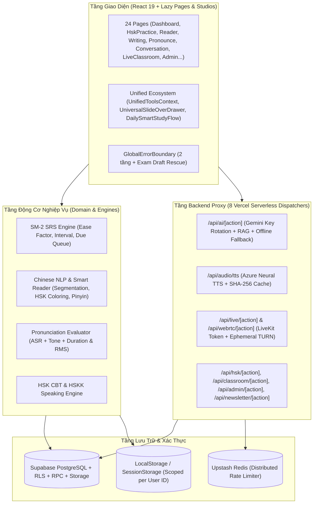

# 🐉 HanziGo — Nền Tảng Học Tiếng Trung, Hán Tự & Luyện Thi HSK/HSKK Toàn Diện

> **HanziGo** là nền tảng học tiếng Trung trực tuyến dành cho người Việt, kết hợp lộ trình chuẩn **HSK 1–6 & HSK 3.0 (Cấp 7–9)**, hệ sinh thái **Unified Dictionary & SM-2 SRS**, **Smart Reader (Chinese NLP + OCR + Web Importer)**, **Listening & Dual-Sub Video Studio**, **Hanzi Writing Studio**, **Pronunciation Lab & Neural TTS**, **Gia sư AI (RAG + Chấm điểm + Roleplay)**, **Phòng thi thử HSK/HSKK CBT**, **Lớp học trực tuyến LiveKit/WebRTC**, cùng hệ thống **SRE GlobalErrorBoundary (Exam Draft Rescue)**, **SEO động** và **Supabase RLS / Vercel Security Hardening**.

---

## 📑 Mục Lục

1. [Kiến Trúc Hệ Thống](#-kiến-trúc-hệ-thống)
2. [Công Nghệ Sử Dụng](#-công-nghệ-sử-dụng)
3. [Hệ Sinh Thái Tính Năng Toàn Diện](#-hệ-sinh-thái-tính-năng-toàn-diện)
4. [Cấu Trúc Thư Mục Dự Án](#-cấu-trúc-thư-mục-dự-án)
5. [Kiến Trúc API Serverless & Bảo Mật](#-kiến-trúc-api-serverless--bảo-mật)
6. [Cơ Sở Dữ Liệu & Migrations (Supabase)](#-cơ-sở-dữ-liệu--migrations-supabase)
7. [Hướng Dẫn Cài Đặt & Chạy Cục Bộ](#-hướng-dẫn-cài-đặt--chạy-cục-bộ)
8. [Cấu Hình Biến Môi Trường](#-cấu-hình-biến-môi-trường)
9. [Kiểm Thử Tự Động, Lint & Go-Live Audit](#-kiểm-thử-tự-động-lint--go-live-audit)
10. [Sẵn Sàng Production (SRE, SEO, PWA & Hạ Tầng)](#-sẵn-sàng-production-sre-seo-pwa--hạ-tầng)
11. [Giấy Phép & Bản Quyền](#-giấy-phép--bản-quyền)

---

## 🏗️ Kiến Trúc Hệ Thống

HanziGo được thiết kế theo kiến trúc phân lớp rõ ràng, tách biệt hoàn toàn giữa giao diện React, động cơ nghiệp vụ phía client, các Serverless Dispatchers bảo mật trên Vercel và tầng dữ liệu PostgreSQL/RLS trên Supabase:



---

## 🛠️ Công Nghệ Sử Dụng

| Lĩnh vực | Công nghệ & Thư viện | Vai trò trong hệ thống |
| :--- | :--- | :--- |
| **Frontend** | React 19 (`^19.2.8`) + Vite 8 (`^8.3.0`) | Giao diện SPA, `React.lazy` code-splitting, tốc độ build nhanh |
| **Styling & Icons** | Tailwind CSS v4 (`@tailwindcss/vite`) + `lucide-react` | Hệ thống theme sáng/tối, responsive layout, icon thống nhất |
| **Luyện viết Hán tự** | `hanzi-writer` (`^3.7.3`) + `canvas-confetti` | Mô phỏng thứ tự nét, chấm điểm nét viết tương tác |
| **Lớp học trực tuyến** | `livekit-client`, `livekit-server-sdk`, `@livekit/components-react` | Video/Audio SFU thời gian thực, chia sẻ màn hình, bảng trắng Hán tự |
| **Backend & Auth** | Supabase (`@supabase/supabase-js`) + PostgreSQL RLS | Xác thực Email/Google OAuth PKCE, phân quyền RBAC cấp DB, Storage |
| **AI & RAG** | Google Gemini API + `ragRetriever.js` + `embeddingProvider.js` | Gia sư AI, roleplay, chấm viết/dịch/phát âm, tra từ điển ngữ cảnh |
| **Neural TTS** | Azure Cognitive Services Speech + Web Speech API fallback | Giọng đọc `zh-CN-XiaoxiaoNeural` / `zh-CN-YunxiNeural`, cache SHA-256 |
| **Rate Limit & Cache** | Upstash Redis REST (fallback In-Memory) | Giới hạn tần suất & quota an toàn cho các serverless endpoints |
| **Chất lượng & Test** | `oxlint` (`^1.81.0`) + Node.js Native Test Runner (`node --test`) | Kiểm tra lint tốc độ cao và chạy bộ unit/integration test |
| **Triển khai** | Vercel Serverless Functions + `vercel.json` | 8 API entrypoints, SPA rewrites, security headers & asset caching |

---

## 🚀 Hệ Sinh Thái Tính Năng Toàn Diện

### 1. Lộ Trình HSK 1–9 & Phòng Thi Thử CBT / HSKK
* **Giáo trình HSK 1–6 & HSK 3.0 (Cấp 7–9)**: Lộ trình bài học, từ vựng, ngữ pháp, luyện dịch HSK 3.0 (`hsk30-translation`) và bài tập phân cấp (`curriculum`, `RoadmapPage`, `LessonPage`, `PracticePage`).
* **Phòng thi thử HSK CBT & HSKK (`HskPracticePage`, `hsk-exam`, `hskk-exam`)**: Mô phỏng thi máy tính, lưu nháp tự động, chấm điểm xác định + AI, phân tích lỗi sai, cấp chứng chỉ (`certificateEngine`) và **Exam Draft Rescue** khi gặp sự cố kỹ thuật.

### 2. Smart Reader & Khai Thác Ngôn Ngữ (Immersion & NLP)
* **Smart Reader (`ReaderPage`, `reading-studio`)**: Tách từ tiếng Trung, hiển thị Pinyin ngữ cảnh, tô màu cấp độ HSK, chỉnh cỡ chữ, đọc TTS và tra từ trực tiếp trên từng từ.
* **Nhập liệu đa nguồn**: Quét ảnh chữ Hán (`ocr-scanner`), nhập bài báo từ web (`web-importer`), đồng hành giáo trình (`textbook-companion`), khám phá thành ngữ & collocation (`chengyu-explorer`), và kho khai thác câu (`immersion-hub`).

### 3. Listening Studio & Dual-Sub Interactive Video Studio
* **Chinese Listening Studio (`listening-studio`)**: Đồng bộ transcript theo thời gian thực, lặp đoạn A–B, điều chỉnh tốc độ, luyện nghe chép chính tả từng chữ, danh sách bài nghe đa cấp độ HSK kèm chế độ thu gọn/mở rộng danh sách.
* **Dual-Sub Interactive Video Studio (`video-studio`)**: Học qua liên kết YouTube kết hợp dán phụ đề `.SRT`/`.VTT`, đồng bộ phụ đề song ngữ tương tác theo dòng thời gian video.

### 4. Hanzi Writing Studio & Pronunciation Lab
* **Hanzi Writing Studio (`WritingPage`, `writing`, `writing-studio`)**: Luyện viết chữ Hán theo đúng thứ tự nét với `hanzi-writer`, bảng tương tác `InteractiveWritingPad` và chấm điểm bài viết (`writingEvaluationService`).
* **Pronunciation Lab (`PronunciationPage`, `pronunciation-lab`)**: Kết hợp ASR (Web Speech API), phân tách âm tiết, nhận diện thanh điệu (1–4 & khinh thanh), đo thời lượng/năng lượng thu âm (Web Audio API) và chẩn đoán chi tiết qua `/api/ai/pronunciation` — không tạo điểm ảo ngẫu nhiên.

### 5. Gia Sư AI, RAG & Chấm Điểm Đa Chiều
* **AI Tutor & Roleplay (`ConversationPage`, `api/ai/[action].js`)**: Hội thoại theo tình huống & cấp độ HSK, gợi ý từ vựng, sửa lỗi câu (`correction`), giải thích ngữ pháp (`grammar_point`) kết hợp bộ nhớ người học (`ragRetriever.js`).
* **AI Grading (`api/_handlers/ai/grade.js`)**: Hỗ trợ chấm dịch HSK 3.0, chấm viết, chấm nói và tra cứu từ điển ngữ cảnh bằng AI khi cụm từ chưa có trong kho cục bộ, kèm cơ chế xoay vòng nhiều Gemini API key và fallback xác định khi offline/quá tải.

### 6. Unified Dictionary Ecosystem & Lặp Lại Ngắt Quãng SM-2
* **Ngăn kéo công cụ hợp nhất (`UnifiedToolsContext.tsx`, `UniversalSlideOverDrawer.tsx`)**: Tra từ điển nhanh (kết hợp tách từ cục bộ + AI dictionary fallback), xem ngữ pháp, luyện viết và phát âm ngay trong ngăn kéo trượt mọi lúc khi đang học.
* **Vocabulary Workspace & SM-2 SRS (`VocabularyPage`, `vocabulary-workspace`, `srs`)**: Lưu từ từ bài đọc/từ điển, tính toán chu kỳ ôn tập SuperMemo-2 (`Ease Factor >= 1.30`, khoảng cách `1 -> 6 -> I × EF`), khóa chống trùng lặp XP theo ngày.

### 7. Lớp Học Trực Tuyến (LiveKit & WebRTC)
* **Classroom & Live Classroom (`ClassroomPage`, `LiveClassroomPage`, `TeacherDashboardPage`)**: Tạo/tham gia lớp học bằng mã lớp, giao bài tập, theo dõi tiến độ học viên, phòng học trực tuyến LiveKit (video/audio, điều phối người tham gia, bảng trắng Hán tự `LiveHanziWhiteboardStage`) và cấp ephemeral TURN/ICE credentials qua `/api/webrtc/ice-servers`.

### 8. Cộng Đồng, Tài Liệu, Gamification & Quản Trị
* **Cộng đồng & Tài liệu (`CommunityPage`, `MaterialsPage`)**: Đăng bài, bình luận, thả cảm xúc, tìm bạn học, báo cáo/kiểm duyệt nội dung và quản lý học liệu tải lên Supabase Storage.
* **Admin & Analytics (`AdminPage`, `DashboardPage`)**: Thống kê học tập theo vai trò, quản lý người dùng qua Supabase RPC bảo mật (`is_admin()`, `admin_update_user_status`, `admin_delete_user`), chặn tự nâng quyền bằng DB trigger.

---

## 📁 Cấu Trúc Thư Mục Dự Án

```text
HanziGo/
├── api/                          # 8 Vercel Serverless Entrypoints + Handlers & Utils
│   ├── admin/[action].js
│   ├── ai/[action].js            # chat, coach, grade, personalize, pronunciation, roleplay, teacher, tutor
│   ├── audio/tts.js              # Azure Neural TTS Caching Proxy
│   ├── classroom/[action].js     # assignments, create, join, lookup, members, remove
│   ├── hsk/[action].js           # analytics, attempt, certificate, exam(s), history, import, mistakes, report, resources, review, submit
│   ├── live/[action].js          # end, join, leave, moderation, participants, session
│   ├── newsletter/[action].js    # subscribe
│   ├── webrtc/[action].js        # ice-servers, livekit-token
│   ├── _handlers/                # Implementation cho từng endpoint
│   ├── _utils/                   # aiProviderAdapter, distributedRateLimiter, embeddingProvider, ragRetriever, supabaseServer, ttsProviderAdapter, verifyAuth
│   └── _webrtc/                  # ice-servers.js, livekit-token.js
├── public/                       # Tài nguyên tĩnh, SEO & học liệu HTML (214 bộ thủ, Pinyin, A4 tập viết, sitemap.xml, robots.txt, manifest.webmanifest)
├── scripts/                      # Audit & DB seeding (preFlightGoLiveAudit.js, verifyBuildBudget.js, syncSupabaseMaster.js, seed*.js)
├── src/
│   ├── components/               # UI components dùng chung, AuthModal, GlobalErrorBoundary, InteractiveWritingPad, Footer...
│   ├── core/                     # ecosystem (UnifiedToolsContext), seo (SeoHeadManager, routeSeoConfig), telemetry (errorReporter)
│   ├── data/                     # Dữ liệu HSK, từ điển, ngữ pháp, đề thi cục bộ
│   ├── features/                 # 25 feature modules (adaptive, analytics, chengyu-explorer, classroom, curriculum, dictionary, hsk-exam, hsk30-translation, hskk-exam, immersion-hub, intelligence, listening-studio, ocr-scanner, pronunciation-lab, reading-studio, srs, textbook-companion, unified-ecosystem, video-studio, vocabulary-workspace, web-importer, writing, writing-studio...)
│   ├── pages/                    # 24 trang chính (lazy-loaded)
│   ├── services/                 # Các service kết nối Supabase, AI, TTS, Video, Listening, Writing, Classroom...
│   └── utils/                    # pronunciationEvaluator, hàm chuẩn hóa Pinyin/NLP...
├── supabase/
│   ├── schema.sql                # Schema tổng hợp
│   └── migrations/               # Chuỗi migration SQL theo timestamp (20261106_* -> 20261114_3701_*)
├── tests/                        # Bộ kiểm thử Node.js Native Test Runner (node --test)
├── .env.example                  # Mẫu biến môi trường chuẩn
├── package.json                  # Scripts dev, build, lint, test, audit, db:seed
└── vercel.json                   # Cấu hình rewrites, security headers & cache control
```

---

## 🛡️ Kiến Trúc API Serverless & Bảo Mật

1. **Giới hạn Entrypoints cho Vercel Hobby/Pro**: Toàn bộ backend được gộp gọn thành **8 Serverless Dispatchers** trong `api/` (`admin`, `ai`, `audio/tts`, `classroom`, `hsk`, `live`, `newsletter`, `webrtc`) và điều phối qua `vercel.json` rewrites.
2. **Bảo vệ Secret Key tuyệt đối**:
   * Các khóa nhạy cảm (`GEMINI_API_KEY`, `GEMINI_API_KEYS`, `AZURE_SPEECH_KEY`, `LIVEKIT_API_SECRET`, `TURN_SHARED_SECRET`, `UPSTASH_REDIS_REST_TOKEN`) **không dùng tiền tố `VITE_`**, chỉ đọc ở phía server/serverless.
   * Frontend chỉ dùng `VITE_SUPABASE_URL` và `VITE_SUPABASE_ANON_KEY`, kết hợp xác thực JWT qua `api/_utils/verifyAuth.js`.
3. **Chống lạm dụng & Chịu lỗi**:
   * `api/_utils/distributedRateLimiter.js` dùng Upstash Redis REST (tự fallback về In-Memory nếu chưa cấu hình Redis).
   * `api/_utils/aiProviderAdapter.js` hỗ trợ xoay vòng nhiều Gemini API Key khi gặp `429`/`403`, có feature flag `ENABLE_AI_TUTOR` và công tắc ngắt khẩn cấp `AI_TUTOR_KILL_SWITCH`.
4. **Phân quyền Cấp Database (Supabase RLS)**:
   * Các hàm quản trị và thao tác nhạy cảm sử dụng `SECURITY DEFINER` kèm `SET search_path = public` và kiểm tra `auth.uid()` / `public.is_admin()`.
   * Trigger database chặn người dùng tự sửa cột `role` trên bảng `profiles`.

---

## 🗄️ Cơ Sở Dữ Liệu & Migrations (Supabase)

Toàn bộ lược đồ PostgreSQL được quản lý trong `supabase/schema.sql` và thư mục `supabase/migrations/` (theo thứ tự thời gian từ `20261106_daily_quotes.sql` đến `20261114_3701_security_rls_and_telemetry_audit.sql`), bao gồm:
* **Hồ sơ, Bảo mật & Telemetry**: `profiles`, RLS policies, chống nâng quyền, `system_error_logs`.
* **Học tập & SRS**: Các bảng tiến độ bài học, lịch sử đọc, từ vựng workspace, SM-2 SRS, kho đề thi HSK/HSKK và nhật ký học tập.
* **Studios & Mở rộng**: Smart Dictionary, Writing Studio, Reading Studio, Listening Studio, Video Studio, OCR Scanner, Web Importer, Chengyu/Collocations, HSK 3.0 Translation, HSK 7–9 Curriculum, TTS Audio Cache (`audio-cache`), AI Learner Memory RAG (`20261114_3401_ai_learner_memory_rag.sql`), Classroom Assignments & Whiteboard (`20261114_3301_classroom_assignments_and_whiteboard.sql`).

### Đồng bộ & Nạp dữ liệu mẫu (Scripts)
```bash
# Đồng bộ master schema/data lên Supabase (đọc biến từ .env)
npm run db:sync

# Nạp dữ liệu mẫu tổng quát
npm run db:seed

# Nạp lộ trình học & toàn bộ từ điển HSK
npm run db:seed:learning

# Nạp riêng từ điển HSK / đề thi HSK / danh ngôn mỗi ngày
npm run db:seed:dictionary
npm run db:seed:hsk
npm run db:seed:quotes
```

---

## 💻 Hướng Dẫn Cài Đặt & Chạy Cục Bộ

### Yêu cầu môi trường
* [Node.js](https://nodejs.org/) phiên bản **18.0** trở lên (khuyến nghị Node 20+ để hỗ trợ tốt `--env-file=.env`).
* `npm` đi kèm Node.js.

### Các bước khởi chạy
```bash
# 1. Clone repository về máy
git clone https://github.com/haidang1603/Hanzigo.git
cd HanziGo

# 2. Cài đặt thư viện phụ thuộc
npm install

# 3. Tạo file môi trường từ mẫu
cp .env.example .env
# (Trên Windows PowerShell: Copy-Item .env.example .env)
# Mở .env và điền thông tin Supabase / Gemini / LiveKit / Azure TTS của bạn

# 4. Khởi chạy môi trường phát triển
npm run dev
```
Mở trình duyệt tại: `http://localhost:5173/`

### Đóng gói Production
```bash
# Build tiêu chuẩn
npm run build

# Build kèm kiểm tra ngân sách bundle (scripts/verifyBuildBudget.js)
npm run build:verify

# Xem trước bản build production cục bộ
npm run preview
```

---

## ⚙️ Cấu Hình Biến Môi Trường

Tham khảo đầy đủ trong [`.env.example`](.env.example). Các nhóm biến chính gồm:

```env
# 1. Supabase (An toàn cho Frontend với anon key)
VITE_SUPABASE_URL=https://your-project-id.supabase.co
VITE_SUPABASE_ANON_KEY=your-anon-key-here

# 2. AI Personalization & Grading (Server-side ONLY - KHÔNG dùng tiền tố VITE_)
GEMINI_API_KEY=your_gemini_api_key_here
GEMINI_API_KEYS=your_backup_gemini_key_1,your_backup_gemini_key_2
GEMINI_MODEL=gemini-3.5-flash-lite
ENABLE_AI_TUTOR=true
AI_TUTOR_KILL_SWITCH=false
VITE_ENABLE_AI_TUTOR=true

# 3. LiveKit WebRTC SFU (Lớp học trực tuyến)
VITE_LIVEKIT_URL=wss://your-project.livekit.cloud
LIVEKIT_URL=wss://your-project.livekit.cloud
LIVEKIT_API_KEY=your_livekit_api_key
LIVEKIT_API_SECRET=your_livekit_api_secret

# 4. Ephemeral TURN / STUN (Server-side REST credential 1 giờ)
TURN_SERVER_URL=turn.your-domain.com:3478
TURN_SHARED_SECRET=your_coturn_static_auth_secret_here

# 5. Azure Cognitive Services Speech (Neural TTS Caching Proxy)
AZURE_SPEECH_KEY=your_azure_speech_resource_key_here
AZURE_SPEECH_REGION=eastasia

# 6. Distributed Rate Limiting (Tùy chọn - fallback In-Memory nếu trống)
UPSTASH_REDIS_REST_URL=https://your-upstash-instance.upstash.io
UPSTASH_REDIS_REST_TOKEN=your_upstash_rest_token_here
```

---

## 🧪 Kiểm Thử Tự Động, Lint & Go-Live Audit

HanziGo sử dụng **Node.js Native Test Runner** (`node --test`), **Oxlint** và **Pre-Flight Go-Live Auditor**:

```bash
# 1. Chạy bộ kiểm thử chính (trong package.json)
npm test

# 2. Chạy kiểm thử riêng lẻ cho từng studio/module (ví dụ)
node --test tests/videoStudio.test.js tests/chineseListeningStudio.test.js tests/unifiedEcosystem.test.js

# 3. Kiểm tra tĩnh với Oxlint
npm run lint

# 4. Chạy Pre-Flight Go-Live Audit Scorecard
npm run audit:golive

# 5. Build và kiểm tra dung lượng bundle
npm run build:verify
```

---

## 🌐 Sẵn Sàng Production (SRE, SEO, PWA & Hạ Tầng)

* **SRE & Exam Draft Rescue**:
  * `src/core/telemetry/errorReporter.js`: Bắt lỗi toàn cục (`error`, `unhandledrejection`), lọc thông tin nhạy cảm (email/JWT/password), chống gửi trùng 60 giây và lưu hàng đợi offline khi mất mạng.
  * `src/components/common/GlobalErrorBoundary.jsx`: Bảo vệ 2 tầng trong `src/App.jsx`, cho phép khôi phục khu vực lỗi, xóa bộ nhớ đệm giao diện, tải bản sao bài thi HSK (`.JSON`) và quay về trang chủ an toàn.
* **SEO & PWA**:
  * `src/core/seo/routeSeoConfig.js` & `src/core/seo/SeoHeadManager.jsx`: Quản lý `title`, `canonical`, OpenGraph (`vi_VN`), Twitter Card và Schema.org JSON-LD.
  * Kèm sẵn `public/robots.txt`, `public/sitemap.xml`, `public/manifest.webmanifest` và các trang tài liệu học tập tĩnh phục vụ SEO trong `public/`.
* **Vercel HTTP Security Headers (`vercel.json`)**:
  * Cấu hình `X-Content-Type-Options: nosniff`, `X-Frame-Options: SAMEORIGIN`, `Referrer-Policy: strict-origin-when-cross-origin`, `Strict-Transport-Security`, `Permissions-Policy` (`camera=(self), microphone=(self), geolocation=()`), và `Cache-Control: public, max-age=31536000, immutable` cho `/assets/*`.

---

## 📜 Giấy Phép & Bản Quyền

Dự án được phát triển và duy trì bởi **HanziGo Team**.  
Toàn bộ nội dung giáo trình, từ điển và công cụ luyện tập được xây dựng phục vụ mục đích học tập và nghiên cứu tiếng Trung phi thương mại.
