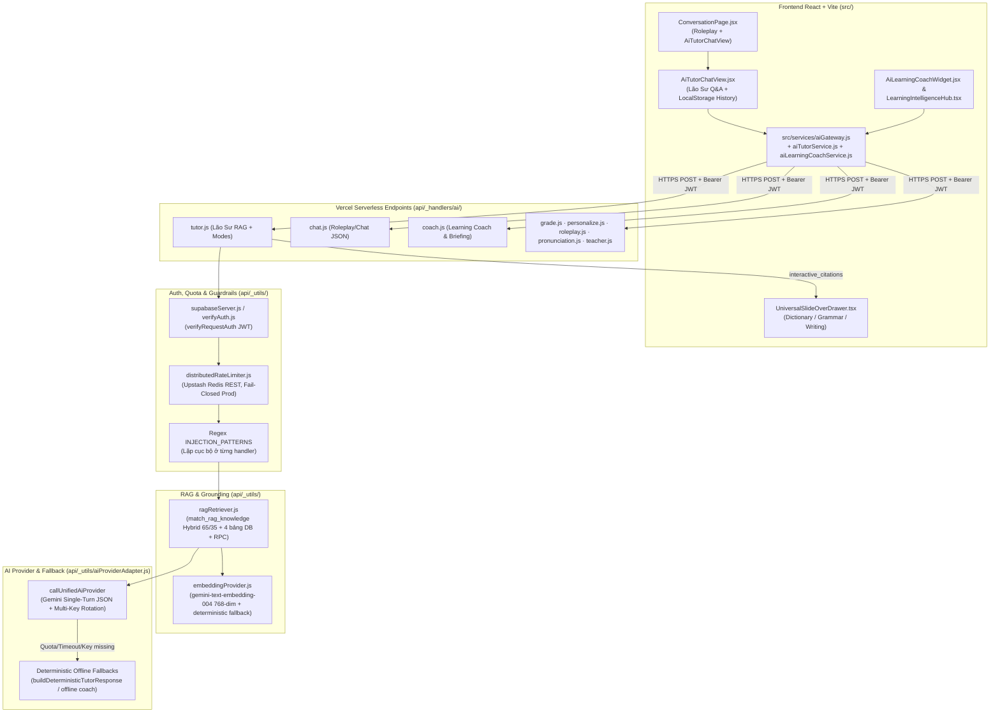

# HANZIGO — LÃO SƯ AI AGENT
# TASK 01: CURRENT AI ARCHITECTURE AUDIT & 19-LAYER GAP ANALYSIS

- **Dự án:** HanziGo (`https://github.com/haidang1603/Hanzigo.git` | `https://hanzigo-xi.vercel.app`)
- **Ngày kiểm toán:** 2026-11-22
- **Baseline kế thừa (sau Phase 39 / Task 39.09):** `0` lint errors · `1,200/1,200` tests pass · `audit:curriculum 100/100` · `TOTAL CSS = 44.08 KB / 45.00 KB` gzip (chỉ còn dư `0.92 KB` — lưu ý đợt tinh gọn mobile sau Task 39.09 ghi nhận `44.10 KB`, dư `0.90 KB`) · Entry `index.js <= 160 KB` gzip.
- **Trạng thái Task 01:** **`AUDIT COMPLETE`** *(Chỉ kiểm toán mã nguồn hiện có và lập kế hoạch; không sửa code ứng dụng, database hay cấu hình production).*

---

## 1. Sơ đồ Kiến trúc AI Hiện tại (As-Is Architecture)

### Nhận xét Kiến trúc Hiện tại (Từ mã nguồn trực tiếp)
1. **Điểm mạnh đã có nền móng tốt:**
   - **Bảo mật & Quota phân tán:** Tất cả các endpoint chính (`chat.js`, `tutor.js`, `coach.js`, `personalize.js`, `teacher.js`, `roleplay.js`) đều xác thực JWT qua `verifyRequestAuth()` và giới hạn lưu lượng qua `checkRateLimitAndQuota()` trong [distributedRateLimiter.js](file:///d:/DELL/Dowloads/HanziGo/api/_utils/distributedRateLimiter.js) (Upstash Redis REST, fail-closed ở production).
   - **AI Gateway & Multi-Key Rotation:** [aiProviderAdapter.js](file:///d:/DELL/Dowloads/HanziGo/api/_utils/aiProviderAdapter.js) hỗ trợ xoay vòng nhiều khóa `GEMINI_API_KEY` / `GEMINI_API_KEYS` / `GEMINI_API_KEY_1..10`, cooldown key 429/403 trong 60s, trích xuất/sửa JSON bị cắt (`extractStructuredJson`), tính `costUsd` theo tier `flash-lite` / `flash` / `pro`, và hạ cấp an toàn về engine sư phạm ngoại tuyến (`buildDeterministicTutorResponse` trong [tutor.js](file:///d:/DELL/Dowloads/HanziGo/api/_handlers/ai/tutor.js)).
   - **RAG Hybrid & Structured Grounding:** [ragRetriever.js](file:///d:/DELL/Dowloads/HanziGo/api/_utils/ragRetriever.js) đã có `normalizeQueryForRetrieval` (giữ chữ Hán, Pinyin có dấu, trợ từ ngữ pháp), tìm kiếm lai `match_rag_knowledge` (ngưỡng `0.45`), truy xuất song song 4 bảng chuẩn (`dictionary_entries`, `grammar_points`, `chengyu_entries`, `hsk_question_bank`) qua `retrieveContextualKnowledgeForQuery()`, hồ sơ thích ứng qua RPC `get_user_adaptive_ai_context` (`retrieveLearnerAdaptiveProfile()`), và đóng gói chống injection bằng thẻ `<verified_knowledge>`.
   - **Hệ sinh thái UI sẵn sàng:** [AiTutorChatView.jsx](file:///d:/DELL/Dowloads/HanziGo/src/components/depth/AiTutorChatView.jsx), [UniversalSlideOverDrawer.tsx](file:///d:/DELL/Dowloads/HanziGo/src/features/unified-ecosystem/UniversalSlideOverDrawer.tsx), [AiLearningCoachWidget.jsx](file:///d:/DELL/Dowloads/HanziGo/src/components/learning/AiLearningCoachWidget.jsx) và [LearningIntelligenceHub.tsx](file:///d:/DELL/Dowloads/HanziGo/src/features/intelligence/LearningIntelligenceHub.tsx) đã hoạt động ổn định trên mobile sau Task 39.09.
2. **Điểm nghẽn cốt lõi cần nâng cấp để thành AI Learning Agent:**
   - **Chưa có vòng lặp Agent & Tool Calling thật:** `callUnifiedAiProvider()` chỉ gọi Gemini `generateContent` dạng **single-turn JSON** (`responseMimeType: 'application/json'`), không hỗ trợ `tools` / `functionDeclarations` hoặc vòng lặp ReAct/Tool Execution (`<= 3` bước). Mọi ngữ cảnh đều nhồi tĩnh trước khi gọi LLM.
   - **Prompt, Guardrails & Model Routing bị phân mảnh:** `INJECTION_PATTERNS`, `SYSTEM_PROMPT`, `maxTokens` đang copy-paste rải rác ở từng file (`chat.js`, `tutor.js`, `coach.js`, `personalize.js`, `teacher.js`). Model chỉ đọc tĩnh `process.env.GEMINI_MODEL || 'gemini-3.5-flash-lite'`, chưa định tuyến theo độ phức tạp tác vụ (HSK 1–3 vs HSK 6/7–9, giải thích ngữ pháp sâu vs hội thoại nhanh).
   - **Thiếu Observability & Audit Log AI tập trung:** Chưa thấy ghi nhận cost/latency/tool-calls/fallback-rate vào bảng `ai_usage_logs` hay `audit_logs` từ các AI handlers; một số handler (`chat.js`, `tutor.js`, `coach.js`) còn `console.error` thay vì dùng chuẩn `sendSafeServerError`.
   - **Memory mới chỉ dừng ở LocalStorage & RPC tĩnh:** Lịch sử chat `AiTutorChatView` lưu cục bộ trong `localStorage` (`hanzigo_ai_tutor_history_<userId>`), chưa có bộ nhớ học tập có kiểm soát (Controlled Learner Memory: ghi nhớ điểm yếu/từ hay hỏi/mục tiêu qua các phiên kèm quyền xóa/bật-tắt minh bạch).

---

## 2. Bảng Gap Analysis Đủ 19 Layers

| Layer / Component | Current State (File thực tế) | Target State | Gap | Scope (`BUILD NOW` / `INTERFACE-DEFER`) | Priority |
| :--- | :--- | :--- | :--- | :---: | :---: |
| **01. Core LLM Gateway & Model Router** | [aiProviderAdapter.js](file:///d:/DELL/Dowloads/HanziGo/api/_utils/aiProviderAdapter.js) gọi 1 model cố định (`GEMINI_MODEL \|\| gemini-3.5-flash-lite`), multi-key rotation in-memory, single-turn JSON. | Router chọn model theo intent/HSK tier (`flash-lite` cho Q&A/roleplay nhanh; `flash`/`pro` cho chấm bài/HSK 7–9/tool reasoning), hỗ trợ structured `tools` / `functionCall` + fallback chuỗi an toàn. | Thiếu task-based Model Routing, hỗ trợ Gemini `tools` declarations và budget cap per-request. | **`BUILD NOW`** | **P0** |
| **02. Prompt Registry & Versioning** | Prompt viết inline trong [tutor.js](file:///d:/DELL/Dowloads/HanziGo/api/_handlers/ai/tutor.js), [chat.js](file:///d:/DELL/Dowloads/HanziGo/api/_handlers/ai/chat.js), [coach.js](file:///d:/DELL/Dowloads/HanziGo/api/_handlers/ai/coach.js), `roleplay.js`, `teacher.js`. | Registry tập trung (`api/_agent/promptRegistry.js`) có `promptId`, `version`, template XML an toàn, tách rõ persona Lão Sư theo HSK 1–9. | Không có versioning, khó audit/A-B test hoặc đồng bộ phong cách sư phạm tiếng Việt. | **`BUILD NOW`** | **P0** |
| **03. Agent Loop & Orchestrator** | Không có. Mỗi endpoint gọi LLM đúng 1 lần (`tutor.js`, `chat.js`). | Stateless Agent Orchestrator chạy trên Vercel Serverless: tối đa `<= 3` tool calls/request, timeout tổng `<= 25s`, tự tổng hợp kết quả tool + RAG thành JSON sư phạm. | Thiếu vòng lặp suy luận -> gọi tool -> quan sát -> trả lời có giới hạn an toàn. | **`BUILD NOW`** | **P0** |
| **04. Real Tool Registry & Execution** | `tutor.js` gọi cứng `retrieveContextualKnowledgeForQuery` và `hsk_question_bank` trước khi hỏi LLM; `interactiveCitations` chỉ là link UI thụ động. | `ToolRegistry` chuẩn hóa JSON Schema, kiểm tra RBAC/scope trước khi chạy, trả về dữ liệu thật từ DB/service (từ điển, ngữ pháp, thành ngữ, SRS due, HSK mistake, gợi ý bài học). | Chưa có contract tool thống nhất, schema validation, timeout per-tool và RBAC guard. | **`BUILD NOW`** | **P0** |
| **05. Code / Execution Sandbox** | Không có sandbox thực thi code bên ngoài. | Chỉ cần interface chuẩn nếu tương lai chạy bài tập lập trình/script phân tích nặng; hiện HanziGo là app học tiếng Trung. | Không phục vụ trực tiếp việc học HSK 1–9; rủi ro bảo mật cao trên Serverless. | **`INTERFACE / DEFER`** | **P2** |
| **06. Grounded RAG & Knowledge Retrieval** | [ragRetriever.js](file:///d:/DELL/Dowloads/HanziGo/api/_utils/ragRetriever.js) + [embeddingProvider.js](file:///d:/DELL/Dowloads/HanziGo/api/_utils/embeddingProvider.js) đã có Hybrid search + `<verified_knowledge>` + 4 bảng DB. | Kế thừa hoàn toàn RAG Phase 02, bổ sung truy xuất từ kho curriculum tĩnh/curated (`learningPathData.js`, `chineseData.js`, `hsk79VocabGlossary`, `hanziDecomposition.js`) thành tool tra cứu chính xác 100% khi DB thiếu/chưa sync. | Chưa nối liền các kho JSON/TS curated nội bộ vào hệ thống tool RAG và chưa chấm citation coverage tự động. | **`BUILD NOW`** | **P0** |
| **07. Controlled Learner Memory** | `retrieveLearnerAdaptiveProfile` đọc RPC `get_user_adaptive_ai_context` ([ragRetriever.js](file:///d:/DELL/Dowloads/HanziGo/api/_utils/ragRetriever.js#L767)); `AiTutorChatView` lưu lịch sử ở `localStorage` + [learnerContextService.js](file:///d:/DELL/Dowloads/HanziGo/src/services/learnerContextService.js). | Bộ nhớ học tập có kiểm soát (session summary + user learning facts + opt-in toggle + nút xóa sạch), tuyệt đối không suy diễn lỗi sai chưa xác nhận. | Thiếu tóm tắt hội thoại đa lượt gọn nhẹ truyền lên API và cơ chế kiểm soát/xóa ký ức rõ ràng giữa các thiết bị. | **`BUILD NOW`** | **P1** |
| **08. Input / Output Guardrails & Anti-Injection** | `INJECTION_PATTERNS` copy-paste rải rác ở `chat.js`, `tutor.js`, `coach.js`; chưa có output validator thống nhất cho JSON/Pinyin/citation. | Module Guardrails dùng chung (`api/_agent/guardrails.js`): chặn injection đa ngữ (VN/CN/EN), lọc PII/secret, kiểm định output schema & cấm bịa nguồn khi `evidence_status = insufficient_evidence`. | Trùng lặp logic regex giữa các file và thiếu tầng kiểm duyệt đầu ra (Output Guardrail). | **`BUILD NOW`** | **P0** |
| **09. Auth, RBAC & Data Boundary** | `verifyRequestAuth` ([supabaseServer.js](file:///d:/DELL/Dowloads/HanziGo/api/_utils/supabaseServer.js) / [verifyAuth.js](file:///d:/DELL/Dowloads/HanziGo/api/_utils/verifyAuth.js)) xác thực Bearer JWT; `teacher.js` & `admin` kiểm tra role riêng. | Mọi tool của Agent bắt buộc bind `userId = auth.user.id` từ server JWT; khóa tuyệt đối hành động phá hủy (`DELETE`, đổi role, ghi vào lớp người khác). | Cần chuẩn hóa `ToolPermissionGuard` cho từng tool (`read_only` vs `safe_write` có xác nhận). | **`BUILD NOW`** | **P0** |
| **10. Distributed Rate Limit, Quota & Cost Cap** | [distributedRateLimiter.js](file:///d:/DELL/Dowloads/HanziGo/api/_utils/distributedRateLimiter.js) dùng Upstash Redis REST (fail-closed Prod) theo `userId` và `prefix`. | Bổ sung quota riêng cho Agent multi-step (tính theo lượt request + tổng tool/token budget/ngày) để 1 vòng lặp Agent không tiêu tốn gấp 3–4 lần quota thường. | Chưa tính hệ số token/tool-call vào daily budget và chưa có circuit breaker khi chi phí ngày vượt ngưỡng. | **`BUILD NOW`** | **P1** |
| **11. Deterministic Pedagogical Fallback** | `buildDeterministicTutorResponse()` ([tutor.js](file:///d:/DELL/Dowloads/HanziGo/api/_handlers/ai/tutor.js#L162)), `deterministicBriefing` ([coach.js](file:///d:/DELL/Dowloads/HanziGo/api/_handlers/ai/coach.js#L172)), `aiTutorService.js`. | Tách thành module dùng chung có khả năng gọi các local/DB read-only tools (từ điển, ngữ pháp, lộ trình) để vẫn trả lời chuẩn xác khi Gemini 429/timeout. | Logic fallback đang hardcode vài mẫu câu (`把`, `l-101`, `l-304`) thay vì tận dụng kết quả tool tra cứu thật. | **`BUILD NOW`** | **P1** |
| **12. Scheduled Background Agent Tasks** | Không có cron/push agent. *(Chỉ thị chiến dịch cấm tuyệt đối tạo push/in-app notification hay nhắc nhở học tập tự động).* | Không triển khai cron nhắc học tự động; chỉ giữ interface nếu cần đồng bộ/đánh chỉ mục tri thức offline (do admin kích hoạt thủ công). | Bị cấm theo ràng buộc phạm vi (không tạo notification/nhắc nhở tự động). | **`INTERFACE / DEFER`** | **P2** |
| **13. Multi-Modal Speech & Writing Integration** | `pronunciation.js`, `ttsAudioService.js`, `aiPronunciationService.js`, `writingStudioService.ts`, `HanziCanvasStage.tsx` hoạt động độc lập. | Lão Sư Agent có thể trả về action/deep-link mở trực tiếp Audio phát âm, `UniversalSlideOverDrawer` (tab Dictionary/Grammar/Writing) hoặc bài luyện viết chữ vừa hỏi. | Đã có `interactive_citations` cơ bản ở `tutor.js`; cần chuẩn hóa thành `ui_actions` thống nhất trong Agent response. | **`BUILD NOW`** | **P1** |
| **14. Observability, Tracing & Cost Telemetry** | `tutor.js` và `chat.js` trả `_metadata` (`provider`, `model`, `usage`, `costUsd`, `latencyMs`) về client; chưa ghi trace/log tập trung vào DB. | Ghi trace nhẹ (requestId, intent, model, toolsCalled, tokenCount, costUsd, evidenceStatus, fallbackReason, latencyMs) qua `sendSafeServerError` / structured logger & tùy chọn bảng telemetry không chặn response. | Thiếu trace ID cho vòng lặp tool và thống kê hiệu quả RAG/Agent theo thời gian thực. | **`BUILD NOW`** | **P1** |
| **15. Local / Self-Hosted GPU Inference** | Dùng Google Gemini API qua HTTPS + deterministic fallback. | Giữ interface provider abstraction trong `aiProviderAdapter.js`; chưa cần tự host vLLM/Ollama vì chạy trên Vercel Serverless. | Tốn chi phí vận hành GPU không phù hợp mô hình serverless phi thương mại hiện tại. | **`INTERFACE / DEFER`** | **P2** |
| **16. External MCP Server Integrations** | Không tích hợp MCP server ngoài trong runtime app. | Giữ interface tool adapter nếu cần kết nối nguồn ngoài sau này; hiện toàn bộ tri thức HSK 1–9 nằm trong repo và Supabase. | Chưa cần kết nối dịch vụ bên thứ ba; tăng độ trễ và bề mặt tấn công. | **`INTERFACE / DEFER`** | **P2** |
| **17. Agent Evaluation & Benchmark Suite** | Có các unit/integration test (`aiTutorBackend.test.js`, `ragRetrievalEngine.test.js`, `aiTutorProductionQA.test.js`, `knowledgeDatasetPipeline.test.js`). | Bổ sung bộ eval tự động cho Lão Sư Agent: độ chính xác chọn tool, chống hallucination khi thiếu nguồn, chống injection VN/CN/EN, giới hạn `<= 3` bước, ngân sách token. | Chưa có benchmark regression cho multi-step tool calling & grounded citation accuracy. | **`BUILD NOW`** | **P0** |
| **18. Lão Sư Learning Workspace UI** | [AiTutorChatView.jsx](file:///d:/DELL/Dowloads/HanziGo/src/components/depth/AiTutorChatView.jsx), [ConversationPage.jsx](file:///d:/DELL/Dowloads/HanziGo/src/pages/ConversationPage.jsx), [UniversalSlideOverDrawer.tsx](file:///d:/DELL/Dowloads/HanziGo/src/features/unified-ecosystem/UniversalSlideOverDrawer.tsx). | Nâng cấp `AiTutorChatView` thành Workspace gọn nhẹ trên mobile: hiển thị trạng thái tool đang tra cứu (transparency chips), thẻ trích dẫn bấm mở drawer, đề xuất bước học tiếp theo 1 chạm, giữ `TOTAL CSS <= 45 KB` gzip. | UI chưa hiển thị bước suy luận/công cụ Lão Sư đã dùng (`tools_used`) và chưa đồng bộ sâu các action card giữa Tutor & Coach. | **`BUILD NOW`** | **P1** |
| **19. Safe Human-in-the-Loop Action Confirmation** | `AiTutorChatView` có modal xác nhận khi xóa lịch sử; chưa có cơ chế xác nhận cho hành động ghi dữ liệu do AI đề xuất. | Mọi tool có tác dụng ghi (`safe_write` như thêm từ vào sổ tay SRS hoặc tạo kế hoạch ôn tập) chỉ trả về **đề xuất chờ người học bấm xác nhận** trên UI, không tự ý ghi ngầm. | Thiếu chuẩn `pending_confirmation` action payload giữa Agent backend và UI. | **`BUILD NOW`** | **P1** |

---

## 3. Danh sách Real Tools Khả thi (Ánh xạ Trực tiếp vào Service / DB Thật)

Tất cả các tool dưới đây đều ánh xạ trực tiếp vào dữ liệu và service hiện có trong repository, chạy **stateless** trong Vercel Serverless, và gắn chặt `userId = auth.user.id` cho dữ liệu cá nhân:

| Tên Tool Đề xuất | Nguồn Dữ liệu / Service Thật Hiện có | Chức năng cho Lão Sư Agent | Phân loại Rủi ro | Quyền & Kiểm soát |
| :--- | :--- | :--- | :---: | :--- |
| `lookup_dictionary_entry` | Bảng `dictionary_entries` ([ragRetriever.js](file:///d:/DELL/Dowloads/HanziGo/api/_utils/ragRetriever.js#L908)), [chineseData.js](file:///d:/DELL/Dowloads/HanziGo/src/data/chineseData.js), [commonCharactersDict.js](file:///d:/DELL/Dowloads/HanziGo/src/data/commonCharactersDict.js), [hsk7to9CurriculumData.ts](file:///d:/DELL/Dowloads/HanziGo/src/data/hsk7to9CurriculumData.ts) | Tra nghĩa tiếng Việt, Pinyin, âm Hán Việt, từ loại, ví dụ, từ đồng/trái nghĩa chuẩn HSK 1–9. | **Low** (Read-only public) | Mở cho mọi user đã xác thực |
| `lookup_hanzi_decomposition` | [hanziDecomposition.js](file:///d:/DELL/Dowloads/HanziGo/src/data/hanziDecomposition.js), [characterDecompositionData.js](file:///d:/DELL/Dowloads/HanziGo/src/data/characterDecompositionData.js), [radicalsData.js](file:///d:/DELL/Dowloads/HanziGo/src/data/radicalsData.js) | Chiết tự bộ thủ, số nét, mẹo nhớ mặt chữ Hán cho người Việt. | **Low** (Read-only public) | Mở cho mọi user đã xác thực |
| `lookup_grammar_pattern` | Bảng `grammar_points` ([ragRetriever.js](file:///d:/DELL/Dowloads/HanziGo/api/_utils/ragRetriever.js#L919)), [functionWordsData.js](file:///d:/DELL/Dowloads/HanziGo/src/data/functionWordsData.js), [grammarEngineService.js](file:///d:/DELL/Dowloads/HanziGo/src/services/grammarEngineService.js) | Tra công thức ngữ pháp (`formula_tokens`), lỗi thường gặp (`common_mistakes`), đối chiếu hư từ HSK. | **Low** (Read-only public) | Mở cho mọi user đã xác thực |
| `lookup_chengyu_idiom` | Bảng `chengyu_entries` ([ragRetriever.js](file:///d:/DELL/Dowloads/HanziGo/api/_utils/ragRetriever.js#L939)), [hsk6IdiomsData.js](file:///d:/DELL/Dowloads/HanziGo/src/data/hsk6IdiomsData.js) | Tra thành ngữ 4 chữ: nghĩa đen, nghĩa bóng và thành ngữ tiếng Việt tương đương. | **Low** (Read-only public) | Mở cho mọi user đã xác thực |
| `search_curated_knowledge` | RPC `match_rag_knowledge` + `BUILTIN_CURATED_CHUNKS` ([ragRetriever.js](file:///d:/DELL/Dowloads/HanziGo/api/_utils/ragRetriever.js)) | Tìm kiếm ngữ nghĩa lai (Vector 65% + Lexical 35%) trả về nguồn có `source_url` & `license`. | **Low** (Read-only curated) | Chỉ trả chunk `is_verified = true` |
| `get_curriculum_lesson_context` | [learningPathData.js](file:///d:/DELL/Dowloads/HanziGo/src/data/learningPathData.js), [curriculumLessons.js](file:///d:/DELL/Dowloads/HanziGo/src/data/curriculumLessons.js), [curriculumLessonsHsk4to6.js](file:///d:/DELL/Dowloads/HanziGo/src/data/curriculumLessonsHsk4to6.js) | Lấy nội dung 180 bài học HSK 1–9 để Lão Sư giảng đúng bài học viên đang học và gợi ý bài kế tiếp chính xác. | **Low** (Read-only public) | Mở cho mọi user đã xác thực |
| `inspect_hsk_exam_question` | Bảng `hsk_question_bank` ([tutor.js](file:///d:/DELL/Dowloads/HanziGo/api/_handlers/ai/tutor.js#L493)), [hskExamsData.js](file:///d:/DELL/Dowloads/HanziGo/src/data/hskExamsData.js) | Đọc đề bài CBT & bẫy đáp án (`target_grammar_codes`) để giải thích lỗi sai câu thi HSK. | **Low** (Read-only public) | Không trả lộ đáp án nếu đang trong phiên thi CBT active |
| `get_learner_adaptive_profile` | RPC `get_user_adaptive_ai_context` ([ragRetriever.js](file:///d:/DELL/Dowloads/HanziGo/api/_utils/ragRetriever.js#L778)), [learningTelemetryService.js](file:///d:/DELL/Dowloads/HanziGo/src/core/telemetry/learningTelemetryService.js) | Lấy từ SRS đến hạn (`due_and_leech_vocab`), ngữ pháp yếu, chữ Hán hay viết sai, chuỗi học. | **Medium** (PII/User Data) | Bắt buộc `userId = auth.user.id` từ JWT server, cấm client spoof |
| `generate_study_prescription` | [aiStudyPrescriptionEngine.js](file:///d:/DELL/Dowloads/HanziGo/src/components/analytics/aiStudyPrescriptionEngine.js), [learningRecommendationEngine.js](file:///d:/DELL/Dowloads/HanziGo/src/services/learningRecommendationEngine.js) | Tổng hợp kê đơn lộ trình ôn tập hôm nay dựa trên telemetry thật. | **Medium** (User Data) | Read-only recommendation; không tự ghi DB |
| `suggest_save_vocab_to_srs` | [vocabularyService.js](file:///d:/DELL/Dowloads/HanziGo/src/services/vocabularyService.js), [srsRetentionService.ts](file:///d:/DELL/Dowloads/HanziGo/src/services/srsRetentionService.ts) | Tạo action đề xuất thêm từ vựng vừa hỏi vào sổ ôn tập SRS cá nhân. | **Medium** (Safe Write) | **Human-in-the-loop:** Trả payload đề xuất để người dùng bấm xác nhận trên UI, AI không tự ghi |
| *(Bị cấm tuyệt đối)* | `delete*`, `adminService`, `teacherAiService` mutate, role update | Xóa dữ liệu, sửa điểm thi, đổi quyền người dùng hoặc gửi thông báo tự động. | **High** (Forbidden) | **CHẶN CỨNG** — Không đăng ký vào `ToolRegistry` |

---

## 4. Đề xuất Lộ trình Thực thi Chi tiết: Task 02 → Task 12

> **Nguyên tắc xuyên suốt:** Giữ kiến trúc stateless trên Vercel Serverless; kế thừa RAG Phase 02 & Upstash Redis; mỗi task kết thúc phải chạy đủ 4 cổng (`npm run lint`, `npm test`, `npm run audit:curriculum`, `npm run build:verify`) và bảo vệ trần `TOTAL CSS <= 45.00 KB` gzip (ưu tiên tăng `<= +0.05 KB`/task UI, backend tasks = `+0.00 KB` CSS).

| Task | Tên & Mục tiêu chính | Phạm vi thay đổi dự kiến | Tác động CSS / Bundle | Tiêu chí kiểm thử & Hard Stop Gate |
| :--- | :--- | :--- | :---: | :--- |
| **Task 02** | **Core Agent Contracts, Prompt Registry & Guardrails** | Tạo `api/_agent/promptRegistry.js` & `api/_agent/guardrails.js` (gom `INJECTION_PATTERNS`, output schema validator, PII sanitizer dùng chung). | `0.00 KB` CSS | Unit test chống injection VN/CN/EN, schema guard & không rò rỉ secret. |
| **Task 03** | **Model Router & Tool-Calling Adapter** | Nâng cấp [aiProviderAdapter.js](file:///d:/DELL/Dowloads/HanziGo/api/_utils/aiProviderAdapter.js) hỗ trợ `selectModelTier(intent, hskLevel)`, Gemini `tools`/`functionCall` parsing & giữ nguyên multi-key rotation. | `0.00 KB` CSS | Unit test mock Gemini `functionCall` + model routing + fallback policy. |
| **Task 04** | **Real Tool Registry & Read-Only Knowledge Tools** | Tạo `api/_agent/toolRegistry.js` + nhóm tool Low-risk (`lookup_dictionary_entry`, `lookup_hanzi_decomposition`, `lookup_grammar_pattern`, `lookup_chengyu_idiom`, `get_curriculum_lesson_context`). | `0.00 KB` CSS | Unit test schema validation, timeout per-tool & dữ liệu thật từ kho HSK 1–9. |
| **Task 05** | **Learner Context, Exam & Safe-Write Proposal Tools** | Gắn `get_learner_adaptive_profile`, `inspect_hsk_exam_question`, `generate_study_prescription` & `suggest_save_vocab_to_srs` (Human-in-the-loop) với RBAC binding `auth.user.id`. | `0.00 KB` CSS | Security test chặn cross-user IDOR & test xác nhận action đề xuất. |
| **Task 06** | **Stateless Agent Orchestrator Loop (`<= 3` bước)** | Tạo `api/_agent/orchestrator.js`: vòng lặp suy luận tối đa `3` tool calls, timeout tổng `25s`, tự tổng hợp citations + fallback deterministic thông minh khi 429/timeout. | `0.00 KB` CSS | Test giới hạn `<= 3` vòng lặp, xử lý lỗi tool không sập request & fallback. |
| **Task 07** | **Tích hợp Orchestrator vào `/api/ai/tutor` & `/api/ai/chat`** | Nối [tutor.js](file:///d:/DELL/Dowloads/HanziGo/api/_handlers/ai/tutor.js) (và giữ tương thích ngược 100% response envelope cho client cũ) qua Agent Orchestrator mới. | `0.00 KB` CSS | Regression test toàn bộ `aiTutorBackend.test.js` & `aiTutorProductionQA.test.js`. |
| **Task 08** | **Controlled Learner Memory & Multi-Turn Compression** | Chuẩn hóa tóm tắt ngữ cảnh phiên (`sessionSummary`) + quyền bật/tắt/xóa ký ức học tập trong `learnerContextService.js` & `tutor.js`. | `0.00 KB` CSS | Test cold-start, phân biệt lỗi xác nhận vs phỏng đoán, xóa sạch ký ức. |
| **Task 09** | **Agent Cost Guard, Quota Multiplier & Observability** | Bổ sung trace metadata (`requestId`, `toolsUsed`, `stepsCount`, `evidenceStatus`) & safe logging không rò rỉ PII/secret trong `api/_agent/` và `distributedRateLimiter.js`. | `0.00 KB` CSS | Test tính đúng token/cost đa bước & fail-closed quota. |
| **Task 10** | **Lão Sư Learning Workspace UI & Transparency Chips** | Nâng cấp [AiTutorChatView.jsx](file:///d:/DELL/Dowloads/HanziGo/src/components/depth/AiTutorChatView.jsx) hiển thị tool chips đã tra cứu, nút xác nhận action (lưu SRS / mở bài học / mở Drawer) trên mobile-first layout. | **`<= +0.05 KB` CSS** (tái sử dụng utility có sẵn) | Kiểm định `TOTAL CSS <= 45.00 KB` gzip + mobile viewport `360×800`. |
| **Task 11** | **Agent Evaluation & Adversarial Security Suite** | Xây bộ eval tự động `tests/agentEvaluationSuite.test.js`: 20+ tình huống HSK 1–9, câu hỏi thiếu chứng cứ, injection đa ngữ, kiểm tra citation fidelity. | `0.00 KB` CSS | `100%` eval suite pass + tích hợp vào `npm test`. |
| **Task 12** | **End-to-End Verification, Documentation & Final Gate** | Chạy toàn bộ 4 cổng kiểm định + kiểm chứng runtime preview trên Chrome DevTools + chốt tài liệu vận hành Lão Sư AI Agent. | `0.00 KB` CSS | `lint` 0 errors · `npm test` 100% · `audit:curriculum` 100/100 · `build:verify` PASS. |

---

## 5. Trạng thái Chốt Task 01

- **Kết luận:** **`AUDIT COMPLETE`**
- **Xác nhận tuân thủ:** Không chỉnh sửa mã nguồn ứng dụng, không thay đổi DB/migration, không đọc hay in giá trị bí mật từ `.env`.
- **HARD STOP GATE:** Dừng lại tại đây để chờ bạn đánh giá và phê duyệt kế hoạch kiến trúc trước khi triển khai **Task 02**.
