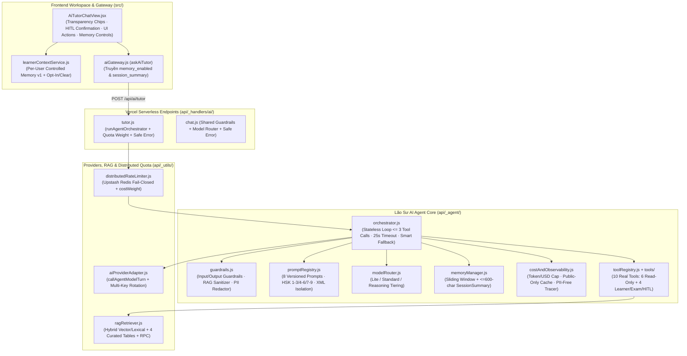

# HANZIGO — LÃO SƯ AI AGENT
# BÁO CÁO TỔNG KẾT & VẬN HÀNH CUỐI CÙNG (FINAL PRODUCTION READINESS REPORT)

- **Dự án:** HanziGo (`https://github.com/haidang1603/Hanzigo.git` | `https://hanzigo-xi.vercel.app`)
- **Chiến dịch:** Lão Sư AI Agent (Task 01 → Task 12)
- **Ngày hoàn tất:** 2026-11-22
- **Trạng thái Chốt Chiến dịch:** **`IMPLEMENTATION COMPLETE` · `TESTS PASSED` · `BUILD VERIFIED`**
- **Trạng thái Kiểm chứng Chrome Preview:** `[NOT VERIFIED — CHROME REMOTE DEBUGGING DISCONNECTED]` *(Chrome `DevToolsActivePort` không khả dụng khi chạy kiểm tra; chưa chạy live smoke test trên `https://hanzigo-xi.vercel.app` nên chưa gắn nhãn `PRODUCTION VERIFIED`)*.

---

## 1. Sơ đồ Kiến trúc Đích (As-Built Architecture)

---

## 2. Bảng Tổng kết 12 Tasks (Task 01 → Task 12)

| Task | Tên & Phạm vi Hoàn thành | File Chính | Test Đóng góp | CSS Delta |
| :--- | :--- | :--- | :---: | :---: |
| **Task 01** | Current AI Architecture Audit & 19-Layer Gap Analysis | `docs/HANZIGO_AI_AGENT_ARCHITECTURE_AUDIT.md` | — | `0.00 KB` |
| **Task 02** | Core Agent Contracts, Versioned Prompt Registry & Guardrails | `api/_agent/contracts.js`, `promptRegistry.js`, `guardrails.js` | `+10` | `0.00 KB` |
| **Task 03** | Model Router (`lite`/`standard`/`reasoning`) & `callAgentModelTurn` | `api/_agent/modelRouter.js`, `api/_utils/aiProviderAdapter.js` | `+5` | `0.00 KB` |
| **Task 04** | Real Tool Registry & 6 Read-Only Knowledge Tools | `api/_agent/toolRegistry.js`, `tools/knowledgeTools.js` | `+8` | `0.00 KB` |
| **Task 05** | 4 Learner, Exam & Safe-Write Proposal Tools + Role Filtering | `api/_agent/tools/learnerExamTools.js`, `tools/index.js` | `+5` | `0.00 KB` |
| **Task 06** | Stateless Agent Orchestrator Loop (`<= 3` bước) & Fallback | `api/_agent/orchestrator.js` | `+8` | `0.00 KB` |
| **Task 07** | Tích hợp Orchestrator vào `/api/ai/tutor` & `/api/ai/chat` | `api/_handlers/ai/tutor.js`, `api/_handlers/ai/chat.js` | `+4` | `0.00 KB` |
| **Task 08** | Controlled Learner Memory & Multi-Turn Compression | `api/_agent/memoryManager.js`, `src/services/learnerContextService.js` | `+6` | `0.00 KB` |
| **Task 09** | Cost Guard, Public-Only Cache, Quota Weight & Tracer | `api/_agent/costAndObservability.js`, `distributedRateLimiter.js` | `+6` | `0.00 KB` |
| **Task 10** | Lão Sư Learning Workspace UI & Transparency Chips | `src/components/depth/AiTutorChatView.jsx`, `aiGateway.js` | `+2` | **`+0.02 KB`** |
| **Task 11** | Agent Evaluation & Adversarial Security Suite (22 cases) | `tests/agentEvaluationSuite.test.js` | `+22` | `0.00 KB` |
| **Task 12** | End-to-End Verification, Documentation & Final Gate | `docs/HANZIGO_AI_AGENT_FINAL_PRODUCTION_READINESS_REPORT.md` | — | `0.00 KB` |
| **Tổng** | **12 / 12 Tasks Hoàn tất** | **Toàn hệ thống Agent** | **`+76` tests** (`1,200` → **`1,276`**) | **`+0.02 KB`** (`44.10` → **`44.12 KB`**) |

---

## 3. Danh mục Biến Môi trường & Cờ Vận hành (Operational Runbook)

| Biến Môi trường / Cờ | Vai trò | Giá trị Mặc định An toàn | Ghi chú Vận hành |
| :--- | :--- | :--- | :--- |
| `GEMINI_API_KEY` / `GEMINI_API_KEYS` / `GEMINI_API_KEY_1..10` | Khóa gọi Google Gemini server-side | *(Server env only)* | Tự động xoay vòng và cooldown 60s khi gặp 429/403. |
| `GEMINI_MODEL` | Model mặc định chung | `gemini-3.5-flash-lite` | Fallback khi không cấu hình biến theo tầng. |
| `GEMINI_MODEL_LITE` | Model cho tầng `lite` (Q&A cơ bản HSK 1–3) | `GEMINI_MODEL` | Tối ưu độ trễ và chi phí thấp. |
| `GEMINI_MODEL_STANDARD` | Model cho tầng `standard` (có tools / HSK 4–6) | `GEMINI_MODEL` | Dùng cho vòng lặp tool và ngữ pháp chuyên sâu. |
| `GEMINI_MODEL_REASONING` | Model cho tầng `reasoning` (HSK 7–9 / writing) | `GEMINI_MODEL_STANDARD` | Chỉ kích hoạt khi `AI_ALLOW_PREMIUM_TIER=true`. |
| `AI_ALLOW_PREMIUM_TIER` | Cờ cho phép leo thang sang tầng `reasoning` | `false` | Mặc định `false` để chặn leo thang chi phí ngoài kiểm soát. |
| `AI_TUTOR_KILL_SWITCH` | Cờ tắt khẩn cấp `/api/ai/tutor` | `false` | Đặt `true` trên Vercel Dashboard để trả HTTP `503` bảo trì tức thì. |
| `ENABLE_AI_TUTOR` | Feature flag bật/tắt AI Tutor | `true` | Đặt `false` để tắt endpoint mà không cần redeploy code. |
| `UPSTASH_REDIS_REST_URL` / `UPSTASH_REDIS_REST_TOKEN` | Rate limit phân tán & Public-Only Cache | *(Server env only)* | Rate limiter fail-closed ở Production; Public Cache fail-open. |

### Quy trình Tắt Khẩn cấp (Kill Switch) & Rollback An toàn
1. **Tắt khẩn cấp API Tutor:** Vào Vercel Project Settings → Environment Variables → đặt `AI_TUTOR_KILL_SWITCH=true` (hoặc `ENABLE_AI_TUTOR=false`) và Redeploy ngay lập tức.
2. **Khóa chi phí model cao:** Đảm bảo `AI_ALLOW_PREMIUM_TIER=false` (mặc định).
3. **Rollback Client UI:** Giao diện giữ tương thích ngược hoàn toàn với envelope cũ; có thể revert riêng `AiTutorChatView.jsx` mà không ảnh hưởng backend.

---

## 4. Kết quả 4 Cổng Kiểm định, Known Limitations & Remaining Risks

### Kết quả 4 Cổng Kiểm định Cuối cùng
- `npm run lint`: **PASS** (`0` errors)
- `npm test`: **PASS** — **`1,276 / 1,276` tests passed** (`48` suites, `0` fail, `0` skipped)
- `npm run audit:curriculum`: **PASS** — **`100 / 100`**
- `npm run build:verify`: **PASS** — `TOTAL CSS (1 file)`: `390.08 KB` raw / **`44.12 KB` gzip** (`<= 45.00 KB`), Chunk isolation **PASS** (`18` script/modulepreload tags).

### Known Limitations & Remaining Risks
- **Các lớp `INTERFACE / DEFER` theo phạm vi Task 01:** Layer 05 (Execution Sandbox), Layer 12 (Scheduled Background Agent — cấm tạo push/in-app notification tự động), Layer 15 (Local GPU Inference), Layer 16 (External MCP Server) chưa triển khai ở giai đoạn Beta.
- **Runtime Preview & Live Production Smoke Test:**
  - Chrome Preview ở Task 12 ghi nhận `[NOT VERIFIED — CHROME REMOTE DEBUGGING DISCONNECTED]`.
  - Sau khi deploy lên `https://hanzigo-xi.vercel.app`, cần smoke test trực tiếp:
    1. Đăng nhập tài khoản học viên và hỏi Lão Sư trên `#conversation/tutor` (kiểm tra Transparency Chips, bấm **"Lưu vào sổ SRS"** từ `pending_confirmations`, thử nút **"Ghi nhớ: Bật/Tắt"** & **"Xóa ký ức AI"**).
    2. Xác nhận Upstash Redis `UPSTASH_REDIS_REST_*` và `GEMINI_API_KEY*` hoạt động bình thường trên Vercel Production.

---

## 5. Trạng thái Chốt Chiến dịch
- **`IMPLEMENTATION COMPLETE` · `TESTS PASSED` · `BUILD VERIFIED`**
- **HARD STOP GATE:** Chiến dịch **Lão Sư AI Agent (Task 01 → Task 12)** đã hoàn tất toàn bộ tài liệu và kiểm định tự động, sẵn sàng để bạn nghiệm thu.
