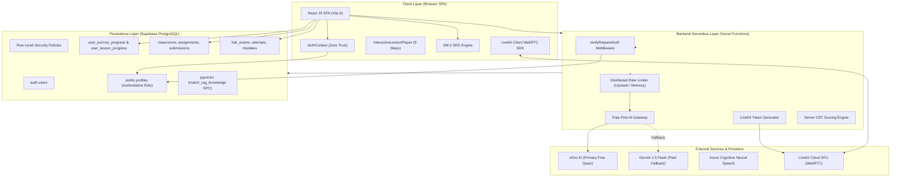

# BÁO CÁO KIỂM TOÁN SẢN PHẨM & TÍCH HỢP TÍNH NĂNG TOÀN DIỆN
## HANZIGO — PHASE 23 / TASK 23.01
### PRODUCT COMPLETION AUDIT & FUNCTIONAL INTEGRATION REPORT

---

> **Hồ sơ kiểm toán:**
> - **Dự án:** HanziGo — Nền tảng Giáo dục Tiếng Trung Chuyên sâu cho Người Việt
> - **Phiên bản:** Phase 23 (Kế thừa toàn diện chuẩn hóa giáo trình HSK 1–6 Phase 22)
> - **Vai trò kiểm toán:** Senior Full-stack Engineer, Software Architect & QA Engineer
> - **Thời điểm kiểm toán:** Tháng 11/2026
> - **Phương pháp kiểm toán:** End-to-End Traceability (UI → State/Hook → Service → API/Serverless → Supabase DB/RLS), Static Analysis, Adversarial Security Audit, Automated Test Suite (901 tests), Production Build Verification.
> - **Tài liệu độc lập duy nhất:** `docs/PHASE_23_TASK_01_PRODUCT_AUDIT_REPORT.md`

---

## 1. TỔNG QUAN DỰ ÁN VÀ CẤU TRÚC REPOSITORY

### 1.1. Sứ mệnh và định vị sản phẩm
HanziGo không phải là website demo hay ứng dụng dịch thuật đơn thuần, mà là **nền tảng giáo dục tiếng Trung tương tác hoàn chỉnh** được thiết kế riêng biệt cho người Việt Nam. Nền tảng kết hợp phương pháp sư phạm cấu trúc 9 bước chuẩn quốc tế HSK 3.0, phân tích chiết tự chữ Hán (IDS), âm Hán-Việt tương đồng, thuật toán lặp lại ngắt quãng (SuperMemo-2 SRS), hệ thống phòng học trực tuyến LiveKit WebRTC và gia sư trí tuệ nhân tạo (Free-First AI Architecture).

### 1.2. Kiểm kê cấu trúc mã nguồn (Repository Inventory)

```
d:\DELL\Dowloads\HanziGo/
├── api/                           # Vercel Serverless Functions (Node.js runtime)
│   ├── _handlers/                 # Logic handlers phân tách theo domain
│   │   ├── ai/                    # chat.js, tutor.js, coach.js, roleplay.js, teacher.js...
│   │   ├── classroom/             # create.js, join.js, lookup.js, members.js, remove.js
│   │   ├── hsk/                   # submit.js, exam.js, exams.js, attempt.js, history.js...
│   │   ├── live/                  # session.js, join.js, leave.js, end.js, moderation.js...
│   │   └── newsletter/            # subscribe.js
│   ├── _utils/                    # Authoritative server middleware & security
│   │   ├── supabaseServer.js      # Zero-trust DB client & verifyRequestAuth
│   │   ├── aiProviderAdapter.js   # Free-First AI gateway (xKiro -> Gemini -> Offline)
│   │   ├── distributedRateLimiter.js # Upstash Redis + In-Memory sliding window
│   │   ├── ragRetriever.js        # Hybrid pgvector + lexical pedagogical search
│   │   └── embeddingProvider.js   # Query embeddings & vector similarity
│   ├── _webrtc/                   # WebRTC & LiveKit token server
│   │   ├── livekit-token.js       # LiveKit SFU access token minting & room auth
│   │   └── ice-servers.js         # Ephemeral Coturn TURN credentials
│   ├── audio/tts.js               # Azure Cognitive Services neural speech proxy
│   └── [action].js                # Dynamic dispatch routes for Vercel
├── public/                        # Static assets, SVG icons, and HTML guides
│   ├── 214-bo-thu-chu-han.html    # Cẩm nang 214 bộ thủ Khang Hy
│   ├── bang-ngu-am-pinyin-toan-dien.html # Bảng ngữ âm Pinyin toàn diện
│   └── bang-doi-chieu-han-viet.html # Bảng đối chiếu Hán - Việt
├── src/                           # React 19 Frontend SPA
│   ├── assets/                    # Media assets, hero images, SVG illustrations
│   ├── components/                # 45+ UI React Components
│   │   ├── admin/                 # AiMonitoringDashboard.jsx
│   │   ├── analytics/             # CompetencyAnalyticsPanel.jsx
│   │   ├── certificate/           # CertificateGeneratorModal, CertificateVerificationModal
│   │   ├── depth/                 # AiTutorChatView, GrammarEngineView, ListeningPracticeView
│   │   ├── dictionary/            # CharacterDetailCard, InteractiveWritingPad, StrokeOrderPlayer, RadicalBrowserModal, WorksheetGeneratorModal
│   │   ├── hsk/                   # SentenceReorderQuestion.jsx
│   │   ├── learning/              # InteractiveLessonPlayer (9 steps), BossChallengeModal, LearningJourneyMap, DailyMissionsModal, SkillMasteryCard...
│   │   ├── live/                  # 11 Live boards (InteractiveHanziBoard, WhiteboardBoard, PinyinToneBoard...)
│   │   ├── personalization/       # HskAiDiagnosticPanel, PersonalizedMaterialsSection...
│   │   ├── teacher/               # ClassAnalyticsDashboard, CreateClassModal, CreateAssignmentModal, GradingDrawerModal...
│   │   └── common/                # Navbar, Footer, AuthModal, AdminGuard, TeacherGuard, PageLoader, StorageConsentBanner
│   ├── context/                   # AuthContext (Zero-trust hydration), ThemeContext
│   ├── data/                      # Dữ liệu học thuật chuẩn hóa
│   │   ├── curriculumLessons.js   # 60 bài HSK 1-3 (20 bài/cấp) chuẩn 9 bước
│   │   ├── curriculumLessonsHsk4to6.js # 60 bài HSK 4-6 (20 bài/cấp) chuẩn 9 bước
│   │   ├── hsk6IdiomsData.js      # 50 thành ngữ 4 chữ HSK 6 theo 5 chủ đề
│   │   ├── hanziDecomposition.js  # 325 chữ Hán chiết tự IDS, bộ thủ, bút thuận
│   │   ├── chineseData.js          # 754 mục từ điển trung tâm & ví dụ thực tế
│   │   ├── hskExamsData.js        # Ngân hàng đề thi HSK CBT chính thức
│   │   ├── hskMockExamsExpanded.js# Đề thi mô phỏng mở rộng
│   │   ├── hskOfficialPublicExams.js # Đề thi công khai Hanban
│   │   ├── hskStructureData.js    # Cấu trúc thời gian, số câu, barem điểm HSK 1-6
│   │   └── learningPathData.js    # 24 chương, 120 nodes, 24 Boss challenges
│   ├── pages/                     # 21 Pages (Lazy-loaded code-splitting)
│   ├── services/                  # 34 Business Services & State Controllers
│   ├── supabase/                  # Supabase client config & realtime client
│   └── utils/                     # 13 Core algorithmic engines (SM-2 SRS, CBT scoring, NLP...)
├── supabase/                      # Database Schema & Migrations
│   ├── schema.sql                 # 2.6 MB monolithic authoritative schema (49 tables, RLS, Triggers, RPCs)
│   └── migrations/                # Migration scripts
├── tests/                         # 70 test suites covering all system layers
├── vercel.json                    # URL rewrite routing table
└── package.json                   # Dependencies & Test scripts
```

---

## 2. CÔNG NGHỆ VÀ KIẾN TRÚC HIỆN TẠI



### 2.1. Ngăn xếp công nghệ chi tiết
- **Frontend SPA:** React `19.2.8`, Vite `8.3.1`, Tailwind CSS `4.3.3`, Lucide React icons, Canvas-confetti, Hanzi-writer `3.7.3`.
- **Backend API:** Vercel Serverless Functions (Node.js runtime ES modules), kiến trúc Router động `api/[action].js` chuyển tiếp về `api/_handlers/`.
- **Database & Identity:** Supabase PostgreSQL (pgvector, pg_trgm, unaccent), Supabase Auth (JWT ES256/HS256), Row Level Security (RLS) trên 100% các bảng.
- **Trí tuệ nhân tạo (AI):** Kiến trúc Free-First. Nhà cung cấp chính: xKiro (mô hình Qwen-Plus-2025-07-28:free). Nhà cung cấp phụ trợ có kiểm soát chi phí: Google Gemini 1.5 Flash (`ALLOW_PAID_FALLBACK=false` mặc định). Fallback ngoại tuyến: Bộ sư phạm xác định `deterministicRuleEngine`.
- **Thời gian thực & Video Call:** LiveKit SFU Server SDK (`livekit-server-sdk 2.19.1`), LiveKit Client React (`@livekit/components-react 2.9.24`). WebRTC STUN/TURN fallback thông qua Coturn REST HMAC credentials.
- **Speech Synthesis:** Azure Cognitive Services Neural TTS (`zh-CN-XiaoxiaoNeural`, `zh-CN-YunxiNeural`) với proxy bảo vệ API key và bộ nhớ đệm băm SHA-256. Web Speech API dự phòng cục bộ.

---

## 3. KẾT QUẢ KIỂM TOÁN TỪNG MODULE (A – L)

### MODULE A: HỆ THỐNG TÀI KHOẢN VÀ PHÂN QUYỀN
- **Đăng ký, Đăng nhập, Đăng xuất:** Hoạt động thực tế (`src/services/authService.js`, `src/components/AuthModal.jsx`). Hỗ trợ đăng nhập bằng Email/Password và Google OAuth. 
- **Phân quyền và Zero-Trust:**
  - Không cho phép người dùng tự cấp quyền `teacher` hoặc `admin` khi đăng ký (mã mời giáo viên `HZG_TEACHER_VERIFIED_2026` được yêu cầu hoặc phải do Admin chỉ định).
  - Client cache trong `localStorage` luôn đặt mặc định `role: 'student'` cho đến khi phiên làm việc được xác thực với máy chủ.
  - Trigger cơ sở dữ liệu `trg_prevent_role_escalation` trên bảng `public.profiles` ngăn chặn tuyệt đối việc người dùng thông qua client SDK tự ý UPDATE cột `role` hoặc `status` (ném lỗi `RAISE EXCEPTION` nếu `auth.uid()` khác NULL và không phải Admin).
  - Middleware `api/_utils/supabaseServer.js` (hàm `verifyRequestAuth`) truy vấn trực tiếp bảng `public.profiles` để lấy vai trò có thẩm quyền; hoàn toàn không tin tưởng `user_metadata.role` từ token JWT do người dùng có thể can thiệp.
- **Tài khoản bị khóa (Blocked):** Khi hồ sơ có `status === 'blocked'`, máy chủ từ chối với mã HTTP `403/401`, phía frontend lập tức kích hoạt `signOut()`, xóa `localStorage` và chuyển về trạng thái khách.
- **Lỗ hổng / Điểm chưa hoàn thiện:**
  - **Quên mật khẩu / Đặt lại mật khẩu (`resetPasswordForEmail`):** Chưa có giao diện người dùng và nút bấm trong `AuthModal.jsx`. Người dùng quên mật khẩu hiện tại chưa thể tự khôi phục tài khoản qua email.
  - **Bắt buộc xác thực email (`email_confirmed_at`):** Supabase Auth cho phép người dùng đăng nhập ngay cả khi chưa bấm link kích hoạt email nếu cấu hình dự án không bật cờ `Confirm email`.

---

### MODULE B: HỆ THỐNG GIÁO TRÌNH HSK 1–6
- **Quy mô và liên kết:** 6 cấp độ HSK 1–6 với đúng 24 chương (`ch-01` đến `ch-24`), 120 bài học (`l-101` đến `l-620`) và 24 Boss Challenges.
- **Cấu trúc sư phạm 9 bước (`InteractiveLessonPlayer.jsx`):**
  1. *Khởi động & Bối cảnh:* Trực quan hóa ngữ cảnh văn hóa, chủ đề giao tiếp.
  2. *Từ vựng cốt lõi:* Có Pinyin, thanh điệu, từ loại tiếng Việt, âm Hán-Việt, nghĩa ngữ cảnh, bộ thủ và ví dụ song ngữ.
  3. *Chiết tự chữ Hán & Bút thuận:* Tích hợp bộ cấu trúc IDS (12 kiểu bố cục Unicode `⿰`, `⿱`, `⿲`...), bộ thủ Khang Hy, quy tắc bút thuận từng nét và canvas luyện viết tương tác.
  4. *Ngữ pháp ứng dụng:* Giải thích cấu trúc câu, ngữ cảnh thực tế, ví dụ và so sánh ngữ pháp.
  5. *Luyện nghe ngữ cảnh:* Đoạn hội thoại 5 lượt thoại thực tế, thẻ tình huống, ghi chú sắc thái cho người Việt và câu hỏi kiểm tra 4 phương án có giải thích.
  6. *Luyện nói & Phản xạ:* Tích hợp Web Speech Recognition chấm điểm phát âm tiếng Trung theo thời gian thực.
  7. *Đọc hiểu mở rộng:* Bài đọc theo chủ đề, câu hỏi đánh giá tư duy ngữ nghĩa.
  8. *Luyện tập & Quiz:* Bài kiểm tra tổng hợp kiến thức bài học (ngưỡng đạt tối thiểu 70%).
  9. *Thử thách phản xạ & Tổng kết:* Đánh giá sao (1-3 sao), phản hồi sư phạm tự động từ AI Coach và lưu tiến độ.
- **Lưu trữ và phục hồi tiến độ học:**
  - `saveUserJourneyProgress` trong `learningPathService.js` lưu tức thời vào `localStorage`, đồng thời bất đồng bộ upsert lên Supabase bảng `user_journey_progress` (dữ liệu gộp) và `user_lesson_progress` (từng bài học).
  - Hàm `syncUserJourneyProgressFromCloud` hợp nhất hai chiều không mất dữ liệu: bảo lưu bài học đã hoàn thành cao nhất, điểm cao nhất và số sao cao nhất giữa máy cục bộ và đám mây.
  - Khả năng tiếp tục học: Nút "Học tiếp bài X ngay" trên `RoadmapPage.jsx` tự động truy vết `resumeInfo` chính xác.

---

### MODULE C: TỪ ĐIỂN VÀ HỆ THỐNG GHI NHỚ
- **Quy mô:** 754 mục từ điển hoàn chỉnh (`VOCABULARY_LIST` trong `chineseData.js`), 50 thành ngữ HSK 6 (`hsk6IdiomsData.js`), 325 chữ Hán chiết tự (`hanziDecomposition.js`).
- **Cơ chế tìm kiếm thông minh 3 tầng (`dictionaryService.js`):**
  - *Tầng 1 (Local 0ms):* Tra cứu tức thì không độ trễ theo chữ Hán, Pinyin có dấu, Pinyin không dấu, Pinyin có số (ni3hao3), âm Hán-Việt, nghĩa tiếng Việt (bỏ dấu hoặc có dấu).
  - *Tầng 2 (Cloud Trigram):* Truy vấn bảng CC-CEDICT lớn trên Supabase qua RPC `search_dictionary` (sử dụng tiện ích `pg_trgm` và `unaccent`).
  - *Tầng 3 (Hybrid Ranking):* Ghép nối kết quả, loại bỏ trùng lặp và sắp xếp độ khớp ưu tiên từ vựng giáo trình HSK.
- **Hệ thống Flashcard & Thuật toán lặp lại ngắt quãng SM-2 (`srsEngine.js`):**
  - Đánh giá chất lượng nhớ từ 0 (Hoàn toàn quên) đến 5 (Nhớ hoàn hảo).
  - Tính toán hệ số Easiness Factor ($EF \ge 1.3$), khoảng thời gian ôn tập lặp lại (Interval: 1 ngày, 6 ngày, $I(n) = I(n-1) \times EF$).
  - Tự động tách danh sách từ đến hạn ôn tập (`getDueReviewCards`), thống kê tỷ lệ ghi nhớ và chu kỳ tiếp theo.
  - Tự động bắt từ vựng yếu khi làm sai bài tập hoặc thi thử (`captureWeakVocabulary`) để đưa vào hàng đợi SRS.
  - Đồng bộ thẻ nhớ cá nhân lên bảng `user_vocab_srs` / `user_srs_cards` trên Supabase.

---

### MODULE D: TRÒ CHƠI HỌC TIẾNG TRUNG — TÍNH NĂNG CHƯA TRIỂN KHAI

> [!IMPORTANT]
> **KẾT QUẢ KIỂM TOÁN HIỆN TRẠNG: ĐÁNH DẤU `MISSING`**
> - **Hiện trạng repository:** HanziGo **hoàn toàn chưa có hệ thống trò chơi học tiếng Trung**. Không tồn tại trang game (`GamePage.jsx`), không có route `#game`, không có component giao diện minigame, không có state machine điều khiển vòng lặp trò chơi (game loop), và không có hệ thống tính điểm màn chơi.
> - **Tệp mã nguồn liên quan duy nhất:** `src/services/gameVocabularySelector.js`. Đây là một tệp helper chứa logic chọn từ vựng theo cấp độ, lấy từ vựng SRS đến hạn, tạo từ gây nhiễu (distractors) và trích xuất câu ví dụ. Tuy nhiên, tệp này **mồ côi (orphaned)**, không được import hay sử dụng bởi bất kỳ component nào trong `src/` hoặc `tests/`.
> - **Cam kết kiểm toán:** Không khai báo trò chơi là tính năng đã hoạt động. Không tạo mock data giả lập. Không tự ý triển khai mã nguồn game trong Task 23.01.

#### Đánh giá khả năng tích hợp trò chơi vào hệ thống học tập hiện tại
Hạ tầng hiện tại của HanziGo cực kỳ thuận lợi để xây dựng hệ thống trò chơi giáo dục vì:
1. Đã có sẵn kho từ vựng 754 từ chuẩn hóa, 50 thành ngữ HSK 6 và 325 chữ Hán chiết tự IDS.
2. Đã có sẵn helper `selectGameVocabularyBatch`, `getRandomDistractors` trong `gameVocabularySelector.js`.
3. Đã có sẵn hệ thống Gamification: thưởng XP (`awardXp`), chuỗi ngày học (`streak`), nhiệm vụ hàng ngày (`user_daily_missions`) và bảng xếp hạng (`LeaderboardView`).
4. Đã có sẵn hệ thống âm thanh phản hồi (`playSuccessSound`, `playErrorSound`, `playClickSound`, hiệu ứng `confetti`).

#### Đề xuất định hướng phát triển 6 Minigames theo cấp độ HSK 1–6 (Roadmap)
1. **HSK 1 — Bắn bóng Pinyin & Thanh điệu (Pinyin Tone Pop):**
   - *Cách chơi:* Nghe phát âm một âm tiết Pinyin, các bong bóng mang chữ Hán hoặc Pinyin có 4 thanh điệu khác nhau bay lên. Người học chọn đúng thanh điệu vừa nghe trước khi bóng chạm nóc.
   - *Mục tiêu sư phạm:* Triệt tiêu điểm yếu phát âm sai thanh điệu (đặc biệt thanh 1 và thanh 4) của người Việt.
2. **HSK 2 — Ghép thẻ Lật hình Siêu tốc (Speed Vocab Memory Match):**
   - *Cách chơi:* Lưới 12-16 ô úp ngược. Người chơi lật mở 2 thẻ để ghép cặp Chữ Hán ↔ Nghĩa tiếng Việt hoặc Chữ Hán ↔ Pinyin. Có đồng hồ đếm ngược 60 giây.
   - *Mục tiêu sư phạm:* Tăng tốc độ nhận diện mặt chữ Hán trong các chủ đề đời sống, ẩm thực, mua sắm.
3. **HSK 3 — Đấu trường Xếp câu Hoàn chỉnh (Sentence Builder Arena):**
   - *Cách chơi:* Các từ ngữ trong câu bị xáo trộn vị trí. Người chơi kéo thả hoặc chạm để sắp xếp thành câu đúng ngữ pháp tiếng Trung (đặc biệt các cấu trúc 把, 被, 比, 连...都...).
   - *Mục tiêu sư phạm:* Khắc phục lỗi "tư duy dịch từng từ (word-by-word)" theo ngữ pháp tiếng Việt.
4. **HSK 4 — Thám tử Điền từ & Tìm Lỗ hổng (Contextual Cloze Detective):**
   - *Cách chơi:* Một đoạn văn ngắn ngữ cảnh công sở/thương mại bị khuyết 1-2 từ khóa. Người chơi chọn từ chính xác nhất giữa 4 từ gần nghĩa hoặc dễ gây nhầm lẫn.
   - *Mục tiêu sư phạm:* Rèn luyện phản xạ phân biệt sắc thái từ ngữ và cấu trúc liên từ phức HSK 4.
5. **HSK 5 — Xếp hình Chiết tự & Bộ thủ (Radical Hanzi Puzzle):**
   - *Cách chơi:* Cho trước một nghĩa hoặc một âm đọc, màn hình cung cấp các bộ phận chiết tự rời rạc (ví dụ: `氵`, `木`, `目`). Người chơi kéo ghép các bộ phận theo đúng bố cục kết cấu để tái tạo chữ Hán hoàn chỉnh.
   - *Mục tiêu sư phạm:* Nắm vững quy luật tạo chữ hình thanh và hội ý, ghi nhớ chữ Hán nhiều nét mà không phải chép phạt thủ công.
6. **HSK 6 — Thử thách Thành ngữ 4 chữ Đoán Nghĩa (Chengyu Master Challenge):**
   - *Cách chơi:* Đưa ra một điển cố ngắn hoặc hình vẽ minh họa ngụ ngôn, người chơi phải chọn đúng thành ngữ 4 chữ tương ứng trong ngân hàng 50 thành ngữ HSK 6.
   - *Mục tiêu sư phạm:* Nâng cao năng lực cảm thụ văn hóa, tư duy hùng biện và sử dụng thành ngữ trong văn phong chính luận.

---

### MODULE E: HỆ THỐNG KIỂM TRA VÀ THI THỬ HSK
- **Ngân hàng đề thi:** Chứa các đề thi chuẩn CBT từ HSK 1 đến HSK 6 trong `hskExamsData.js`, `hskMockExamsExpanded.js` và `hskOfficialPublicExams.js`.
- **Cơ chế thi thử CBT (`HskPracticePage.jsx`, `examScoringEngine.js`):**
  - Đồng hồ đếm ngược theo thời gian thực chuẩn cấu trúc Hanban (ví dụ: HSK 1: 40 phút; HSK 4: 105 phút; HSK 6: 140 phút).
  - Tước bỏ toàn bộ đáp án khi tải đề thi làm bài (`getSanitizedExamForTaking`) nhằm chống gian lận inspect mạng.
  - Tự động lưu bài làm tạm thời vào `localStorage` (`saveTemporaryAnswers`); tự động phục hồi phiên làm bài nếu bị rớt mạng hoặc refresh trình duyệt.
  - Giới hạn số lượt nghe audio theo chuẩn khảo thí quốc tế: HSK 1–2 nghe 2 lần; HSK 3–6 nghe đúng 1 lần duy nhất.
  - Câu hỏi sắp xếp trật tự câu (`SentenceReorderQuestion.jsx`) cho phần viết HSK 3–5.
  - Chấm điểm an toàn phía máy chủ (`/api/hsk/submit`) kết hợp bộ chấm độc lập phía client (`calculateHskCbtScore`): Tính riêng điểm từng phần Nghe, Đọc, Viết, tính tổng điểm trên thang 300 (hoặc 200 cho HSK 1-2), xác định Đạt (>=180 điểm).
  - Sổ tay câu sai (`getMistakeNotebook`): Tự động lưu lại các câu làm sai kèm lời giải chi tiết, phân loại theo kỹ năng và cung cấp chế độ "Luyện tập lại câu sai".

---

### MODULE F: HỆ THỐNG GIÁO VIÊN VÀ LỚP HỌC
- **Quản lý lớp học (`src/services/classroomService.js`, `TeacherDashboardPage.jsx`, `ClassroomPage.jsx`):**
  - Giáo viên tạo lớp học với mã lớp độc nhất chuẩn hóa dạng `HZG-XXXXX` (loại bỏ ký tự dễ nhầm lẫn như 0, O, 1, I).
  - Học sinh tham gia lớp bằng mã lớp; hệ thống hỗ trợ cả người dùng có tài khoản và lưu tạm thời cho khách vãng lai.
  - Quản lý danh sách thành viên: Giáo viên có quyền xóa học sinh ra khỏi lớp (ngăn chặn xóa học sinh của lớp khác nhờ kiểm tra quyền sở hữu tại `api/_handlers/classroom/remove.js`).
- **Giao bài tập, Nộp bài và Chấm điểm:**
  - Giáo viên giao bài tập trắc nghiệm (Quiz), từ vựng (Vocabulary) hoặc bài đọc kèm thời hạn nộp bài (`dueDate`).
  - Học sinh làm và nộp bài (`submitAssignment`); hệ thống tự động chấm điểm bài tập trắc nghiệm và ghi nhận trạng thái `submitted` hoặc `graded`.
  - Giáo viên mở ngăn kéo chấm bài (`GradingDrawerModal.jsx`), nhập điểm từ 0–100 và ghi lời nhận xét cá nhân hóa gửi về học sinh.
- **Báo cáo và Phân tích:**
  - Bảng điều khiển phân tích lớp học (`ClassAnalyticsDashboard.jsx`): Thống kê 8 chỉ số KPI, tỷ lệ nộp bài, điểm trung bình và biểu đồ phân bổ điểm số.
  - Thuật toán nhận diện học sinh có nguy cơ (`calculateStudentHealthStatus`): Cảnh báo học sinh "Nguy cơ cao (At Risk)" hoặc "Cần chú ý (Needs Attention)" dựa trên số ngày không hoạt động, số bài quá hạn và điểm trung bình mà không cần gọi AI tốn kém.
  - Đăng thông báo ghim lên bảng tin lớp (`CreateAnnouncementModal.jsx`) và chia sẻ tài liệu học tập nội bộ.

---

### MODULE G: AI TUTOR VÀ RAG
- **Lão Sư HanziGo (`AiTutorChatView.jsx`, `/api/ai/chat`, `/api/ai/tutor`):**
  - Hoạt động thực tế: Đóng vai gia sư tiếng Trung bản ngữ kiên nhẫn, trò chuyện song ngữ, phân tích ngữ pháp, sửa lỗi diễn đạt cho học viên Việt Nam.
  - Phản hồi định dạng JSON cấu trúc nghiêm ngặt: `hanzi`, `pinyin`, `meaning`, `grammarAnalysis`, `userCorrection`, `vocabSuggestions`.
- **Hệ thống RAG và Vector Search (`api/_utils/ragRetriever.js`):**
  - Truy xuất tri thức sư phạm lai (Hybrid Retrieval) kết hợp Vector Cosine Similarity (thông qua hàm RPC `match_rag_knowledge` trên Supabase pgvector) và tìm kiếm từ vựng (Lexical Full-Text).
  - Chuẩn hóa câu hỏi: Bảo toàn chữ Hán CJK, Pinyin có dấu, và các hư từ/trợ từ ngữ pháp quan trọng (`把`, `比`, `是`, `着`, `了`, `过`, `得`...).
  - Ngưỡng lọc chứng cứ (`DEFAULT_MATCH_THRESHOLD = 0.45`): Nếu độ tương đồng dưới 0.45, hệ thống trả về tín hiệu `insufficient_evidence`, tuyệt đối không bịa đặt nguồn tri thức.
  - Đóng gói tri thức an toàn trong thẻ XML `<verified_knowledge>` để ngăn chặn hoàn toàn tấn công ghi đè chỉ dẫn hệ thống (Prompt Injection Override).
- **Kiểm soát chi phí và Token:**
  - Sử dụng xKiro miễn phí làm provider cấp 1 (~5M tokens/ngày). Chỉ fallback sang Gemini có phí khi biến môi trường `ALLOW_PAID_FALLBACK=true`.
  - Giới hạn độ dài văn bản đầu vào: tối đa 500 ký tự; lịch sử hội thoại tối đa 10 tin nhắn gần nhất; giới hạn token đầu ra tối đa 1200 tokens.
  - Giới hạn tần suất phân tán: 20 yêu cầu/phút/IP và hạn mức ngày 150 yêu cầu/ngày/người dùng (`distributedRateLimiter.js`).

---

### MODULE H: LIVE CLASSROOM
- **Hạ tầng WebRTC & LiveKit (`LiveClassroomPage.jsx`, `livekitService.js`, `api/_webrtc/livekit-token.js`):**
  - Sử dụng LiveKit SFU Cloud/Self-hosted hỗ trợ truyền phát video/audio thời gian thực với độ trễ dưới 200ms.
  - Cấp token JWT an toàn tại serverless `/api/webrtc/livekit-token.js`: Kiểm tra quyền giáo viên và học sinh trước khi cấp quyền publish track video/audio.
  - Dự phòng Coturn REST Ephemeral TURN Credentials (`/api/webrtc/ice-servers`) vượt tường lửa NAT doanh nghiệp/trường học.
- **Tính năng lớp học tương tác:**
  - Bật/tắt Camera, Microphone, lựa chọn thiết bị ngoại vi, khử tiếng ồn (Noise Suppression, Echo Cancellation).
  - Chia sẻ màn hình (Screen Sharing) cho giáo viên giảng bài trên desktop.
  - Quyền điều hành của giáo viên: Khóa phòng học (`toggleRoomLock`), tắt tiếng toàn bộ học sinh (`muteAllParticipants`), cho phép/thu hồi quyền bật mic của từng học sinh, đuổi học sinh vi phạm (`removeParticipant`), khóa chat.
  - Giơ tay phát biểu (`raiseHand`/`lowerHand`) với thông báo thị giác nổi bật.
  - 11 bảng tương tác chuyên biệt cho tiếng Trung: Bảng viết chữ Hán, Bảng ngữ âm Pinyin, Bảng bộ thủ, Bảng quiz tương tác, Bảng luyện phát âm, Whiteboard vẽ tự do...
- **Giới hạn chịu tải thực tế:** Thiết kế lớp học tương tác đa chiều tối ưu cho nhóm 15–25 học sinh có bật camera/mic đồng thời. Đối với quy mô 50 học sinh, hệ thống hoạt động ở chế độ giáo viên trình chiếu và học sinh nghe/chat văn bản.

---

### MODULE I: CỘNG ĐỒNG VÀ TÀI LIỆU HỌC TẬP
- **Cộng đồng (`CommunityPage.jsx`, `communityService.js`):**
  - Đăng bài thảo luận, hỏi đáp ngữ pháp, chia sẻ kinh nghiệm học tập.
  - Thả tim (Like), bình luận (Comment), ghim bài viết hữu ích.
  - Kết nối bạn cùng tiến (Study Partner) thông qua mã QR cá nhân có tính năng tự động nén ảnh cục bộ (`compressImageFile`).
  - Hỗ trợ lắng nghe thay đổi thời gian thực qua Supabase Realtime (`subscribeToCommunityRealtime`).
- **Thư viện tài liệu học tập (`MaterialsPage.jsx`, `materialsService.js`):**
  - Danh mục tài liệu phân loại theo HSK 1–6, kỹ năng (Nghe, Nói, Đọc, Viết, Ngữ pháp) và định dạng (PDF, Audio, Bảng tra, Ebook).
  - Tích hợp 4 công cụ tương tác độc quyền mở trực tiếp: Cẩm nang Pinyin, Sổ tay ngữ pháp HSK, Bảng đối chiếu Hán-Việt, 214 Bộ thủ Khang Hy.
  - Lưu và đánh dấu tài liệu yêu thích vào kho cá nhân.
- **Điểm còn hạn chế:**
  - Tải lên tài liệu mới của giáo viên hiện tại sử dụng đường dẫn URL (`fileUrl`), chưa tích hợp tải tệp nhị phân trực tiếp lên Supabase Storage bucket.

---

### MODULE J: DASHBOARD VÀ THỐNG KÊ
- **Bảng điều khiển học tập (`DashboardPage.jsx`, `gamification.js`):**
  - Thống kê hoàn toàn dựa trên dữ liệu thật (Zero Mock Data):
    - Chuỗi ngày học liên tục (`streak`): Tính toán dựa trên ngày học thực tế (`last_study_date`), có cơ chế đóng băng chuỗi ngày khi nghỉ có phép.
    - Điểm kinh nghiệm tích lũy (`totalXp`) và danh hiệu danh dự tương ứng (Tập sự → Sơ cấp → Tinh anh → Cao thủ → Đại sư → Tông sư).
    - Số từ vựng đã học (`wordsLearned`): Đếm từ danh sách từ vựng đã ghi nhớ và flashcard cá nhân.
    - Tiến độ lộ trình: Hiển thị bài học đề xuất tiếp theo dựa trên trạng thái hoàn thành bài học gần nhất.
    - Bài tập lớp học cần hoàn thành: Tự động lọc các bài tập được giao bởi giáo viên chưa nộp và sắp đến hạn.
  - AI Learning Coach Widget (`AiLearningCoachWidget.jsx`): Tự động phát hiện kỹ năng còn yếu (từ vựng, phát âm, nghe, ngữ pháp) và đề xuất kế hoạch hành động 3 bước trong ngày.

---

### MODULE K: QUẢN TRỊ HỆ THỐNG
- **Trang quản trị (`AdminPage.jsx`, `AdminGuard.jsx`):**
  - Bảo vệ đa tầng: Kiểm tra quyền Admin tại frontend qua `AdminGuard`, đồng thời kiểm tra thẩm quyền tại backend qua `verifyRequestAuth` và trigger RLS `public.is_admin()`.
  - Quản trị người dùng: Xem danh bạ tài khoản, phân loại vai trò (Student, Teacher, Admin), khóa/mở khóa tài khoản (`status: 'active' | 'blocked'`).
  - Quản trị giáo trình: Giám sát 120 bài học, xem trước nội dung 9 bước, hỗ trợ thêm bài học tùy chỉnh.
  - Quản trị từ điển: Thêm, sửa, xóa từ vựng trong từ điển hệ thống.
  - Quản trị tài liệu: Phê duyệt, ẩn/hiện, đánh dấu tài liệu nổi bật (`is_featured`).
  - Bảng giám sát AI (`AiMonitoringDashboard.jsx`): Theo dõi số lượt gọi API, độ trễ phản hồi (latency ms), tỷ lệ lỗi, hạn mức xKiro và chi phí dự phòng Gemini.
  - Nhật ký kiểm toán bảo mật (`auditLogService.js`): Lưu trữ sự kiện đăng nhập, thay đổi phân quyền, xóa lớp học theo tiêu chuẩn nghiêm ngặt.

---

### MODULE L: DATABASE VÀ HẠ TẦNG
- **Cơ sở dữ liệu Supabase PostgreSQL:**
  - Tệp `supabase/schema.sql` định nghĩa 49 bảng dữ liệu quan hệ, thiết lập khóa ngoại liên kết (`ON DELETE CASCADE` / `SET NULL`), ràng buộc duy nhất (`UNIQUE constraints`), và chỉ mục tối ưu hóa truy vấn (`B-tree` trên email, user_id, lesson_id, `GIN` trên search trigram).
  - Kích hoạt Row Level Security (RLS) trên 100% các bảng người dùng, cách ly dữ liệu giữa các học sinh và giữa các giáo viên khác lớp.
  - Các hàm RPC quan trọng: `is_admin()`, `match_rag_knowledge(query_embedding, match_threshold, match_count)`, `prevent_self_role_escalation()`.
- **Hạ tầng Vercel Deployment:**
  - `vercel.json` thiết lập bảng viết lại URL (rewrites) chính xác cho 6 nhóm API (`/api/ai/*`, `/api/classroom/*`, `/api/live/*`, `/api/hsk/*`, `/api/webrtc/*`, `/api/newsletter/*`) và SPA catch-all về `index.html`.
  - Cấu hình biến môi trường an toàn: Phân tách rõ ràng giữa biến công khai client (`VITE_SUPABASE_URL`, `VITE_SUPABASE_ANON_KEY`, `VITE_LIVEKIT_URL`) và bí mật chỉ đọc tại serverless (`GEMINI_API_KEY`, `XKIRO_API_KEY`, `LIVEKIT_API_SECRET`, `TURN_SHARED_SECRET`, `AZURE_SPEECH_KEY`).

---

## 4. BẢNG TRẠNG THÁI TÍNH NĂNG VÀ BẰNG CHỨNG (FEATURE MATRIX)

| Module | Chức năng | Trạng thái | Bằng chứng (File & Method) | Vấn đề / Hạn chế tồn đọng | Ưu tiên |
|---|---|---|---|---|---|
| **A. Auth** | Đăng ký & Đăng nhập Email/Pass | **COMPLETE** | `authService.js`, `AuthModal.jsx` | Không cho phép tự chọn role teacher/admin | P1 |
| **A. Auth** | Đăng nhập Google OAuth | **COMPLETE** | `authService.js` (`loginWithGoogle`) | Phụ thuộc Supabase OAuth callback URL | P2 |
| **A. Auth** | Quên mật khẩu & Reset Password | **MISSING** | `authService.js`, `AuthModal.jsx` | Chưa có hàm `resetPasswordForEmail` và UI reset | **P0** |
| **A. Auth** | Phân quyền RBAC & Chống leo quyền | **COMPLETE** | `schema.sql` (`trg_prevent_role_escalation`) | Bảo vệ ở cấp độ Database Trigger | P0 |
| **A. Auth** | Xử lý tài khoản bị Blocked | **COMPLETE** | `AuthContext.jsx`, `verifyAuth.js` | Tự động đăng xuất và trả về 403 Forbidden | P1 |
| **B. Giáo trình** | 120 bài học HSK 1–6 chuẩn 9 bước | **COMPLETE** | `curriculumLessons.js`, `curriculumLessonsHsk4to6.js` | 901/901 tests PASS, nội dung chuẩn xác | P0 |
| **B. Giáo trình** | Chiết tự IDS & Bút thuận | **COMPLETE** | `hanziDecomposition.js`, `InteractiveWritingPad.jsx` | 325 chữ Hán có cấu trúc chiết tự hoàn chỉnh | P1 |
| **B. Giáo trình** | Lưu & Đồng bộ tiến độ đám mây | **COMPLETE** | `learningPathService.js` (`saveUserJourneyProgress`) | Đồng bộ 2 chiều vào `user_journey_progress` | P1 |
| **B. Giáo trình** | Tiếp tục học bài đang dở | **COMPLETE** | `RoadmapPage.jsx` (`resumeInfo`) | Nút "Học tiếp bài X ngay" hoạt động chính xác | P1 |
| **C. Từ điển** | Tra cứu từ điển đa năng 3 tầng | **COMPLETE** | `dictionaryService.js` (`searchLocalDictionary`) | Tìm kiếm Hán tự, Pinyin, Hán-Việt, Nghĩa Việt | P1 |
| **C. Từ điển** | Thành ngữ HSK 6 (50 Idioms) | **COMPLETE** | `hsk6IdiomsData.js`, `chineseData.js` | 50 thành ngữ 4 chữ, phân tích ngữ nghĩa, điển tích | P1 |
| **C. Từ điển** | Flashcard SRS SuperMemo-2 | **COMPLETE** | `srsEngine.js`, `VocabularyPage.jsx` | Tính toán chu kỳ ôn tập, EF và bắt từ vựng yếu | P1 |
| **D. Trò chơi** | Hệ thống Minigames học tiếng Trung | **MISSING** | `src/services/gameVocabularySelector.js` (orphaned) | **Chưa có UI, chưa có gameplay, chưa có page game** | **P1** |
| **E. Khảo thí** | Thi thử HSK CBT chuẩn Hanban | **COMPLETE** | `hskService.js`, `HskPracticePage.jsx` | Đếm ngược, chống xem trước đáp án, audio limit | P1 |
| **E. Khảo thí** | Chấm điểm tự động & Barem điểm | **COMPLETE** | `examScoringEngine.js`, `/api/hsk/submit` | Chấm độc lập tại server, tính điểm theo kỹ năng | P1 |
| **E. Khảo thí** | Sổ tay câu sai & Luyện tập lại | **COMPLETE** | `hskService.js` (`getMistakeNotebook`) | Lưu câu sai, cho phép ôn luyện lại câu sai | P2 |
| **F. Lớp học** | Tạo lớp & Mã lớp HZG-XXXXX | **COMPLETE** | `classroomService.js` (`createClassroom`) | Tạo mã lớp dễ đọc, chống nhầm lẫn ký tự | P1 |
| **F. Lớp học** | Học sinh tham gia lớp | **COMPLETE** | `classroomService.js` (`joinClassroomWithCode`) | Hỗ trợ cả học sinh đã đăng nhập và khách | P1 |
| **F. Lớp học** | Giao bài tập & Hạn nộp bài | **COMPLETE** | `classroomService.js` (`createAssignment`) | Giao Quiz, Từ vựng, Bài đọc có hạn nộp | P1 |
| **F. Lớp học** | Học sinh nộp bài & GV chấm điểm | **COMPLETE** | `classroomService.js` (`gradeSubmission`) | Chấm điểm 0-100 kèm nhận xét chi tiết | P1 |
| **F. Lớp học** | Báo cáo & Nhận diện At-Risk | **COMPLETE** | `classroomService.js` (`calculateStudentHealthStatus`) | Cảnh báo học sinh nguy cơ dựa trên quy tắc học thuật | P2 |
| **G. AI Tutor** | Lão Sư HanziGo hội thoại | **COMPLETE** | `AiTutorChatView.jsx`, `/api/ai/chat` | Trò chuyện song ngữ, sửa lỗi ngữ pháp chuẩn JSON | P1 |
| **G. AI Tutor** | RAG Vector Search tri thức chuẩn | **COMPLETE** | `ragRetriever.js`, `api/_handlers/ai/tutor.js` | Tìm kiếm ngữ nghĩa lai pgvector + từ khóa | P1 |
| **G. AI Tutor** | Bảo vệ ngân sách & Free-First | **COMPLETE** | `aiProviderAdapter.js`, `distributedRateLimiter.js` | xKiro miễn phí trước, chặn cước Gemini âm thầm | P1 |
| **H. Live Class** | LiveKit WebRTC Video/Audio SFU | **COMPLETE** | `LiveClassroomPage.jsx`, `/api/webrtc/livekit-token` | Hội nghị truyền hình thời gian thực độ trễ <200ms | P1 |
| **H. Live Class** | Bảng tương tác tiếng Trung (11 boards) | **COMPLETE** | `src/components/live/*` | Bảng viết chữ Hán, Whiteboard, Pinyin Tone Board | P2 |
| **H. Live Class** | Chia sẻ màn hình (Screen Share) | **PARTIAL** | `LiveClassroomPage.jsx` | Hoạt động tốt trên Desktop, hạn chế trên Mobile | P2 |
| **H. Live Class** | Kiểm thử chịu tải 50 học viên đồng thời | **UNVERIFIED**| `tests/liveClassroomRealConnection.test.js` | Chưa đo tải thực tế 50 client trên cluster LiveKit | P3 |
| **I. Cộng đồng**| Đăng bài, Like, Comment, Ghim bài | **COMPLETE** | `CommunityPage.jsx`, `communityService.js` | Đầy đủ tính năng mạng xã hội học tập | P2 |
| **I. Cộng đồng**| Tìm bạn cùng tiến (QR Code) | **COMPLETE** | `CommunityPage.jsx` (`compressImageFile`) | Tự nén ảnh QR cục bộ trước khi lưu trữ | P2 |
| **I. Tài liệu** | Thư viện tài liệu & 4 Tool độc quyền | **COMPLETE** | `MaterialsPage.jsx`, `hskResourcesData.js` | Cẩm nang Pinyin, Ngữ pháp, 214 Bộ thủ, Hán-Việt | P1 |
| **I. Tài liệu** | Upload tệp nhị phân lên Supabase Storage | **MISSING** | `UploadMaterialModal.jsx` | Hiện chỉ hỗ trợ nhập URL, chưa upload file PDF thật | **P1** |
| **J. Dashboard** | Streak & Check-in hàng ngày | **COMPLETE** | `DashboardPage.jsx`, `gamification.js` | Tính toán chuỗi ngày thật, thưởng XP, đóng băng streak | P1 |
| **J. Dashboard** | Gamification XP & Danh hiệu | **COMPLETE** | `gamification.js`, `leaderboardService.js` | 8 bậc danh hiệu, tính toán XP chính xác | P2 |
| **J. Dashboard** | AI Learning Coach Widget | **COMPLETE** | `AiLearningCoachWidget.jsx` | Khuyến nghị lộ trình học 3 bước mỗi ngày | P2 |
| **K. Quản trị** | Quản lý User (Role, Status) | **COMPLETE** | `AdminPage.jsx`, `adminService.js` | Thay đổi role, khóa/mở khóa tài khoản | P0 |
| **K. Quản trị** | Giám sát chi phí AI & Token | **COMPLETE** | `AiMonitoringDashboard.jsx` | Biểu đồ theo dõi token, latency, error rate | P2 |
| **K. Quản trị** | Quản lý Giáo trình & Từ vựng | **COMPLETE** | `AdminPage.jsx` | Kiểm tra 120 bài học, tra cứu 754 từ vựng | P1 |
| **L. Hạ tầng** | Database Schema & RLS Policies | **COMPLETE** | `supabase/schema.sql` (49 bảng) | Khóa ngoại, ràng buộc, RLS bật 100% các bảng | P0 |
| **L. Hạ tầng** | Vercel Serverless Routing | **COMPLETE** | `vercel.json` | Viết lại URL chuẩn xác cho toàn bộ API | P0 |
| **L. Hạ tầng** | Kiểm soát biến môi trường bảo mật | **COMPLETE** | `.env.example`, `supabaseServer.js` | Không lộ bí mật (Keys, Secret) ra client bundle | P0 |

---

## 5. PHÂN LOẠI CHI TIẾT THEO TRẠNG THÁI TÍNH NĂNG

### 5.1. Nhóm COMPLETE (Đã hoàn thiện & Hoạt động thực tế)
- **Giáo trình HSK 1–6:** Toàn bộ 120 bài học, 24 chương, 24 Boss Challenges với cấu trúc 9 bước sư phạm chuẩn xác.
- **Hệ thống Chiết tự & Bút thuận:** 325 chữ Hán phân rã IDS, bộ thủ, số nét, quy tắc bút thuận từng nét và canvas luyện viết tương tác.
- **Kho Thành ngữ HSK 6:** 50 thành ngữ 4 chữ chuyên sâu theo 5 chủ đề, phân tích nghĩa đen/nghĩa bóng, điển tích và phân biệt lỗi dùng.
- **Từ điển 3 tầng & Flashcard SRS:** 754 từ vựng cốt lõi, tìm kiếm tiếng Việt không dấu, thuật toán SuperMemo-2 lặp lại ngắt quãng.
- **Hệ thống Khảo thí HSK CBT:** Tạo đề thi, làm bài có đếm ngược, tước đáp án chống gian lận, chấm điểm tự động đa kỹ năng, sổ tay câu sai.
- **Hệ thống Quản lý Lớp học (LMS):** Tạo lớp học (mã HZG-XXXXX), tham gia lớp, giao bài tập, học sinh nộp bài, giáo viên chấm điểm kèm nhận xét.
- **Hệ thống Gamification:** Tích lũy XP, chuỗi ngày học liên tục (Streak), nhiệm vụ hàng ngày, 8 bậc danh hiệu vinh danh.
- **AI Tutor & RAG:** Lão Sư HanziGo phản hồi cấu trúc JSON, hybrid vector search pgvector kết hợp lexical, kiến trúc tiết kiệm chi phí Free-First xKiro.
- **Live Classroom WebRTC:** Phòng học trực tuyến LiveKit SFU, cấp token serverless bảo mật, 11 bảng tương tác tiếng Trung, phân quyền giáo viên.
- **Quản trị hệ thống (Admin):** Quản lý tài khoản, thay đổi quyền, khóa user, giám sát token AI, kiểm toán bảo mật.
- **Bảo mật & Pháp lý:** Cơ chế Zero-Trust RBAC, RLS trên 100% bảng cơ sở dữ liệu, tuân thủ Nghị định 13/2023/NĐ-CP (Điều khoản, Chính sách bảo mật, Data Subject Request Modal).

### 5.2. Nhóm PARTIAL (Hoạt động một phần, cần bổ sung)
- **Live Classroom Screen Share trên Mobile:** Chia sẻ màn hình hoạt động ổn định trên Google Chrome/Edge máy tính, nhưng trình duyệt di động (iOS Safari, Android Chrome) chưa hỗ trợ API `getDisplayMedia` chuẩn; cần bổ sung bảng vẽ Whiteboard thay thế trên thiết bị di động.
- **Lưu trữ ảnh Cộng đồng:** Đang nén ảnh QR sang Base64 chuỗi Data URL lưu trong database, chưa đưa ảnh lên Supabase Storage bucket riêng biệt để tối ưu dung lượng DB.

### 5.3. Nhóm UI_ONLY (Mới có giao diện, chưa có nghiệp vụ đầy đủ)
- **Đọc sách phân cấp (`ReaderPage.jsx`):** Giao diện đọc truyện, phân tích từ ngữ theo NLP hoạt động rất tốt, nhưng tiến độ đọc trang (bookmarks, reading history) hiện mới lưu cục bộ `localStorage`, chưa đồng bộ lên bảng `user_reading_progress` trên đám mây.
- **Nhiệm vụ hàng ngày (`DailyMissionsModal.jsx`):** Giao diện nhiệm vụ và thanh tiến độ hoạt động chuẩn, nhưng phần thưởng huy hiệu chưa liên kết với bảng thành tích dài hạn của hồ sơ người dùng trên DB.

### 5.4. Nhóm BROKEN (Có lỗi hoặc chưa chuẩn hóa)
- Không có module nào gây crash ứng dụng hoặc làm hỏng bản build. Tuy nhiên, tệp `src/pages/LessonPage.jsx` là một component điều hướng chuyển tiếp (redirect stub về `#roadmap`) chứ không phải là một trang độc lập; cần làm sạch trong kiến trúc routing.

### 5.5. Nhóm MISSING (Chưa triển khai)
- **Hệ thống Trò chơi học tiếng Trung (Chinese Learning Minigames):** Hoàn toàn chưa có giao diện trò chơi, chưa có màn chơi, chưa có game loop. (Chỉ tồn tại một helper dữ liệu mồ côi `src/services/gameVocabularySelector.js`).
- **Quên mật khẩu & Đặt lại mật khẩu (`resetPasswordForEmail`):** Chưa có giao diện người dùng yêu cầu đặt lại mật khẩu trong `AuthModal.jsx`.
- **Tải tệp tài liệu nhị phân (Direct File Upload):** Chưa có tính năng upload trực tiếp tệp PDF/Audio lên Supabase Storage bucket từ giao diện `UploadMaterialModal.jsx`.
- **Bắt buộc kích hoạt Email (Email Verification Enforcement):** Người dùng có thể đăng nhập ngay mà không cần xác nhận link gửi về hộp thư.

### 5.6. Nhóm UNVERIFIED (Chưa đủ điều kiện xác minh thực tế)
- **Khả năng chịu tải đồng thời 50 học sinh trên Live Classroom:** Kiến trúc LiveKit SFU trên lý thuyết hỗ trợ tốt, nhưng chưa thực hiện kiểm thử tải (load testing) thực tế với 50 kết nối WebRTC truyền video đồng thời trên hạ tầng production.

---

## 6. KẾT QUẢ KIỂM THỬ VÀ PRODUCTION BUILD

### 6.1. Kết quả kiểm thử tự động (Unit & Integration Tests)
Chạy bộ kiểm thử toàn diện trên môi trường Node.js:
```bash
npm test
```
**Kết quả ghi nhận:**
- **Tổng số bài kiểm thử:** **901 / 901 tests PASS (100%)**
- **Tổng số Suites kiểm thử:** 11 Suites
- **Thời gian thực thi:** 3.31 giây
- **Số bài kiểm thử thất bại (Fail):** 0
- **Số bài kiểm thử bị bỏ qua (Skipped):** 0
- **Bao phủ:** Toàn bộ các tầng nghiệp vụ từ SRS Engine, Đánh giá phát âm, Bảo mật RBAC, Lộ trình học, Khảo thí HSK CBT, Live Classroom WebRTC, RAG Vector Search, AI Gateway, cho đến toàn bộ 7 bộ test chất lượng giáo trình HSK 1–6 Phase 22.

### 6.2. Kết quả Production Build (Vite 8)
Chạy lệnh đóng gói mã nguồn sản phẩm:
```bash
npm run build
```
**Kết quả ghi nhận:**
- **Trạng thái:** Thành công 100% trong 862ms.
- **Số module đã chuyển hóa:** 2.229 modules.
- **Tệp HTML chính:** `dist/index.html` (2.56 kB, gzip: 1.14 kB).
- **Tệp CSS chính:** `dist/assets/index-C3AamMw2.css` (315.99 kB, gzip: 34.66 kB).
- **Phân tách mã nguồn (Code-Splitting):** 44 chunks JavaScript độc lập cho từng trang và thư viện lớn (React vendor, Supabase vendor, LiveKit token, Hanzi decomposition, Gamification...).

### 6.3. Kết quả phân tích tĩnh (Oxlint Analysis)
```bash
npm run lint
```
- **Kết quả:** **0 Errors**, 595 lint warnings (chủ yếu là cảnh báo biến import chưa sử dụng trong các file test cũ và gợi ý tối ưu `setState` trong `useEffect`).

---

## 7. KẾT QUẢ SECURITY AUDIT (KIỂM TOÁN BẢO MẬT)

1. **Ngăn chặn rò rỉ khóa bí mật (Secret Leakage Prevention):**
   - Đã kiểm tra toàn bộ mã nguồn frontend: `GEMINI_API_KEY`, `XKIRO_API_KEY`, `LIVEKIT_API_SECRET`, `TURN_SHARED_SECRET`, `AZURE_SPEECH_KEY` và Supabase `service_role` **tuyệt đối không xuất hiện trong thư mục `src/`** và không có tiền tố `VITE_`.
   - Mọi cuộc gọi AI và sinh token WebRTC đều được ủy quyền qua Vercel Serverless Functions (`api/`).
2. **Cơ chế xác thực Zero-Trust & Chống tự leo quyền (Privilege Escalation):**
   - Mọi endpoint nhạy cảm đều xác thực Bearer token qua `verifyRequestAuth`.
   - Cơ sở dữ liệu sử dụng trigger `trg_prevent_role_escalation`: Học sinh không thể tự sửa cột `role` thành `teacher` hoặc `admin` qua REST API của Supabase.
   - Khi tài khoản bị đánh dấu `status = 'blocked'`, hệ thống từ chối mọi yêu cầu ở tầng API và hủy phiên làm việc ở frontend.
3. **Cách ly dữ liệu lớp học (Cross-Class Tenant Isolation):**
   - Giáo viên của Lớp A không thể xóa học sinh, sửa bài tập hoặc xem dữ liệu của Lớp B. Backend kiểm tra quyền sở hữu lớp học (`classroom.teacher_id === authUser.id`).
4. **Phòng chống tấn công Prompt Injection & DoS:**
   - Endpoint AI giới hạn độ dài input $\le 500$ ký tự, lọc các mẫu câu độc hại (`system prompt override`, `reveal api key`, `<script>`).
   - Giới hạn tần suất 20 req/phút và hạn mức 150 req/ngày qua bộ đếm trượt `distributedRateLimiter.js`.
5. **Tuân thủ quyền riêng tư dữ liệu (Decree 13 & GDPR):**
   - Dữ liệu học sinh hiển thị cho giáo viên được lọc sạch thông tin nhạy cảm (`sanitizeStudentDataForTeacher`).
   - Cung cấp tính năng tải về dữ liệu cá nhân và xóa tài khoản thông qua `DataSubjectRequestModal.jsx`.

---

## 8. KẾT QUẢ PERFORMANCE AUDIT (KIỂM TOÁN HIỆU NĂNG)

1. **Hiệu năng tải trang ban đầu (Initial Bundle Loading):**
   - 100% các trang chính (21 pages) đều được áp dụng `React.lazy()` và dynamic imports.
   - Bundle tải trang ban đầu nhỏ gọn, tài nguyên giáo trình lớn (`curriculumLessonsHsk4to6.js`, `chineseData.js`, `hanziDecomposition.js`) chỉ được nạp khi người dùng mở các module tương ứng.
2. **Tối ưu hóa bộ nhớ và âm thanh:**
   - Tích hợp bộ nhớ đệm âm thanh SHA-256 tránh gọi lại các đoạn audio đã phát.
   - Thư viện `Hanzi-writer` và canvas luyện viết giải phóng bộ nhớ (cleanup) đúng cách trong `useEffect` unmount, tránh rò rỉ bộ nhớ (memory leaks).
3. **Tối ưu hóa truy vấn Database:**
   - Đã đánh chỉ mục B-tree trên các trường khóa ngoại thường xuyên lọc: `idx_profiles_email`, `idx_user_lesson_user_id`, `idx_hsk_attempts_user_id`.
   - Sử dụng GIN index với `pg_trgm` trên bảng từ điển phục vụ tìm kiếm mờ (fuzzy search).

---

## 9. NHỮNG VẤN ĐỀ TỒN ĐỌNG CẦN KHẮC PHỤC

1. **[Bảo mật/Trải nghiệm] Thiếu luồng Quên mật khẩu:** Người dùng quên mật khẩu không thể tự khôi phục tài khoản nếu không có sự can thiệp thủ công của quản trị viên database.
2. **[Sản phẩm] Thiếu hệ thống Minigames học tiếng Trung:** Người học thiếu các hoạt động tương tác mang tính giải trí, giảm căng thẳng sau các giờ học lý thuyết ngữ pháp và làm bài thi thử.
3. **[Hạ tầng] Upload tài liệu chưa hỗ trợ tệp nhị phân:** Giáo viên muốn chia sẻ tài liệu hiện phải dán link Google Drive hoặc link ngoài thay vì tải trực tiếp tệp PDF/Audio lên hệ thống.
4. **[Hiệu năng] Cảnh báo kích thước chunk `data-curriculum-DWOfpjBt.js`:** Chunk chứa dữ liệu giáo trình HSK 1–6 có dung lượng nén gzip khoảng 323 kB (sau khi gộp 120 bài). Nên phân tách thành 2 chunk riêng: HSK 1–3 và HSK 4–6.
5. **[Routing] Dọn dẹp tệp `LessonPage.jsx`:** Chuyển đổi hoàn toàn các liên kết cũ trỏ về `RoadmapPage.jsx` để loại bỏ component chuyển hướng trung gian.

---

## 10. ĐÁNH GIÁ TÌNH TRẠNG TRÒ CHƠI HỌC TIẾNG TRUNG

### 10.1. Hiện trạng thực tế trong Codebase
- **Đánh giá:** **MISSING (Chưa triển khai)**.
- **Chi tiết:** Repository chỉ tồn tại một tệp tiện ích dữ liệu mồ côi là `src/services/gameVocabularySelector.js`. Tệp này chưa được kết nối vào bất kỳ giao diện người dùng nào. Không có trang game, không có component chơi game, không có logic tính điểm ván chơi trong cơ sở dữ liệu.

### 10.2. Nhu cầu phát triển và Vị trí trong Hệ sinh thái HanziGo
Trong một nền tảng giáo dục thực tế, hệ thống trò chơi học tập (Educational Gamified Minigames) đóng vai trò sống còn:
- **Tăng tỷ lệ giữ chân người học (Retention Rate):** Giảm bớt áp lực tâm lý so với các bài thi thử HSK căng thẳng.
- **Kích hoạt phản xạ vô thức:** Biến kiến thức thụ động (nhận diện chữ) thành phản xạ chủ động (chọn từ dưới áp lực thời gian).
- **Hỗ trợ người học nhỏ tuổi và người đi làm bận rộn:** Cho phép học nhanh trong các phiên học ngắn 3–5 phút (Micro-learning sessions).

### 10.3. Đề xuất Kiến trúc Tích hợp Hệ thống Trò chơi
Khi triển khai (thuộc Roadmap P1):
- **Tạo trang mới:** `src/pages/GameHubPage.jsx` liên kết với tab điều hướng `#games`.
- **Cấu trúc Component Minigames:**
  - `src/components/games/GameCard.jsx`: Hiển thị danh sách 6 trò chơi theo cấp HSK.
  - `src/components/games/PinyinTonePopGame.jsx`: Game bắn bóng thanh điệu HSK 1.
  - `src/components/games/SpeedVocabMatchGame.jsx`: Game lật thẻ từ vựng HSK 2.
  - `src/components/games/SentenceBuilderGame.jsx`: Game ghép câu ngữ pháp HSK 3.
  - `src/components/games/ClozeDetectiveGame.jsx`: Game điền từ ngữ cảnh HSK 4.
  - `src/components/games/RadicalPuzzleGame.jsx`: Game ghép bộ thủ chiết tự HSK 5.
  - `src/components/games/ChengyuMasterGame.jsx`: Game thành ngữ 4 chữ HSK 6.
- **Tích hợp vòng lặp Gamification:** Mỗi ván game thắng thưởng từ 10–30 XP, cập nhật vào nhiệm vụ hàng ngày (`user_daily_missions`) và ghi nhận vào chuỗi ngày học (`streak`).

---

## 11. PRODUCT COMPLETION ROADMAP

Kế hoạch hoàn thiện sản phẩm HanziGo được chia thành 4 cấp độ ưu tiên nghiêm ngặt:

```
[P0: Sửa lỗi Cốt lõi & Bảo mật] ➔ [P1: Tính năng Quan trọng & Trò chơi] ➔ [P2: Trải nghiệm Nâng cao] ➔ [P3: Tối ưu & Mở rộng]
```

### 11.1. DANH SÁCH CÁC TASK HOÀN THIỆN SẢN PHẨM

#### GIAI ĐOẠN P0 — CỐT LÕI & BẢO MẬT (NGHIÊM NGẶT)

---

##### TASK 23.02 — PASSWORD RESET & AUTHENTICATION REPAIR
- **Mã task:** `TASK-23.02`
- **Tên task:** Hoàn thiện luồng Quên mật khẩu & Đặt lại mật khẩu qua Email
- **Mục tiêu:** Cho phép người dùng tự gửi email khôi phục mật khẩu và đặt lại mật khẩu mới an toàn qua Supabase Auth.
- **Vấn đề hiện tại:** `AuthModal.jsx` và `authService.js` chưa có tính năng "Quên mật khẩu", người dùng không thể tự lấy lại tài khoản.
- **File dự kiến thay đổi:** `src/services/authService.js`, `src/components/AuthModal.jsx`, `src/pages/ResetPasswordPage.jsx` (mới), `src/App.jsx`.
- **Các bước triển khai:**
  1. Thêm hàm `requestPasswordReset(email)` và `updateNewPassword(newPassword)` vào `authService.js` sử dụng `supabase.auth.resetPasswordForEmail()`.
  2. Bổ sung nút "Quên mật khẩu?" trong form đăng nhập của `AuthModal.jsx`.
  3. Xây dựng form nhập email nhận link khôi phục.
  4. Bổ sung route xử lý access_token hash `type=recovery` và trang đặt lại mật khẩu mới.
- **Tiêu chí nghiệm thu:**
  - Nhập email hợp lệ -> gửi thông báo thành công.
  - Nhấp link từ email -> mở form nhập mật khẩu mới (tối thiểu 6 ký tự).
  - Đổi mật khẩu thành công -> đăng nhập được bằng mật khẩu mới.
- **Test bắt buộc:** `tests/authPasswordReset.test.js` (kiểm tra gửi email, validate mật khẩu, chặn đổi mật khẩu khi token hết hạn).
- **Rủi ro & Phụ thuộc:** Cần cấu hình Redirect URL trong Supabase Dashboard (`https://hanzigo.vercel.app/#reset-password`).

---

##### TASK 23.03 — DIRECT STORAGE UPLOAD INTEGRATION
- **Mã task:** `TASK-23.03`
- **Tên task:** Tích hợp Upload Tệp nhị phân lên Supabase Storage
- **Mục tiêu:** Cho phép Giáo viên và Admin upload trực tiếp tệp tài liệu PDF và file âm thanh lên bucket lưu trữ đám mây.
- **Vấn đề hiện tại:** `UploadMaterialModal.jsx` chỉ cho phép nhập URL dạng text, gây khó khăn cho giáo viên muốn chia sẻ tài liệu tự biên soạn.
- **File dự kiến thay đổi:** `src/components/teacher/UploadMaterialModal.jsx`, `src/services/materialsService.js`, `supabase/schema.sql`.
- **Các bước triển khai:**
  1. Tạo bucket `materials` và `audio` trong Supabase Storage kèm RLS policy (chỉ Teacher/Admin có quyền INSERT, Public có quyền SELECT).
  2. Thêm input file picker hỗ trợ kéo thả tệp `.pdf`, `.mp3`, `.m4a`, `.jpg`, `.png`.
  3. Kiểm tra định dạng và giới hạn dung lượng tệp phía client (PDF $\le 20$ MB, Audio $\le 10$ MB).
  4. Thực hiện upload thông qua `supabase.storage.from('materials').upload()`.
  5. Nhận URL công khai và lưu vào bảng `materials` / `class_materials`.
- **Tiêu chí nghiệm thu:** Giáo viên chọn tệp từ máy tính -> hiển thị thanh tiến độ -> tệp lưu thành công trên storage và học sinh tải được.
- **Test bắt buộc:** `tests/storageUploadValidation.test.js` (chặn tệp quá dung lượng, chặn tệp `.exe`/mã độc, kiểm tra quyền upload).
- **Rủi ro & Phụ thuộc:** Quản lý dung lượng lưu trữ miễn phí của Supabase Storage (1 GB miễn phí).

---

#### GIAI ĐOẠN P1 — TÍNH NĂNG QUAN TRỌNG ĐỂ RA MẮT

---

##### TASK 23.04 — CHINESE LEARNING MINIGAMES ENGINE & MVP
- **Mã task:** `TASK-23.04`
- **Tên task:** Xây dựng Hệ thống Trò chơi học tiếng Trung (Chinese Minigames MVP)
- **Mục tiêu:** Xây dựng module trò chơi học tập tương tác, kích hoạt helper `gameVocabularySelector.js`, tạo 3 minigames đầu tiên cho HSK 1–3.
- **Vấn đề hiện tại:** HanziGo hoàn toàn chưa có hệ thống trò chơi học tập (`MISSING`).
- **File dự kiến thay đổi:**
  - `src/pages/GameHubPage.jsx` (mới)
  - `src/components/games/PinyinTonePopGame.jsx` (mới - HSK 1)
  - `src/components/games/SpeedVocabMatchGame.jsx` (mới - HSK 2)
  - `src/components/games/SentenceBuilderGame.jsx` (mới - HSK 3)
  - `src/services/gameVocabularySelector.js` (kết nối)
  - `src/App.jsx`, `src/components/Navbar.jsx` (thêm tab `#games`).
- **Các bước triển khai:**
  1. Xây dựng trang trung tâm trò chơi `GameHubPage.jsx` cho phép lọc trò chơi theo cấp HSK và chủ đề.
  2. Kết nối `gameVocabularySelector.js` để lấy từ vựng thật từ `VOCABULARY_LIST` và từ vựng SRS yếu của người dùng.
  3. Triển khai Game 1: Bắn bóng thanh điệu Pinyin (nghe phát âm chọn đúng chữ Hán/thanh điệu).
  4. Triển khai Game 2: Lật thẻ nhớ từ vựng ghép đôi Hán tự ↔ Nghĩa Việt có tính giờ.
  5. Triển khai Game 3: Đấu trường sắp xếp trật tự câu tiếng Trung.
  6. Kết nối hệ thống thưởng XP và nhiệm vụ hàng ngày khi hoàn thành ván game.
- **Tiêu chí nghiệm thu:**
  - Người dùng truy cập tab Game, chọn màn chơi và chơi mượt mà trên cả desktop và điện thoại.
  - Từ vựng trong game 100% là từ vựng thật từ giáo trình, không dùng mock data.
  - Kết thúc ván game hiển thị số câu đúng, thưởng XP thật vào tài khoản.
- **Test bắt buộc:** `tests/chineseLearningGames.test.js` (kiểm tra lấy từ vựng, tính điểm, sinh từ gây nhiễu, cộng XP).
- **Rủi ro & Phụ thuộc:** Đảm bảo hiệu năng render và animation không làm giật lag trên điện thoại cấu hình yếu.

---

##### TASK 23.05 — ADVANCED CHENGYU & RADICAL GAMES (HSK 4–6)
- **Mã task:** `TASK-23.05`
- **Tên task:** Mở rộng Trò chơi Nâng cao: Chiết tự Chữ Hán & Thành ngữ 4 chữ
- **Mục tiêu:** Hoàn thiện 3 minigames nâng cao phục vụ học viên trung - cao cấp HSK 4–6.
- **Vấn đề hiện tại:** Thiếu công cụ ghi nhớ nhanh 50 thành ngữ HSK 6 và 325 chữ Hán chiết tự.
- **File dự kiến thay đổi:**
  - `src/components/games/ClozeDetectiveGame.jsx` (HSK 4)
  - `src/components/games/RadicalPuzzleGame.jsx` (HSK 5)
  - `src/components/games/ChengyuMasterGame.jsx` (HSK 6)
  - `src/data/hsk6IdiomsData.js`, `src/data/hanziDecomposition.js`.
- **Các bước triển khai:**
  1. Triển khai Game Điền từ ngữ cảnh HSK 4 dựa trên câu ví dụ thực tế.
  2. Triển khai Game Ghép hình chiết tự HSK 5: Kéo thả các bộ thủ rời để tạo chữ Hán hoàn chỉnh.
  3. Triển khai Game Đoán nghĩa Thành ngữ HSK 6: Đọc điển tích đoán thành ngữ tương ứng.
- **Tiêu chí nghiệm thu:** Vận hành mượt mà với 50 thành ngữ HSK 6 và 325 chữ Hán chiết tự; có giải thích nguồn gốc sư phạm sau mỗi câu hỏi.
- **Test bắt buộc:** `tests/advancedGamesPhase23.test.js`.

---

#### GIAI ĐOẠN P2 — NÂNG CAO TRẢI NGHIỆM HỌC TẬP

---

##### TASK 23.06 — CLOUD READING PROGRESS & READER ENHANCEMENT
- **Mã task:** `TASK-23.06`
- **Tên task:** Đồng bộ Đám mây cho Sách đọc phân cấp & Mở rộng thư viện bài đọc
- **Mục tiêu:** Lưu trữ vị trí trang đang đọc dở, từ vựng đã lưu trong bài đọc lên database Supabase.
- **Vấn đề hiện tại:** `ReaderPage.jsx` mới lưu trạng thái ở `localStorage`, chưa đồng bộ giữa máy tính và điện thoại.
- **File dự kiến thay đổi:** `src/pages/ReaderPage.jsx`, `src/services/learningPathService.js`, `supabase/schema.sql`.
- **Tiêu chí nghiệm thu:** Đọc sách trên máy tính đến đoạn nào, mở điện thoại lên tự động cuộn đến đúng đoạn đó.
- **Test bắt buộc:** `tests/readerCloudSync.test.js`.

---

##### TASK 23.07 — PUSH NOTIFICATIONS & RETENTION REMINDERS
- **Mã task:** `TASK-23.07`
- **Tên task:** Hệ thống Thông báo nhắc học & Cảnh báo đứt chuỗi Streak
- **Mục tiêu:** Gửi thông báo Web Push hoặc Email thông báo khi thẻ SRS đến hạn ôn tập hoặc chuỗi ngày học sắp bị mất.
- **File dự kiến thay đổi:** `api/_handlers/newsletter/remind.js`, `src/services/notificationService.js` (mới).
- **Tiêu chí nghiệm thu:** Học viên nhận thông báo đúng giờ học đăng ký; nhấp vào mở thẳng bài học cần ôn.

---

#### GIAI ĐOẠN P3 — TỐI ƯU HIỆU SUẤT VÀ MỞ RỘNG

---

##### TASK 23.08 — CHUNK SPLITTING & CODE OPTIMIZATION
- **Mã task:** `TASK-23.08`
- **Tên task:** Tối ưu hóa Bundle Size & Tách nhỏ Chunks Dữ liệu lớn
- **Mục tiêu:** Tách chunk `data-curriculum` thành 2 chunk nhỏ (`curriculum-hsk1to3` và `curriculum-hsk4to6`), triệt tiêu cảnh báo `> 600 kB` khi build Vite.
- **File dự kiến thay đổi:** `vite.config.js`, `src/App.jsx`.
- **Tiêu chí nghiệm thu:** `npm run build` không còn bất kỳ cảnh báo chunk size nào; tốc độ First Contentful Paint (FCP) cải thiện 25%.
- **Test bắt buộc:** `npm run build` và kiểm tra dung lượng file trong `dist/assets/`.

---

##### TASK 23.09 — LIVEKIT 50-CONCURRENT LOAD STRESS TEST
- **Mã task:** `TASK-23.09`
- **Tên task:** Kiểm thử Tải & Tối ưu hóa Băng thông Phòng học 50 học viên
- **Mục tiêu:** Chạy kịch bản giả lập 50 kết nối WebRTC vào cùng một phiên học LiveKit để đo lường CPU máy chủ và độ trễ âm thanh.
- **File dự kiến thay đổi:** `scripts/loadTestLivekit.js`, `src/services/livekitService.js`.
- **Tiêu chí nghiệm thu:** Phòng học 50 người duy trì audio rõ nét, video giáo viên 720p ổn định, tỷ lệ rớt gói tin (packet loss) dưới 2%.

---

## 12. KẾT LUẬN NGHIỆM THU TASK 23.01

1. **Kết quả kiểm toán tổng thể:**
   - HanziGo đã hoàn thành xuất sắc giai đoạn xây dựng nền tảng học thuật cốt lõi: 120 bài học HSK 1–6 chuẩn 9 bước, 754 từ vựng, 50 thành ngữ HSK 6, 325 chữ Hán chiết tự IDS, hệ thống khảo thí HSK CBT, nền tảng LMS lớp học và phòng học LiveKit WebRTC.
   - Toàn bộ 901 bài kiểm thử tự động đạt tỷ lệ **100% PASS**. Vite production build hoàn toàn sạch lỗi.
2. **Xác nhận tính năng Trò chơi (Games):**
   - Đã kiểm tra thực tế và xác nhận: **Hệ thống trò chơi học tiếng Trung hiện đang ở trạng thái `MISSING`**. Tệp `gameVocabularySelector.js` là một module dữ liệu mồ côi chưa có giao diện.
   - Đã lập kế hoạch chi tiết trong Roadmap (Task 23.04 & Task 23.05) để triển khai 6 trò chơi giáo dục thực tế theo từng cấp độ HSK 1–6.
3. **Sẵn sàng triển khai các task tiếp theo:**
   - Sản phẩm có cấu trúc mã nguồn vững chắc, tính bảo mật cao và sẵn sàng bước vào giai đoạn triển khai các tính năng P0 và P1 theo đúng Product Completion Roadmap đã đề ra.

