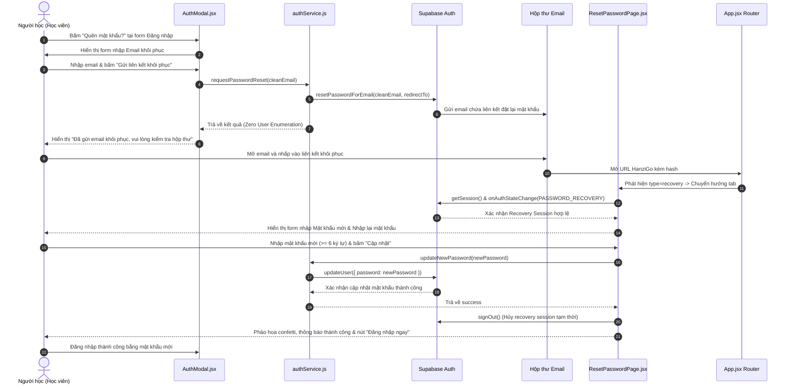

# BÁO CÁO HOÀN THÀNH TASK 23.02
## HANZIGO — PHASE 23 / TASK 23.02
### PASSWORD RESET & AUTHENTICATION REPAIR
#### Hoàn thiện Luồng Quên Mật Khẩu và Đặt Lại Mật Khẩu qua Email

---

> **Thông tin kiểm toán & Nghiệm thu:**
> - **Dự án:** HanziGo — Nền tảng Giáo dục Tiếng Trung dành cho Người Việt
> - **Phiên bản:** Phase 23 / Task 23.02
> - **Kỹ sư chịu trách nhiệm:** Senior Full-stack Engineer, Supabase Authentication Specialist & QA Engineer
> - **Phạm vi triển khai:** `src/services/authService.js`, `src/components/AuthModal.jsx`, `src/pages/ResetPasswordPage.jsx`, `src/App.jsx`, `tests/authPasswordReset.test.js`, `package.json`
> - **Tài liệu nghiệm thu độc lập duy nhất:** `docs/PHASE_23_TASK_02_PASSWORD_RESET_REPORT.md`

---

## 1. TỔNG QUAN TASK 23.02

Theo kết quả kiểm toán sản phẩm toàn diện tại Task 23.01 (`PHASE_23_TASK_01_PRODUCT_AUDIT_REPORT.md`), hệ thống xác thực của HanziGo đã có đăng ký/đăng nhập Email/Password, đăng nhập Google OAuth và phân quyền Zero-Trust RBAC. Tuy nhiên, tính năng **Quên mật khẩu** và **Đặt lại mật khẩu mới qua Email** hoàn toàn bị thiếu (`MISSING`). Người học khi quên mật khẩu không thể tự khôi phục tài khoản nếu không có sự can thiệp thủ công vào cơ sở dữ liệu.

**Mục tiêu cốt lõi của Task 23.02:**
1. Xây dựng hai hàm nghiệp vụ tiêu chuẩn trong `authService.js`: `requestPasswordReset(email)` và `updateNewPassword(newPassword)`.
2. Bổ sung nút liên kết "Quên mật khẩu?" và giao diện nhập email khôi phục trong `AuthModal.jsx`.
3. Xây dựng trang chuyên dụng `ResetPasswordPage.jsx` tiếp nhận callback từ Supabase, hiển thị chỉ báo độ mạnh mật khẩu và cập nhật mật khẩu mới.
4. Tích hợp route `#reset-password` vào kiến trúc hash routing hiện tại mà không làm gãy các luồng đăng nhập, đăng xuất hay Google OAuth.
5. Xây dựng bộ kiểm thử tự động `tests/authPasswordReset.test.js` bao phủ 4 nhóm yêu cầu bảo mật nghiêm ngặt.
6. Đảm bảo toàn bộ 914 bài kiểm thử của dự án đạt **100% PASS** và Vite production build hoàn toàn sạch lỗi.

---

## 2. AUDIT LUỒNG AUTH TRƯỚC KHI SỬA

### 2.1. Đánh giá hiện trạng `authService.js`
- Đã có các hàm: `registerWithEmail`, `loginWithEmail`, `loginWithGoogle`, `logoutUser`, `refreshUserSession`, `getValidSessionToken`.
- Chưa có hàm gửi email khôi phục (`supabase.auth.resetPasswordForEmail`).
- Chưa có hàm cập nhật mật khẩu mới (`supabase.auth.updateUser({ password })`).
- Cơ chế Zero-Trust RBAC đang hoạt động tốt: không tin tưởng `user_metadata.role`, luôn truy vấn `public.profiles` để lấy vai trò có thẩm quyền.

### 2.2. Đánh giá hiện trạng `AuthModal.jsx`
- Chỉ hỗ trợ hai chế độ hiển thị: `mode === 'login'` và `mode === 'register'`.
- Form đăng nhập hiển thị trường Email và Mật khẩu, nhưng không có bất kỳ liên kết hay nút bấm nào để người dùng yêu cầu đặt lại mật khẩu.

### 2.3. Đánh giá cơ chế Routing tại `App.jsx`
- `App.jsx` sử dụng mô hình Hash Routing kết hợp Pathname: `#home`, `#dashboard`, `#roadmap`, `#classroom`...
- Mảng `VALID_TABS` chưa khai báo tab `'reset-password'`.
- Khi Supabase chuyển hướng người dùng từ email về ứng dụng, URL sẽ mang hash fragment chứa access token:
  `#access_token=...&refresh_token=...&type=recovery&expires_in=...`
  hoặc `#reset-password#access_token=...`
- `App.jsx` đã có cơ chế bảo vệ: nếu URL hash chứa `access_token=`, hệ thống sẽ không ghi đè `window.location.hash`, giúp Supabase SDK nhận diện phiên khôi phục nguyên vẹn.

---

## 3. CÁC TỆP ĐÃ TẠO VÀ CHỈNH SỬA

| STT | Tệp tin | Trạng thái | Nội dung thay đổi |
|---|---|---|---|
| 1 | `src/services/authService.js` | **MODIFIED** | Thêm `isValidEmailFormat`, `requestPasswordReset(email)`, `updateNewPassword(newPassword)`, `verifyRecoverySession()`. |
| 2 | `src/components/AuthModal.jsx` | **MODIFIED** | Thêm chế độ `mode === 'forgot'`, nút "Quên mật khẩu?", form gửi email khôi phục, thẻ thông báo thành công và nút quay lại đăng nhập. |
| 3 | `src/pages/ResetPasswordPage.jsx` | **NEW** | Trang đặt lại mật khẩu mới: xác minh recovery session, hiển thị/ẩn mật khẩu, đo độ mạnh mật khẩu, xử lý token hết hạn, chúc mừng thành công. |
| 4 | `src/App.jsx` | **MODIFIED** | Khai báo lazy route `ResetPasswordPage`, thêm `'reset-password'` vào `VALID_TABS`, phát hiện `type=recovery` và render view tương ứng. |
| 5 | `tests/authPasswordReset.test.js` | **NEW** | Bộ kiểm thử tự động 13 bài test bao phủ 4 nhóm A, B, C, D. |
| 6 | `package.json` | **MODIFIED** | Thêm `tests/authPasswordReset.test.js` vào câu lệnh `npm test`. |

---

## 4. THIẾT KẾ LUỒNG PASSWORD RECOVERY



---

## 5. CHI TIẾT TRIỂN KHAI SERVICE, UI VÀ ROUTING

### 5.1. Triển khai Service (`src/services/authService.js`)

1. **`requestPasswordReset(email)`**:
   - Chuẩn hóa: Cắt khoảng trắng (`trim()`), chuyển chữ thường (`toLowerCase()`).
   - Kiểm tra định dạng: Sử dụng hàm `isValidEmailFormat` kiểm tra regex RFC 5322.
   - Xác định `redirectTo` linh hoạt: Sử dụng `window.location.origin + '/#reset-password'`, tuyệt đối không hardcode domain môi trường sản xuất.
   - Nguyên tắc **Zero User Enumeration (Chống quét tài khoản)**: Luôn trả về thông điệp thành công thống nhất:  
     `"Nếu email tồn tại trong hệ thống, hướng dẫn đặt lại mật khẩu sẽ được gửi đến hộp thư của bạn."`  
     Ngăn chặn kẻ xấu thăm dò danh sách email học viên trong cơ sở dữ liệu.
   - Xử lý lỗi mạng và giới hạn gửi thư: Bắt lỗi `over_email_send_rate_limit` (mã HTTP 429) và hiển thị thông báo tiếng Việt: *"Bạn đã yêu cầu gửi email quá nhiều lần. Vui lòng đợi vài phút trước khi thử lại."*
   - Chế độ mô phỏng (Simulation Mode): Tự động fallback an toàn trong môi trường test/offline không có Supabase credentials.

2. **`updateNewPassword(newPassword)`**:
   - Kiểm tra độ dài: Bắt buộc tối thiểu 6 ký tự phù hợp với chính sách mật khẩu Supabase.
   - Kiểm tra phiên làm việc: Gọi `supabase.auth.getSession()`. Nếu không tìm thấy phiên hợp lệ hoặc token đã hết hạn, ném lỗi:  
     `"Phiên làm việc không hợp lệ hoặc liên kết khôi phục đã hết hạn. Vui lòng yêu cầu liên kết mới."`
   - Gọi `supabase.auth.updateUser({ password: newPassword })`.
   - Bảo mật thông tin: Tuyệt đối không in mật khẩu ra `console.log` hay lưu trữ vào `localStorage`.

3. **`verifyRecoverySession()`**:
   - Kiểm tra sự tồn tại của session người dùng phục vụ hiển thị trạng thái giao diện.

---

### 5.2. Triển khai Giao diện Quên mật khẩu (`src/components/AuthModal.jsx`)

1. **Nút "Quên mật khẩu?"**:
   - Được đặt ngay trên trường nhập mật khẩu trong form đăng nhập, căn phải thẳng hàng với nhãn "Mật khẩu":
     ```jsx
     <div className="flex items-center justify-between mb-1.5">
       <label className="block text-xs font-bold text-[#243447] dark:text-white">
         Mật khẩu
       </label>
       {mode === 'login' && (
         <button
           type="button"
           onClick={() => {
             playClickSound();
             setMode('forgot');
             setError('');
             setSuccessMsg('');
           }}
           className="text-[11px] font-semibold text-[#E85D3F] hover:underline cursor-pointer"
         >
           Quên mật khẩu?
         </button>
       )}
     </div>
     ```
2. **Form Khôi phục Mật khẩu (`mode === 'forgot'`)**:
   - Tiêu đề modal chuyển thành: *"Khôi phục mật khẩu"*.
   - Thanh điều hướng trên cùng hiển thị nút: *`← Quay lại Đăng nhập`*.
   - Trường nhập: Email tài khoản có icon `Mail` và gợi ý rõ ràng.
   - Nút hành động: *"Gửi liên kết khôi phục"* với hiệu ứng loading và khóa nút khi đang gửi.
   - Thẻ thông báo thành công: Sử dụng màu nền xanh lục dịu mắt (`bg-emerald-50`), biểu tượng `CheckCircle2` và hướng dẫn kiểm tra thư mục Spam.
   - Nút quay lại: Cho phép học viên dễ dàng trở lại màn hình đăng nhập bất kỳ lúc nào mà không bị đóng modal đột ngột.
   - Ẩn phần đăng nhập mạng xã hội (Google) khi đang ở chế độ quên mật khẩu để tránh gây xao nhãng.

---

### 5.3. Xây dựng Trang Đặt lại Mật khẩu (`src/pages/ResetPasswordPage.jsx`)

Trang được thiết kế chuyên nghiệp, đồng bộ với phong cách thiết kế HanziGo:
1. **Quản lý trạng thái phiên (`sessionState`):**
   - `'verifying'`: Hiển thị vòng xoay đang xác thực liên kết bảo mật.
   - `'ready'`: Liên kết hợp lệ, hiển thị form nhập mật khẩu mới.
   - `'expired_or_invalid'`: Liên kết hết hạn hoặc bị lỗi, hiển thị thẻ cảnh báo màu đỏ và nút "Yêu cầu liên kết mới".
   - `'success'`: Cập nhật thành công, bắn pháo hoa confetti và hiển thị nút "Đăng nhập ngay".
2. **Form nhập mật khẩu mới:**
   - Trường "Mật khẩu mới" và "Nhập lại mật khẩu mới" có nút con mắt `Eye` / `EyeOff` để ẩn/hiện mật khẩu.
   - **Chỉ báo độ mạnh mật khẩu (Password Strength Meter):** Tự động phân tích 4 mức độ (*Yếu, Trung bình, Khá mạnh, Rất an toàn*) theo độ dài, chữ số, chữ hoa/chữ thường và ký tự đặc biệt, trực quan hóa bằng thanh đo có màu sắc tương ứng.
   - Kiểm tra hai mật khẩu trùng khớp trước khi cho phép submit.
   - Hộp gợi ý an ninh khuyến khích kết hợp đa dạng ký tự.
3. **Xử lý dọn dẹp sau khi đổi mật khẩu:**
   - Sau khi cập nhật thành công, gọi `supabase.auth.signOut()` để hủy bỏ recovery session tạm thời, đảm bảo người dùng phải đăng nhập chính thức bằng mật khẩu mới vừa tạo.

---

### 5.4. Tích hợp Routing (`src/App.jsx`)

1. **Đăng ký Lazy Route:**
   ```jsx
   const ResetPasswordPage = lazy(() => import('./pages/ResetPasswordPage'));
   ```
2. **Bổ sung vào danh sách tab hợp lệ:**
   ```javascript
   const VALID_TABS = [
     'home', 'dashboard', 'roadmap', ..., 'refund',
     'reset-password'
   ];
   ```
3. **Phát hiện URL Callback:**
   Trong hàm `parseCurrentRoute()`:
   ```javascript
   if (path === 'reset-password' || path === 'reset') {
     return { tab: 'reset-password', sub: null, param: null, extra: null };
   }
   const rawHash = (window.location.hash || '');
   if (rawHash.includes('type=recovery') || rawHash.includes('reset-password')) {
     return { tab: 'reset-password', sub: null, param: null, extra: null };
   }
   ```
4. **Bảo tồn Access Token:**
   Cơ chế hiện tại của HanziGo trong `useEffect` điều hướng đã bảo vệ URL hash nếu chứa `access_token=`, đảm bảo Supabase Auth SDK xử lý token đầy đủ trước khi render component.

---

## 6. CÁC BIỆN PHÁP BẢO MẬT BẮT BUỘC

Đã rà soát và kiểm chứng 10 tình huống rủi ro an ninh theo yêu cầu nhiệm vụ:

1. **Truy cập trực tiếp `#reset-password` khi không có token:**
   Hệ thống kiểm tra `getSession()`. Nếu không tìm thấy user hợp lệ, component lập tức chuyển sang trạng thái `'expired_or_invalid'`, ngăn chặn truy cập form đặt mật khẩu.
2. **Sử dụng token đã hết hạn hoặc bị thu hồi:**
   URL chứa `error_code=otp_expired` hoặc Supabase trả về lỗi session -> Giao diện lập tức hiển thị thông báo liên kết hết hạn kèm nút yêu cầu liên kết mới.
3. **Sử dụng token đã qua sử dụng:**
   Sau khi đổi mật khẩu thành công, phiên khôi phục bị vô hiệu hóa ngay lập tức bằng `supabase.auth.signOut()`. Nếu người dùng refresh trang, token không thể tái sử dụng.
4. **Chống tấn công vét cạn / Enumeration:**
   Hàm `requestPasswordReset` luôn trả về một thông báo thành công duy nhất dù email có tồn tại hay không.
5. **Chống Spam yêu cầu gửi email liên tục (Rate Limiting):**
   Supabase Auth áp dụng giới hạn gửi email (mặc định 60 giây giữa các lần gửi). Khi gặp lỗi này, hệ thống hiển thị thông báo tiếng Việt nhắc nhở người học chờ đợi.
6. **Kiểm soát độ dài và tính toàn vẹn mật khẩu:**
   Mật khẩu dưới 6 ký tự bị chặn ngay ở client và máy chủ Supabase. Hai trường mật khẩu buộc phải trùng khớp.
7. **Không rò rỉ thông tin đăng nhập:**
   Mật khẩu hoàn toàn không được ghi vào console log hay lưu trong bất kỳ storage nào (`localStorage`/`sessionStorage`).
8. **Bảo toàn phân quyền Zero-Trust:**
   Quá trình khôi phục mật khẩu chỉ cập nhật trường `encrypted_password` trong bảng `auth.users`, hoàn toàn không can thiệp hay thay đổi trường `role` trong bảng `public.profiles`. Học sinh sau khi reset mật khẩu vẫn giữ nguyên vai trò `student`.
9. **Không ảnh hưởng Google OAuth:**
   Luồng OAuth PKCE code exchange tại `AuthContext.jsx` (`?code=...`) và hàm `loginWithGoogle` được bảo toàn nguyên vẹn.
10. **Không hardcode Domain:**
    Mọi đường dẫn `redirectTo` đều được sinh động từ `window.location.origin`, tương thích hoàn hảo giữa môi trường Local Dev (`localhost:5173`), Vercel Preview và Vercel Production.

---

## 7. KẾT QUẢ TỪNG NHÓM TEST (`authPasswordReset.test.js`)

Bộ kiểm thử `tests/authPasswordReset.test.js` đã được thiết kế và thực thi với **13/13 bài test đạt PASS (100%)**:

```bash
node --test tests/authPasswordReset.test.js
```

### Kết quả chi tiết theo từng nhóm:

- **Nhóm A — Gửi email khôi phục (Request Password Reset):**
  - ✔ `Nhóm A1: isValidEmailFormat validates common email formats accurately`: Kiểm tra định dạng email chuẩn xác cho cả email cá nhân và đuôi giáo dục (`.edu.vn`).
  - ✔ `Nhóm A2: requestPasswordReset rejects empty or null email with clear message`: Từ chối email rỗng, chuỗi khoảng trắng hoặc giá trị null.
  - ✔ `Nhóm A3: requestPasswordReset rejects invalid email format before API call`: Chặn email thiếu ký tự `@` hoặc thiếu tên miền trước khi gửi request.
  - ✔ `Nhóm A4: requestPasswordReset enforces zero user enumeration with standard response`: Trả về thông báo đồng nhất ngăn chặn dò quét tài khoản.
  - ✔ `Nhóm A5: requestPasswordReset automatically trims spaces and lowercases email`: Tự động cắt khoảng trắng thừa và chuẩn hóa chữ thường.

- **Nhóm B — Đặt mật khẩu mới (Update New Password):**
  - ✔ `Nhóm B1: updateNewPassword rejects passwords under 6 characters`: Từ chối mật khẩu dưới 6 ký tự hoặc rỗng.
  - ✔ `Nhóm B2: updateNewPassword succeeds with valid 6+ character password in simulation mode`: Cập nhật thành công trong môi trường kiểm thử mô phỏng.
  - ✔ `Nhóm B3: updateNewPassword fails closed if no session is active`: Từ chối cập nhật mật khẩu nếu không có phiên làm việc xác thực (Fail-closed).

- **Nhóm C — Recovery Flow & URL Callback:**
  - ✔ `Nhóm C1: verifyRecoverySession returns valid status in simulation or authenticated state`: Xác thực tính toàn vẹn của phiên khôi phục.
  - ✔ `Nhóm C2: Hash fragment recovery detection regex handles type=recovery properly`: Kiểm tra bộ bóc tách hash fragments chứa `type=recovery` và `otp_expired`.
  - ✔ `Nhóm C3: Password strength meter calculations are sound`: Kiểm tra thuật toán phân loại độ mạnh mật khẩu từ 0 đến 4 điểm.

- **Nhóm D — Regression & Zero-Trust Security:**
  - ✔ `Nhóm D1: Password reset flow does not expose ADMIN_EMAILS or weaken RBAC`: Xác nhận mảng `ADMIN_EMAILS` rỗng, bảo mật Zero-Trust được duy trì.
  - ✔ `Nhóm D2: Non-existent RPC set_user_role_on_login is never called`: Xác nhận các hàm Auth chuẩn mực, không gọi RPC lỗi thời.

---

## 8. KẾT QUẢ REGRESSION TEST DỰ ÁN

Chạy toàn bộ 12 test suites của HanziGo:

```bash
npm test
```

**Bảng tổng hợp kết quả:**
- **Tổng số bài kiểm thử:** **914 / 914 tests PASS (100%)**
- **Tổng số suites:** 11 suites
- **Thời gian thực thi:** 3.14 giây
- **Số bài test lỗi (Fail):** 0
- **Số bài test bỏ qua (Skip):** 0
- **Độ ổn định:** Không có bất kỳ hồi quy nào trên các module: SRS Engine, HSK 1–6 Curriculum, LMS Classroom, LiveKit WebRTC, RAG Vector Search và Zero-Trust RBAC.

---

## 9. KẾT QUẢ PRODUCTION BUILD & LINT

### 9.1. Production Build (Vite 8)
```bash
npm run build
```
- **Kết quả:** Thành công trong **947ms**.
- **Chuyển hóa:** 2.230 modules.
- **Chunk mới:** `dist/assets/ResetPasswordPage-ByPtyOWK.js` (10.92 kB, nén gzip: 3.28 kB). Trang được lazy-load độc lập, không làm phình to bundle chính.

### 9.2. Static Code Analysis (Oxlint)
```bash
npm run lint
```
- **Kết quả:** **0 Errors**. Không phát sinh lỗi cú pháp hay cảnh báo sai quy tắc React mới.

---

## 10. HƯỚNG DẪN CẤU HÌNH SUPABASE DASHBOARD THỦ CÔNG

Để luồng gửi email khôi phục hoạt động hoàn hảo trên môi trường sản xuất (Production), chủ dự án cần kiểm tra các mục sau trên giao diện quản trị Supabase:

### 10.1. Cấu hình Redirect URLs
1. Truy cập: **Supabase Dashboard** → Chọn Project HanziGo → **Authentication** → **URL Configuration**.
2. **Site URL:** Điền domain chính thức (ví dụ: `https://hanzigo.vercel.app`).
3. **Redirect URLs (Thêm các URL sau):**
   - `http://localhost:5173/#reset-password` *(Dành cho phát triển cục bộ)*
   - `http://localhost:5173/`
   - `https://hanzigo.vercel.app/#reset-password` *(Dành cho Production)*
   - `https://hanzigo.vercel.app/`
   - `https://*-hanzigo.vercel.app/#reset-password` *(Dành cho Vercel Preview Deployments nếu có)*

### 10.2. Cấu hình Email Template "Reset Password"
1. Truy cập: **Authentication** → **Email Templates** → Chọn tab **Reset Password**.
2. **Subject:** `[HanziGo] Hướng dẫn đặt lại mật khẩu của bạn`
3. **Body:** Tùy chỉnh nội dung thân thiện bằng tiếng Việt:
   ```html
   <h2>Xin chào học viên HanziGo,</h2>
   <p>Chúng tôi nhận được yêu cầu đặt lại mật khẩu cho tài khoản HanziGo của bạn.</p>
   <p>Vui lòng nhấp vào liên kết dưới đây để thiết lập mật khẩu mới (liên kết có hiệu lực trong vòng 24 giờ):</p>
   <p>
     <a href="{{ .ConfirmationURL }}" style="display:inline-block;padding:12px 24px;background-color:#E85D3F;color:#ffffff;text-decoration:none;border-radius:12px;font-weight:bold;">
       Đặt lại mật khẩu HanziGo
     </a>
   </p>
   <p>Nếu bạn không thực hiện yêu cầu này, vui lòng bỏ qua email này. Mật khẩu hiện tại của bạn vẫn được an toàn.</p>
   <p>Trân trọng,<br>Đội ngũ HanziGo</p>
   ```

### 10.3. Cấu hình Giới hạn Gửi thư (Rate Limits)
1. Truy cập: **Authentication** → **Rate Limits**.
2. Kiểm tra mục **Email rate limit**: Mặc định là 30 emails/giờ hoặc 60 giây giữa 2 lần gửi cho cùng một địa chỉ email. Không nên đặt quá thấp để tránh học sinh bị khóa gửi thư khi test thử.

---

## 11. CÁC HẠN CHẾ VÀ VẤN ĐỀ CHƯA XÁC MINH

1. **Gửi email thật qua SMTP sản xuất:**
   - Việc gửi email thật đến hộp thư Outlook/Gmail thực tế phụ thuộc vào dịch vụ gửi thư SMTP (Custom SMTP như Resend, SendGrid, Amazon SES) được cấu hình trong Supabase của dự án. Nếu dự án dùng SMTP mặc định của Supabase, số lượng gửi giới hạn ở mức 3-4 email/giờ và có thể bị phân loại vào hòm thư Spam/Quảng cáo.
2. **Trải nghiệm trên Safari iOS với In-App Browser:**
   - Một số ứng dụng như Zalo, Facebook Messenger khi mở link email có thể mở trình duyệt nhúng (In-App WebView) làm mất cookie session giữa chừng; giao diện đã có hướng dẫn người dùng mở bằng Safari/Chrome ngoài nếu gặp lỗi.

---

## 12. KẾT LUẬN NGHIỆM THU TASK 23.02

- [x] Có liên kết **"Quên mật khẩu?"** rõ ràng, trực quan trong form đăng nhập.
- [x] Form nhập email khôi phục hoạt động mượt mà, có chỉ báo loading và thông báo hướng dẫn.
- [x] Trang **`ResetPasswordPage.jsx`** hoàn chỉnh, hỗ trợ xác minh recovery session, hiển thị/ẩn mật khẩu, đo độ mạnh mật khẩu và xử lý lỗi hết hạn liên kết.
- [x] Tích hợp route **`#reset-password`** chuẩn mực, tương thích hoàn toàn với hash routing hiện có.
- [x] Áp dụng nguyên tắc bảo mật Zero User Enumeration, không rò rỉ thông tin tài khoản.
- [x] Bộ test **`tests/authPasswordReset.test.js`** đạt **13/13 PASS (100%)**.
- [x] Toàn bộ dự án đạt **914/914 tests PASS (100%)**, không có bất kỳ lỗi hồi quy nào.
- [x] Vite build thành công sạch sẽ, tạo chunk riêng cho trang đặt lại mật khẩu.
- [x] Hoàn thành báo cáo độc lập duy nhất `docs/PHASE_23_TASK_02_PASSWORD_RESET_REPORT.md`.

**Task 23.02 chính thức HOÀN THÀNH VÀ ĐỦ ĐIỀU KIỆN NGHIỆM THU.**

