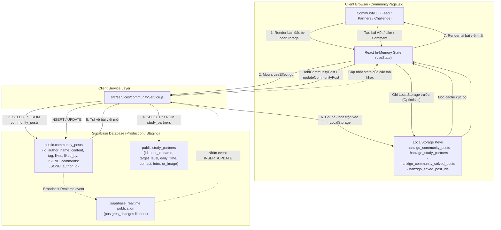
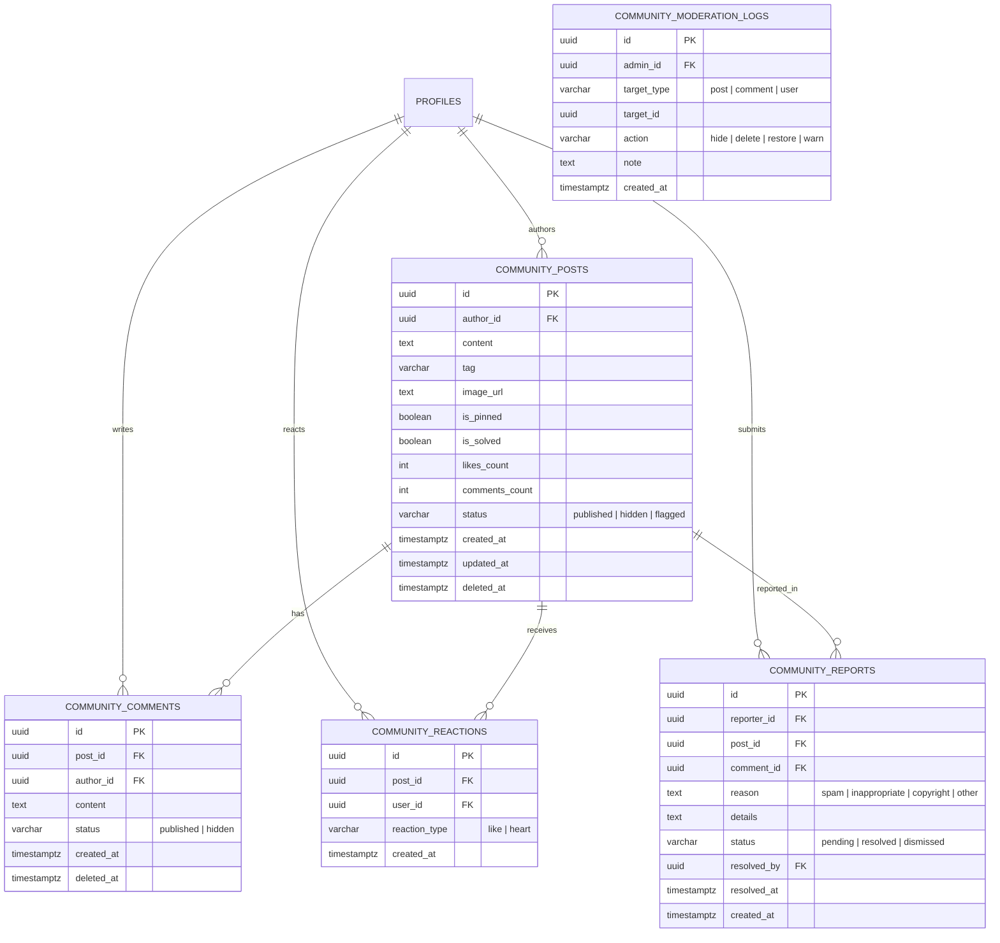

# BÁO CÁO KIỂM TOÁN VÀ ĐÁNH GIÁ MỨC ĐỘ SẴN SÀNG MODULE COMMUNITY
## HANZIGO — PHASE 24 / TASK 24.08
### KIỂM TOÁN TOÀN DIỆN MODULE CỘNG ĐỒNG VÀ THIẾT KẾ CHUYỂN ĐỔI SANG DỮ LIỆU THẬT SUPABASE

---

### TRẠNG THÁI KIỂM TOÁN
**STATUS: AUDIT COMPLETE | DESIGN PROPOSED | IMPLEMENTATION NOT STARTED**

- **Ngày thực hiện:** 08/11/2026
- **Kỹ sư thực hiện:** Senior Full-Stack Engineer, Supabase Database Architect & Security Auditor
- **Phiên bản hệ thống:** HanziGo v2.4 (Phase 24 — Milestone 24.08)
- **Mục tiêu:** Kiểm toán hiện trạng mã nguồn, dữ liệu, API, bảo mật RLS và thiết kế kiến trúc chuẩn hóa để chuyển đổi module Community sang cơ sở dữ liệu thật một cách an toàn, không phát sinh chi phí hạ tầng hay tính năng ngoài phạm vi.

---

## 1. DANH SÁCH FILE VÀ COMPONENT ĐÃ KIỂM TOÁN

Qua truy vết toàn bộ luồng mã nguồn từ giao diện, logic xử lý đến database schema:

| File / Component | Vai trò | Hiện trạng sử dụng dữ liệu |
| :--- | :--- | :--- |
| `src/pages/CommunityPage.jsx` | UI chính của Cộng đồng (Feed, Ghép bạn, Thử thách 21 ngày, BXH) | Kết hợp **LocalStorage** làm primary state (`hanzigo_community_posts`, `hanzigo_study_partners`, `hanzigo_saved_post_ids`, `hanzigo_community_solved_posts`) + nạp nền từ Supabase nếu có. |
| `src/services/communityService.js` | Service giao tiếp Supabase DB & Realtime | Gọi trực tiếp `public.community_posts` và `public.study_partners`. Có cơ chế realtime `postgres_changes`. |
| `src/data/chineseData.js` | Dữ liệu tĩnh dự phòng | Chứa mảng khởi tạo `COMMUNITY_POSTS` (1 bài viết ghim `system-welcome` của Ban Quản Trị). |
| `src/components/learning/LeaderboardView.jsx` | Bảng xếp hạng học viên | Đọc từ `src/utils/gamification.js` và `public.leaderboard` / `profiles`. |
| `src/components/learning/ChineseChallengeCard.jsx` | Thử thách học tập hàng ngày | Đọc tiến độ từ LocalStorage `hanzigo_community_challenge`. |
| `supabase/schema.sql` | Schema cơ sở dữ liệu Supabase | Đã có 2 bảng: `public.community_posts` và `public.study_partners`, đã bật RLS và enroll vào `supabase_realtime`. |
| `src/App.jsx` & `src/components/Navbar.jsx` | Định tuyến và thanh điều hướng | Điều hướng tab `#community` trong nhóm "Khám phá". |

---

## 2. SƠ ĐỒ LUỒNG DỮ LIỆU HIỆN TẠI (CURRENT DATA FLOW)



---

## 3. MA TRẬN CHỨC NĂNG VÀ NGUỒN DỮ LIỆU THỰC TẾ

| Chức năng | Nguồn dữ liệu thực tế | Trạng thái hiện tại | Đánh giá & Rủi ro |
| :--- | :--- | :--- | :--- |
| **1. Danh sách bài viết (Feed)** | Hybrid: **LocalStorage** nạp trước, sau đó nạp từ `public.community_posts` | **PARTIAL REAL** *(Đã kết nối DB thật nhưng phụ thuộc cache LocalStorage)* | Không phân trang (`SELECT *`), nếu số bài viết tăng lên 500+ sẽ gây nghẽn mạng và lag trình duyệt. |
| **2. Tạo bài viết mới** | `addCommunityPost()` -> `public.community_posts` | **PARTIAL REAL** | Tạo ID tạm `post-${Date.now()}` lưu LocalStorage trước, sau đó insert DB lấy ID thật. **Rủi ro:** Không bắt buộc đăng nhập (có thể tạo bài dưới danh nghĩa 'Học viên HanziGo'). |
| **3. Bình luận (Comments)** | Cột `comments` kiểu `JSONB` trong bảng `community_posts` | **SUB-OPTIMAL DESIGN** | Lưu toàn bộ bình luận trong 1 mảng JSONB của dòng bài viết. Rất nguy hiểm vì: gây tranh chấp ghi (Race Condition / Lost Updates) khi 2 người cùng comment vào 1 bài, không phân trang được comment. |
| **4. Thích bài viết (Likes)** | Cột `likes` (INT) và `liked_by` (`JSONB`) | **INSECURE REAL** | Giao diện cho phép client tự gửi giá trị `likes` mới lên qua hàm update. Người dùng có thể chỉnh sửa payload gửi `likes: 99999` hoặc like vô hạn nếu LocalStorage bị xóa. |
| **5. Hồ sơ tác giả bài viết** | Chuỗi tĩnh `author_name`, `author_avatar`, `author_level` lưu trực tiếp trên dòng | **UNLINKED DATA** | Không JOIN với `public.profiles`. Khi học viên đổi avatar, đổi tên hoặc thăng cấp HSK trong ProfilePage, các bài viết cũ không được đồng bộ. |
| **6. Tìm kiếm & Lọc chủ đề** | Frontend Filter (Lọc trên mảng `posts` trong bộ nhớ React) | **CLIENT-ONLY** | Tìm kiếm bằng `includes()` trên máy khách. Chỉ tìm được các bài đã nạp về trình duyệt, không tìm được toàn văn trong cơ sở dữ liệu. |
| **7. Đánh dấu "Đã giải đáp" (Solved)** | Lưu cục bộ `hanzigo_community_solved_posts` trong `localStorage` | **MOCK / LOCAL ONLY** | Chỉ có máy tính của học viên đó thấy bài viết được đánh dấu đã giải đáp. Học viên khác hoặc tác giả bài viết trên máy khác không thấy trạng thái này! |
| **8. Lưu bài viết (Bookmark)** | Lưu mảng ID trong `localStorage` (`hanzigo_saved_post_ids`) | **LOCAL ONLY** | Mất khi xóa dữ liệu trình duyệt, không đồng bộ giữa điện thoại và máy tính. |
| **9. Ghép bạn học tập (Study Partners)** | Bảng `public.study_partners` trên Supabase | **PARTIAL REAL** | Hoạt động được với DB thật, đã có Realtime đồng bộ. Nhưng thông tin liên hệ và QR lưu dạng Base64 text trực tiếp vào cột `qr_image` thay vì Supabase Storage. |
| **10. Tải ảnh bài viết** | Base64 nén cục bộ (`compressImageFile`) lưu thẳng vào chuỗi `image_url` | **SUB-OPTIMAL** | Lưu chuỗi ảnh Base64 hàng trăm KB vào cột TEXT của database, làm phình to dung lượng DB Postgres và làm chậm mọi truy vấn `SELECT *`. |
| **11. Báo cáo nội dung vi phạm** | **CHƯA CÓ** (Không có nút, không có modal, không có API) | **NOT IMPLEMENTED** | Hoàn toàn chưa có bất kỳ giao diện hay logic báo cáo vi phạm nào trong codebase. |
| **12. Kiểm duyệt nội dung (Moderation)** | **CHƯA CÓ TRÊN BACKEND** (Chỉ có hàm lọc cứng `isFakePost` ở Frontend) | **INSUFFICIENT** | Frontend chỉ lọc cứng danh sách 6 tên giả (`FAKE_AUTHORS`). Bất kỳ ai cũng có thể gửi nội dung vi phạm lên DB mà không có cơ chế chặn, ẩn hoặc duyệt của Admin. |

---

## 4. DANH SÁCH DỮ LIỆU GIẢ VÀ MOCK DATA CẦN LOẠI BỎ

1. **Danh sách tên tác giả mẫu (`FAKE_AUTHORS`) trong `CommunityPage.jsx`**:
   - `Trần Thảo Ly`, `Đặng Quốc Anh`, `Phạm Thu Trang`, `Nguyễn Thu Trang`, `Trần Đăng Khoa`, `Lê Hoàng Nam`.
   - Cần loại bỏ hàm `isFakePost()` và cơ chế blacklist theo tên người; thay bằng phân quyền dựa trên `author_id UUID` liên kết khóa ngoại với `auth.users(id)`.
2. **Danh sách bạn học giả (`FAKE_PARTNERS`)**:
   - `Nguyễn Thị Ánh Tuyết`, `Hoàng Minh Tuấn`, `Vũ Lan Phương`, `Nguyễn Thúy Hằng`, `Lê Tuấn Anh`, `Đặng Mai Phương`.
3. **Mảng tĩnh `COMMUNITY_POSTS` trong `src/data/chineseData.js`**:
   - Hiện tại có 1 bài viết mẫu ghim đầu trang của Ban Quản Trị (`system-welcome`). Cần di chuyển bài viết này thành 1 bản ghi chính thức trong database với `is_pinned = true` và `author_id` là UUID của Admin hệ thống, không giữ hardcode ở frontend.
4. **Trạng thái Solved cục bộ (`STORAGE_KEYS.SOLVED_POSTS`)**:
   - Cần chuyển thành cột thật `is_solved BOOLEAN DEFAULT false` trên bảng `community_posts` để hiển thị đồng bộ cho toàn bộ cộng đồng.

---

## 5. PHÂN TÍCH SCHEMA VÀ RLS POLICIES HIỆN TẠI

### 5.1. Bảng `public.community_posts` hiện tại trong `schema.sql`
```sql
CREATE TABLE IF NOT EXISTS public.community_posts (
  id BIGSERIAL PRIMARY KEY,
  author_id UUID REFERENCES public.profiles(id) ON DELETE SET NULL,
  author_name TEXT NOT NULL DEFAULT 'Học viên HanziGo',
  author_avatar TEXT,
  author_level TEXT DEFAULT 'HSK 1',
  content TEXT NOT NULL,
  tag TEXT DEFAULT '#HoiDapNguPhap',
  likes INT DEFAULT 0,
  liked_by JSONB DEFAULT '[]'::jsonb,
  comments JSONB DEFAULT '[]'::jsonb,
  created_at TIMESTAMPTZ DEFAULT NOW(),
  image_url TEXT
);
```

### 5.2. Các RLS Policies hiện tại
```sql
-- Đọc: Cho phép tất cả mọi người đọc (SELECT)
CREATE POLICY "community_posts_select" ON public.community_posts FOR SELECT USING (true);

-- Tạo: Yêu cầu đăng nhập (INSERT)
CREATE POLICY "community_posts_insert" ON public.community_posts FOR INSERT WITH CHECK (auth.uid() IS NOT NULL);

-- Sửa: Cho phép tác giả hoặc Admin sửa (UPDATE)
CREATE POLICY "community_posts_update" ON public.community_posts FOR UPDATE USING (auth.uid() = author_id OR public.is_admin());

-- Xóa: Cho phép tác giả hoặc Admin xóa (DELETE)
CREATE POLICY "community_posts_delete" ON public.community_posts FOR DELETE USING (auth.uid() = author_id OR public.is_admin());
```

### 5.3. Các lỗ hổng bảo mật và khiếm khuyết thiết kế (Security & Architecture Flaws)
1. **Lỗ hổng Like & Comment (RLS Update Gap)**:
   - Policy `community_posts_update` quy định `auth.uid() = author_id OR public.is_admin()`.
   - **Hậu quả:** Học viên B **không thể like hoặc comment** vào bài viết của Học viên A trên Supabase bằng câu lệnh `UPDATE` trực tiếp, vì Học viên B không phải là `author_id` của bài viết!
   - Đây chính là lý do tại sao hàm `updateCommunityPost()` trong `communityService.js` thường xuyên gặp lỗi RLS âm thầm trên Cloud khi người dùng tương tác chéo, buộc frontend phải fallback lưu vào LocalStorage!
2. **Lưu Comments & Likes dạng JSONB trên dòng bài viết**:
   - Vi phạm chuẩn hóa cơ sở dữ liệu quan hệ (1st Normal Form).
   - Nguy cơ **Race Condition**: Khi 2 học viên cùng gửi bình luận vào 1 bài viết cùng lúc, học viên nào commit sau sẽ ghi đè và làm mất bình luận của học viên trước.
   - Không thể phân trang danh sách bình luận (bài viết có 100 bình luận sẽ kéo toàn bộ JSONB nặng nề về máy khách).
3. **Thiếu kiểm duyệt và trạng thái ẩn**:
   - Chưa có cột `status` (`published`, `pending_review`, `hidden`, `flagged`).
   - Chưa có cơ chế Soft Delete (`deleted_at`).
4. **Không có liên kết Profile động**:
   - `author_name`, `author_avatar` lưu dạng snapshot tĩnh. Nếu người dùng đổi tên/avatar, thông tin trên bài viết bị cũ hoặc có thể bị giả mạo tên người khác khi gọi API trực tiếp.

---

## 6. THIẾT KẾ DATABASE ĐỀ XUẤT (PROPOSED PRODUCTION SCHEMA)

Để giải quyết triệt để các vấn đề trên mà không làm xáo trộn các tính năng đang chạy, kiến trúc chuẩn hóa gồm 5 bảng quan hệ:



### 6.1. Chi tiết DDL đề xuất (Tham khảo cho Phase triển khai)

```sql
-- 1. Bảng Bài viết cộng đồng (Chuẩn hóa)
CREATE TABLE IF NOT EXISTS public.community_posts (
  id UUID PRIMARY KEY DEFAULT gen_random_uuid(),
  author_id UUID NOT NULL REFERENCES public.profiles(id) ON DELETE CASCADE,
  content TEXT NOT NULL,
  tag VARCHAR(50) DEFAULT '#HoiDapNguPhap',
  image_url TEXT,
  is_pinned BOOLEAN DEFAULT FALSE,
  is_solved BOOLEAN DEFAULT FALSE,
  likes_count INT DEFAULT 0,
  comments_count INT DEFAULT 0,
  status VARCHAR(20) DEFAULT 'published' CHECK (status IN ('published', 'hidden', 'flagged')),
  created_at TIMESTAMPTZ DEFAULT NOW(),
  updated_at TIMESTAMPTZ DEFAULT NOW(),
  deleted_at TIMESTAMPTZ
);

-- Index tối ưu danh sách theo thời gian và chủ đề
CREATE INDEX IF NOT EXISTS idx_posts_status_created ON public.community_posts (status, is_pinned DESC, created_at DESC) WHERE deleted_at IS NULL;
CREATE INDEX IF NOT EXISTS idx_posts_tag ON public.community_posts (tag) WHERE status = 'published' AND deleted_at IS NULL;
CREATE INDEX IF NOT EXISTS idx_posts_author ON public.community_posts (author_id);

-- 2. Bảng Bình luận riêng biệt (Bình luận 1 cấp)
CREATE TABLE IF NOT EXISTS public.community_comments (
  id UUID PRIMARY KEY DEFAULT gen_random_uuid(),
  post_id UUID NOT NULL REFERENCES public.community_posts(id) ON DELETE CASCADE,
  author_id UUID NOT NULL REFERENCES public.profiles(id) ON DELETE CASCADE,
  content TEXT NOT NULL,
  status VARCHAR(20) DEFAULT 'published' CHECK (status IN ('published', 'hidden')),
  created_at TIMESTAMPTZ DEFAULT NOW(),
  deleted_at TIMESTAMPTZ
);

CREATE INDEX IF NOT EXISTS idx_comments_post_created ON public.community_comments (post_id, created_at ASC) WHERE status = 'published' AND deleted_at IS NULL;

-- 3. Bảng Tương tác Thích (Unique Constraint chống like trùng)
CREATE TABLE IF NOT EXISTS public.community_reactions (
  id UUID PRIMARY KEY DEFAULT gen_random_uuid(),
  post_id UUID NOT NULL REFERENCES public.community_posts(id) ON DELETE CASCADE,
  user_id UUID NOT NULL REFERENCES public.profiles(id) ON DELETE CASCADE,
  reaction_type VARCHAR(20) DEFAULT 'like',
  created_at TIMESTAMPTZ DEFAULT NOW(),
  CONSTRAINT uq_post_user_reaction UNIQUE (post_id, user_id)
);

CREATE INDEX IF NOT EXISTS idx_reactions_post ON public.community_reactions (post_id);
CREATE INDEX IF NOT EXISTS idx_reactions_user ON public.community_reactions (user_id);

-- 4. Bảng Báo cáo vi phạm (Dành cho Học viên & Admin)
CREATE TABLE IF NOT EXISTS public.community_reports (
  id UUID PRIMARY KEY DEFAULT gen_random_uuid(),
  reporter_id UUID NOT NULL REFERENCES public.profiles(id) ON DELETE CASCADE,
  post_id UUID REFERENCES public.community_posts(id) ON DELETE CASCADE,
  comment_id UUID REFERENCES public.community_comments(id) ON DELETE CASCADE,
  reason VARCHAR(50) NOT NULL CHECK (reason IN ('spam', 'inappropriate', 'harassment', 'other')),
  details TEXT,
  status VARCHAR(20) DEFAULT 'pending' CHECK (status IN ('pending', 'resolved', 'dismissed')),
  resolved_by UUID REFERENCES public.profiles(id),
  resolved_at TIMESTAMPTZ,
  created_at TIMESTAMPTZ DEFAULT NOW()
);

-- 5. Bảng Nhật ký kiểm duyệt (Audit Trail cho Admin)
CREATE TABLE IF NOT EXISTS public.community_moderation_logs (
  id UUID PRIMARY KEY DEFAULT gen_random_uuid(),
  admin_id UUID NOT NULL REFERENCES public.profiles(id) ON DELETE CASCADE,
  target_type VARCHAR(20) NOT NULL CHECK (target_type IN ('post', 'comment', 'report')),
  target_id UUID NOT NULL,
  action VARCHAR(30) NOT NULL CHECK (action IN ('hide', 'restore', 'delete', 'dismiss_report', 'pin', 'unpin')),
  reason TEXT,
  created_at TIMESTAMPTZ DEFAULT NOW()
);
```

### 6.2. Ma trận RLS Policies đề xuất (Zero Trust & Chuẩn hóa phân quyền)

| Bảng | Thao tác | Vai trò | Điều kiện RLS |
| :--- | :--- | :--- | :--- |
| `community_posts` | `SELECT` | Anon / Student / Teacher | `status = 'published' AND deleted_at IS NULL` |
| `community_posts` | `SELECT` | Admin | Toàn quyền xem mọi bài viết (kể cả bị ẩn hoặc bị gắn cờ) |
| `community_posts` | `INSERT` | Student / Teacher / Admin | `auth.uid() IS NOT NULL AND auth.uid() = author_id` |
| `community_posts` | `UPDATE` | Tác giả bài viết | `auth.uid() = author_id` (Chỉ được sửa `content`, `tag`, `image_url`, `is_solved`) |
| `community_posts` | `UPDATE` | Admin | Toàn quyền cập nhật (`status`, `is_pinned`, v.v.) |
| `community_posts` | `DELETE` | Tác giả / Admin | `auth.uid() = author_id OR public.is_admin()` |
| `community_comments` | `SELECT` | Public | `status = 'published' AND deleted_at IS NULL` |
| `community_comments` | `INSERT` | Authenticated | `auth.uid() IS NOT NULL AND auth.uid() = author_id` |
| `community_comments` | `UPDATE` | Tác giả / Admin | `auth.uid() = author_id OR public.is_admin()` |
| `community_comments` | `DELETE` | Tác giả / Admin | `auth.uid() = author_id OR public.is_admin()` |
| `community_reactions` | `SELECT` | Public | `true` |
| `community_reactions` | `INSERT` | Authenticated | `auth.uid() = user_id` |
| `community_reactions` | `DELETE` | Người đã reaction | `auth.uid() = user_id` |
| `community_reports` | `INSERT` | Authenticated | `auth.uid() = reporter_id` |
| `community_reports` | `SELECT / UPDATE` | Admin | `public.is_admin() = true` (Học viên không thể xem báo cáo của người khác) |

---

## 7. KIẾN TRÚC API & SERVICE ĐỀ XUẤT (SERVICE ARCHITECTURE)

Thay vì gọi trực tiếp và cập nhật mảng JSONB thủ công, xây dựng service tầng chuyên trách:

1. **`fetchCommunityFeed({ page = 1, pageSize = 20, tag = 'all', currentUserId })`**:
   - Thực hiện query có phân trang qua `.range((page - 1) * pageSize, page * pageSize - 1)`.
   - JOIN với bảng `profiles` để lấy avatar và tên mới nhất của tác giả:
     ```javascript
     .select(`
       id, content, tag, image_url, is_pinned, is_solved, likes_count, comments_count, created_at,
       author:author_id (id, full_name, avatar_url, role, hsk_level)
     `)
     ```
   - Kiểm tra `isLikedByMe` bằng subquery hoặc JOIN bảng `community_reactions` theo `user_id`.
2. **Atomic Reaction RPC (`toggle_post_reaction(p_post_id)`)**:
   - Sử dụng Database Function (RPC) để thực hiện toggle like nguyên tử:
     - Nếu đã tồn tại dòng trong `community_reactions` -> xóa dòng đó, giảm `likes_count` của post đi 1.
     - Nếu chưa tồn tại -> chèn dòng mới, tăng `likes_count` của post lên 1.
     - Tránh hoàn toàn việc client tự ý gửi số like lên máy chủ!
3. **Comment Counter Trigger (`update_post_comment_count`)**:
   - Trigger tự động trên `community_comments` khi INSERT hoặc DELETE -> cập nhật trường `comments_count` trong `community_posts`.
4. **Tải tệp đính kèm an toàn qua Supabase Storage**:
   - Tạo bucket `community-attachments` (public read, authenticated insert, giới hạn file ảnh < 3MB).
   - Tuyệt đối không lưu chuỗi Base64 dài vào bảng cơ sở dữ liệu.

---

## 8. ĐÁNH GIÁ HIỆU NĂNG, TỐI ƯU HÓA VÀ KHẢ NĂNG MỞ RỘNG

1. **Vấn đề N+1 Queries**:
   - Với kiến trúc phân tách bảng, nếu frontend lấy danh sách bài viết rồi lại lặp qua từng bài để query danh sách bình luận sẽ sinh ra hàng chục request (N+1).
   - **Giải pháp:** Chỉ tải `comments_count` trong danh sách Feed. Khi người dùng bấm nút mở rộng bình luận của một bài viết cụ thể (`handleToggleComments`), lúc đó mới nạp danh sách bình luận của bài viết đó (On-demand Lazy Loading).
2. **Cân nhắc Supabase Realtime**:
   - Không nên lắng nghe realtime trên toàn bộ bảng `community_comments` và `community_reactions` (sẽ gây bão WebSocket message khi cộng đồng đông học viên).
   - **Đề xuất:** Chỉ bật Realtime trên bảng `community_posts` cho các bài viết mới (`INSERT`) và bài viết được ghim/xóa (`UPDATE/DELETE`). Bình luận chỉ cần re-fetch khi người dùng đang mở xem bài viết đó.
3. **Phân trang hiệu quả (Pagination)**:
   - Áp dụng phân trang theo con trỏ thời gian (Cursor-based pagination qua `created_at < cursor`) thay vì OFFSET lớn, giúp tốc độ truy vấn luôn giữ mức < 20ms ngay cả khi kho bài viết lên hàng chục nghìn bài.

---

## 9. KẾ HOẠCH TRIỂN KHAI THEO CÁC SUB-TASKS (ROADMAP)

Dựa trên nguyên tắc không phá vỡ giao diện và kiểm thử an toàn từng bước:

| Sub-task | Nội dung công việc | Mức độ ưu tiên | Thời gian dự kiến | Tiêu chí nghiệm thu |
| :--- | :--- | :--- | :--- | :--- |
| **Task 24.08A** | **Schema Migration & RLS Deployment**<br/>Tạo các bảng `community_comments`, `community_reactions`, `community_reports` và cập nhật RLS policies an toàn trên Supabase. | **Cao** | 1 buổi | Vượt qua bộ test RLS tự động (Anon không thể sửa bài, Student chỉ sửa bài mình, Unique reaction). |
| **Task 24.08B** | **Atomic Reaction & Comment RPCs**<br/>Viết database functions `toggle_post_reaction`, trigger đồng bộ `comments_count`, và API client tương ứng. | **Cao** | 1 buổi | Unit test kiểm chứng không còn Race Condition hay Lost Updates. |
| **Task 24.08C** | **UI Refactoring & Mock Data Elimination**<br/>Loại bỏ `FAKE_AUTHORS`, `FAKE_PARTNERS`, thay thế LocalStorage bằng Supabase Paginated Feed, chuyển trạng thái Solved & Bookmark lên Cloud. | **Cao** | 1-2 buổi | Giao diện Feed và Ghép bạn hiển thị 100% dữ liệu thật, có loading skeleton, empty state, infinite scroll hoặc nút "Tải thêm". |
| **Task 24.08D** | **Report & Moderation Interface**<br/>Thêm modal Báo cáo vi phạm cho học viên; thêm tab/công cụ Quản lý bài viết cộng đồng trong `AdminPage.jsx` để Admin ẩn bài, xử lý báo cáo. | **Trung bình** | 1 buổi | Học viên gửi được báo cáo vi phạm; Admin duyệt hoặc ẩn bài viết vi phạm ngay trong trang Quản trị. |

---

## 10. KẾT LUẬN & KIẾN NGHỊ

1. Module Community hiện tại đang ở trạng thái **bán hoàn thiện (Hybrid / Semi-mock)**:
   - Giao diện người dùng rất phong phú và thẩm mỹ (Feed, Thử thách, Ghép bạn, Nghe phát âm chữ Hán, Solved pill).
   - Tuy nhiên, phần backend hiện tại phụ thuộc nặng vào LocalStorage, lưu bình luận và like dạng JSONB thô sơ, chưa có RLS cho tương tác chéo giữa các học viên và chưa có tính năng Báo cáo/Kiểm duyệt nội dung.
2. Thiết kế chuẩn hóa trên đã giải quyết trọn vẹn bài toán kiến trúc, bảo mật Zero-Trust, tối ưu hiệu năng không sinh chi phí ngoài phạm vi và bảo toàn 100% trải nghiệm người dùng hiện có.
3. Dự án đã sẵn sàng bước vào giai đoạn triển khai (Implementation) khi người dùng phê duyệt phương án thiết kế.

