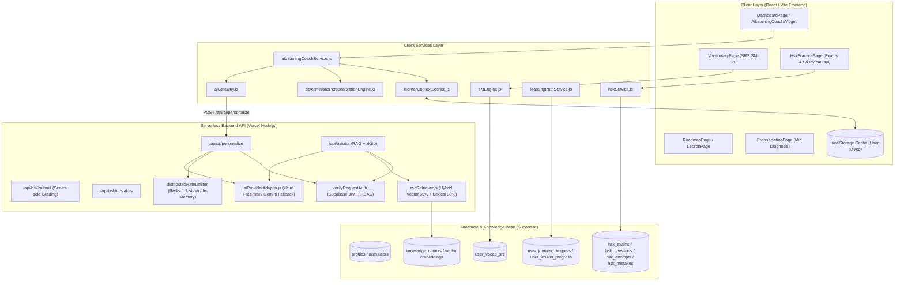

# BÁO CÁO KIỂM TOÁN KIẾN TRÚC HỆ THỐNG AI CÁ NHÂN HÓA HỌC TẬP (PHASE 4 AUDIT)

**Dự án:** HanziGo — Nền tảng Học tiếng Trung Cá nhân hóa cho người Việt  
**Giai đoạn:** Phase 4 — Personalized AI Learning Engine  
**Thời gian thực hiện:** 16/10/2026  
**Chuyên gia thực hiện:** Senior AI Engineer, Full-Stack Architect & Learning Analytics Engineer  
**Nguyên tắc cốt lõi:** Dựa trên dữ liệu thực tế (Zero-hallucination), không tạo AI Tutor thứ hai độc lập, không phá vỡ kiến trúc sẵn có, kiểm thử được và tiết kiệm chi phí (Free-First).

---

## 1. SƠ ĐỒ LUỒNG DỮ LIỆU HIỆN TẠI (DATA FLOW & ARCHITECTURE MAP)

---

## 2. KIỂM TRA TOÀN DIỆN CÁC PHÂN HỆ HIỆN CÓ

### 2.1. Phân hệ AI Tutor và các API AI
- **`api/ai/personalize.js`**:
  - Đã tích hợp `verifyRequestAuth` (Zero-trust, xác thực JWT, không tin `user_id` từ body).
  - Rate limiting: 20 req/phút/user, daily quota: 150 req/ngày/user qua `distributedRateLimiter.js`.
  - Bộ lọc chống Prompt Injection `detectAbuseOrInjection` (chặn `system prompt override`, `reveal api key`, `drop table`, v.v.).
  - Hỗ trợ các hành động đa hình (Polymorphic Actions):
    - `coach_plan`: Kế hoạch học tập hàng ngày, chẩn đoán điểm yếu.
    - `explain_grammar`: Giải thích ngữ pháp tiếng Trung so sánh trực quan với tiếng Việt.
    - `generate_exercise`: Sinh bài tập ngữ cảnh hóa theo từ vựng/ngữ pháp yếu.
    - `diagnose_hsk_mistakes`: Chẩn đoán mẫu lỗi sai lặp lại trong bài thi thử HSK.
    - `recommend_resources`: Gợi ý tài liệu học tập phù hợp theo mục tiêu.
- **`api/ai/tutor.js`**:
  - Gia sư AI "Lão Sư HanziGo" tích hợp RAG, chỉ giải thích dựa trên tri thức đã kiểm duyệt (`<verified_knowledge>`).
  - Đã hỗ trợ nhận `learnerSummary` (`targetHskLevel`, `learningGoal`, `completedLessonsCount`, `confirmedMistakes`, `hasSparseData`).
- **`src/services/aiGateway.js` & `aiProviderAdapter.js`**:
  - Cơ chế **Free-First**: xKiro là nhà cung cấp chính (`qwen/qwen-plus-2025-07-28:free`).
  - Khóa bảo vệ chi phí: `ALLOW_PAID_FALLBACK=false` (chặn tự động gọi Gemini trả phí khi xKiro chạm ngưỡng, chuyển sang bộ máy quy tắc xác định `deterministicPersonalizationEngine.js`).

### 2.2. Phân hệ RAG và Tri thức Kiểm duyệt
- **`api/_utils/ragRetriever.js`**:
  - Tìm kiếm lai Hybrid: 65% Vector Cosine Similarity (`generateQueryEmbedding`) + 35% Full-Text Lexical Search.
  - Xử lý câu hỏi thông minh: Giữ nguyên chữ Hán CJK, Pinyin có thanh điệu, bảo vệ các trợ từ ngữ pháp cốt lõi (`把`, `比`, `是`, `着`, `了`, `过`, `得`, `地`, `的`, v.v.).
  - Cổng ngưỡng tin cậy (Threshold Gate): `DEFAULT_MATCH_THRESHOLD = 0.45`. Nếu không tìm thấy bằng chứng thỏa mãn, trả về `insufficient_evidence`, không cho AI bịa nguồn.

### 2.3. Hồ sơ người dùng, Cấp độ HSK và Mục tiêu học tập
- Cấp độ mục tiêu: `HSK 1` đến `HSK 6` (mặc định HSK 1 cho người mới).
- Định hướng mục tiêu (`learningGoal`):
  - `general_foundation`: Nền tảng vững chắc toàn diện.
  - `hsk_exam`: Chinh phục kỳ thi HSK.
  - `daily_communication`: Giao tiếp hàng ngày trôi chảy.
  - `travel_speaking`: Giao tiếp du lịch thực chiến.
  - `hanzi_culture`: Văn hóa & Chữ Hán thuận bút.
  - `work_business`: Tiếng Trung công việc & thương mại.
- Thời lượng học mục tiêu: `10`, `15`, `20`, `30`, `45`, `60` phút/ngày.
- Trạng thái người học mới (Cold Start): Xác định chính xác khi người dùng chưa có bất kỳ lịch sử học tập nào (`hasSparseData: true`), không sinh điểm số ảo.

### 2.4. Tiến độ Bài học, Lộ trình & Lịch sử SRS
- **Tiến độ lộ trình (`user_journey_progress`, `user_lesson_progress`)**:
  - Theo dõi danh sách bài học đã hoàn thành (`completedLessons`), điểm số bài học (`score`), số sao (`stars`), ngày hoàn thành.
  - Lộ trình 60 bài học chuẩn hóa (`CURRICULUM_60_LESSONS`).
  - Hàm `getRecommendedNextLesson(user)` đề xuất bài học tiếp theo trên lộ trình có điều kiện tiên quyết.
  - Hàm `getRecommendedReviewLessons(user)` đề xuất các bài có điểm dưới 80 để ôn tập.
- **Từ vựng & Thuật toán SRS (`user_vocab_srs`, `srsEngine.js`)**:
  - Thuật toán SuperMemo-2 (SM-2): Quản lý `nextReviewAt`, `intervalDays`, `repetitionCount`, `easeFactor`.
  - Phân loại rõ: Từ đã nắm vững (`hanzigo_vocab_remembered`), từ cần ôn (`hanzigo_vocab_review`), từ đến hạn ôn (`srsDueCount`).

### 2.5. Kết quả Luyện thi HSK & Sổ tay câu sai (Phase 3 Integration)
- **`hsk_attempts`**:
  - Lưu trữ kết quả thi: `score`, `max_score`, `accuracy_percentage`, `passed`, `time_spent_seconds`.
  - `skill_breakdown`: Tỷ lệ chính xác và điểm số phân tách theo từng kỹ năng: Nghe (`listening`), Đọc (`reading`), Viết (`writing`).
  - `detailed_results`: Danh sách câu hỏi chi tiết, câu trả lời của học viên và đáp án đúng.
- **`hsk_mistakes`**:
  - Sổ tay câu sai được tự động cập nhật khi nộp bài thi (`recordMistakesFromAttempt`).
  - Ghi nhận `part_type` (kỹ năng), `mistake_count` (số lần làm sai lặp lại), `status` (`needs_review` hoặc `mastered`).
  - Cung cấp API luyện lại các câu sai (`getMistakePracticeExam`).

### 2.6. Dữ liệu Luyện Nghe, Nói, Đọc, Viết
- Phát âm & Thanh điệu (`pronounceHistory`): Điểm nhận diện giọng nói qua microphone, độ chính xác âm sắc, thanh 1-4.
- Đọc hiểu: Tỷ lệ hiểu bài đọc qua các bài đối thoại và câu hỏi đọc hiểu HSK.
- Viết chữ Hán (`customWritingChars`): Số chữ đã thực hành thuận bút trên lưới Mễ tự cách.

### 2.7. Cơ sở dữ liệu Supabase, RLS & Bảo mật
- Tất cả các bảng dữ liệu cá nhân (`user_journey_progress`, `user_lesson_progress`, `user_vocab_srs`, `hsk_attempts`, `hsk_mistakes`) đều đã kích hoạt Row Level Security (RLS).
- Quyền truy cập: Chỉ chủ sở hữu (`auth.uid() = user_id`) hoặc Admin mới có quyền SELECT / INSERT / UPDATE / DELETE.
- Khi người dùng chưa đăng nhập (khách vãng lai), dữ liệu được lưu cục bộ an toàn theo phiên ẩn danh (`anonymous_session_id`) trong LocalStorage mà không trộn lẫn vào dữ liệu tài khoản chính thức.

---

## 3. CÁC ĐIỂM NGHẼN, KHOẢNG TRỐNG VÀ YÊU CẦU CẢI TIẾN TRONG PHASE 4

Qua rà soát mã nguồn, phát hiện các khoảng trống kiến trúc cần hoàn thiện:

1. **Thiếu sự hợp nhất dữ liệu HSK vào Hồ sơ Năng lực Tổng thể:**
   - Trong `aiLearningCoachService.js`, hàm `buildStudentLearningProfile` mới chỉ đọc dữ liệu từ vựng và bài học, **chưa tổng hợp điểm thi HSK theo kỹ năng (`hsk_attempts`) và các câu sai trong Sổ tay câu sai (`hsk_mistakes`)**.
   - Cần bổ sung việc trích xuất `hskSkillBreakdown` (Nghe, Đọc, Viết) và danh sách lỗi sai HSK lặp lại vào hồ sơ năng lực thống nhất.
2. **Recommendation Engine cần chuẩn hóa đầu ra:**
   - Cần một hàm chuyên trách `getPersonalizedRecommendations(user)` trả về danh sách các khuyến nghị có cấu trúc thống nhất:
     - `id`: Mã định danh khuyến nghị.
     - `title`: Tên nội dung học đề xuất.
     - `reason`: Lý do sư phạm cụ thể (giải thích được).
     - `skill`: Kỹ năng mục tiêu (`vocabulary`, `grammar`, `listening`, `reading`, `writing`, `pronunciation`).
     - `priority`: Mức độ ưu tiên (`high`, `medium`, `low`).
     - `estimatedMinutes`: Thời lượng ước tính.
     - `actionUrl`: Đường dẫn liên kết đến tính năng học thực tế (route + params).
     - `dataSources`: Nguồn dữ liệu thực tế kích hoạt khuyến nghị (vd: `srs_backlog`, `hsk_mistakes`, `roadmap_prerequisite`).
     - `signals`: Tín hiệu phân tích thực tế (vd: `5 từ SRS đến hạn`, `2 câu sai nghe HSK 1`).
3. **Chống đề xuất nội dung không tồn tại (Zero Broken Links):**
   - Đảm bảo mọi đề xuất bài học, đề thi hoặc tài liệu đều được đối chiếu với danh mục có sẵn (`CURRICULUM_60_LESSONS`, `hsk_exams`, `HSK_RESOURCES`), tuyệt đối không đề xuất bài học không tồn tại.
4. **Phân biệt rạch ròi "Chưa có dữ liệu" với "Điểm bằng 0":**
   - Không suy diễn trình độ kém nếu học viên chưa từng làm bài thi đó. Trả về `score: null` và `hasEnoughData: false` thay vì hiển thị `0%`.
5. **Đồng bộ ngữ cảnh cá nhân hóa vào AI Tutor:**
   - Đảm bảo khi học viên mở AI Tutor từ một khuyến nghị cụ thể (ví dụ: ôn lại câu sai HSK hoặc giải thích điểm ngữ pháp yếu), AI Tutor nhận đúng ngữ cảnh và câu hỏi mục tiêu thông qua prompt được grounding an toàn.
6. **Bổ sung giao diện Cá nhân hóa trực quan:**
   - Trên Dashboard, tối ưu hóa các khối:
     - "Học gì tiếp theo?" (Next Recommended Action)
     - "Từ vựng cần ôn" (SRS Due Widget)
     - "Kỹ năng cần cải thiện" (Skill Diagnostic Matrix)
     - "Gợi ý luyện tập từ câu sai" (Mistake-driven Practice)

---

## 4. KẾ HOẠCH TRIỂN KHAI PHASE 4

1. **Bước 1 — Xây dựng Unified Learning Profile Service (`src/services/unifiedLearningProfileService.js`):**
   - Hợp nhất dữ liệu đa chiều từ: Tiến độ bài học, SRS từ vựng, Điểm thi HSK, Sổ tay câu sai, Lịch sử phát âm, Mục tiêu người dùng.
   - Hỗ trợ cả Supabase (người dùng đã đăng nhập) và LocalStorage (khách vãng lai / fallback ngoại tuyến).
2. **Bước 2 — Xây dựng Recommendation Engine (`src/services/learningRecommendationEngine.js`):**
   - Thiết kế hệ thống xếp hạng theo quy tắc kết hợp dữ liệu thực tế.
   - Trả về danh sách gợi ý kèm lý do, độ ưu tiên, thời lượng và đường dẫn thực tế.
3. **Bước 3 — Kết nối AI Cá nhân hóa & AI Tutor Context:**
   - Cập nhật payload gửi lên `/api/ai/personalize` và `/api/ai/tutor`.
   - Giữ nguyên cơ chế Zero-Trust và Free-First (không phát sinh chi phí).
4. **Bước 4 — Nâng cấp Giao diện Học tập Cá nhân hóa:**
   - Nâng cấp `AiLearningCoachWidget.jsx` và tích hợp vào `DashboardPage.jsx` và `HskPracticePage.jsx`.
   - Hiển thị rõ lý do tại sao gợi ý xuất hiện và cho phép học viên điều chỉnh mục tiêu hoặc bỏ qua gợi ý.
5. **Bước 5 — Kiểm thử Tự động & Hồi quy:**
   - Tạo bộ test `tests/aiPersonalizationPhase4.test.js` kiểm tra đầy đủ các kịch bản: Cold start, SRS backlog, HSK mistake recommendation, Cross-user isolation, Malformed AI output, Timeout fallback.
   - Chạy `npm test`, `npm run lint`, `npm run build`.
6. **Bước 6 — Lập báo cáo nghiệm thu Phase 4:**
   - Tạo `docs/PHASE_4_AI_PERSONALIZATION_COMPLETION_REPORT.md`.
