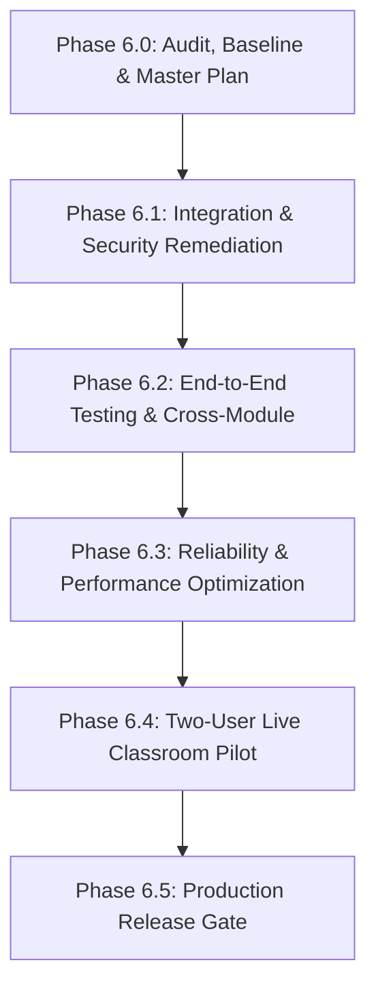

# HANZIGO — PHASE 6.0: KẾ HOẠCH TỔNG THỂ & LỘ TRÌNH TRIỂN KHAI
(MASTER PLAN & ROADMAP)

> **Dự án**: HanziGo — Nền tảng học tiếng Trung chuyên sâu dành cho người Việt  
> **Repository**: [https://github.com/haidang1603/Hanzigo](https://github.com/haidang1603/Hanzigo)  
> **Production Target**: [https://hanzigo-xi.vercel.app/](https://hanzigo-xi.vercel.app/)  
> **Vai trò**: Senior Software Architect & Technical Lead  
> **Thời điểm xác lập**: Ngày 16 tháng 10 năm 2026  
> **Tính chất tài liệu**: Lộ trình chiến lược, định hướng kỹ thuật theo thứ tự ưu tiên bằng chứng, có tiêu chí nghiệm thu định lượng (Acceptance Criteria) và cổng an toàn (Safety Gates).

---

## 1. BẢN ĐỒ RỦI RO & MA TRẬN ƯU TIÊN (RISK MATRIX & PRIORITIZATION)

Tuân thủ nguyên tắc: **Không phát triển tính năng mới khi nền tảng an ninh, dữ liệu và phân quyền chưa ổn định**. Danh sách vấn đề được sắp xếp theo mức độ ưu tiên giảm dần:

```
[ƯU TIÊN 1: AN NINH & TOÀN VẸN DỮ LIỆU]
  ├── SEC-01: Lỗ hổng RPC atomic_join_live_session nhận p_user_id không ràng buộc auth.uid() (High)
  ├── SEC-02: Bảng hsk_questions mở quyền SELECT lộ đáp án cho học viên (High)
  ├── SEC-03: Chính sách RLS cho phép khách vãng lai đọc chéo dữ liệu hsk_attempts/mistakes (High)
  └── SEC-05: LiveKit token generator fallback secret giả trong production nếu thiếu env (Medium)

[ƯU TIÊN 2: LUỒNG HỌC TẬP & PHÂN QUYỀN CHUẨN XÁC]
  ├── HSK Frontend chưa kết nối serverless submitHandler (vẫn chấm điểm client-side)
  ├── vercel.json thiếu rewrite rule cho /api/hsk/:action
  └── Đăng ký tài khoản cho phép người dùng tự cấp role = 'teacher' (SEC-04)

[ƯU TIÊN 3: ĐỒNG BỘ MÃ NGUỒN & HẠ TẦNG LIÊN MODULE]
  └── Đồng bộ khoảng cách giữa Local Workspace (45 modified files, 30 untracked files) và Production Git

[ƯU TIÊN 4: ĐỘ ỔN ĐỊNH, ĐỘ TIN CẬY & OBSERVABILITY]
  ├── Xử lý 467 cảnh báo React 19 (set-state-in-effect) tối ưu hóa rendering
  └── Tối ưu code-splitting các chunks dữ liệu giáo trình lớn (> 600 kB)

[ƯU TIÊN 5: THỬ NGHIỆM THỰC TẾ TRÊN THIẾT BỊ VẬT LÝ]
  └── Pilot 2 người (1 Giáo viên + 1 Học viên) trên LiveKit Cloud SFU
```

---

## 2. LỘ TRÌNH TRIỂN KHAI CÁC GIAI ĐOẠN TIẾP THEO (PHASED MASTER PLAN)



---

### GIAI ĐOẠN 6.1: XỬ LÝ AN NINH & TÍCH HỢP HỆ THỐNG
*(System Integration & Security Remediation)*

- **Mục tiêu**: Khắc phục triệt để các lỗ hổng bảo mật đã phát hiện trong Phase 6.0 (SEC-01 đến SEC-06), hoàn thiện định tuyến Vercel cho HSK, chuyển đổi luồng chấm điểm HSK sang authoritative server-side, và chuẩn bị bộ thay đổi sạch sẽ để commit lên Git.
- **Phạm vi công việc**:
  1. **Vá SEC-01 (RPC Live Session)**:
     - Cập nhật hàm `atomic_join_live_session` trong SQL migration: Ràng buộc `IF auth.role() = 'authenticated' AND auth.uid() != p_user_id THEN RAISE EXCEPTION 'Không thể thao tác thay người khác'; END IF;` hoặc chỉ `GRANT EXECUTE TO service_role`.
  2. **Vá SEC-02 & SEC-03 (HSK RLS & Khách vãng lai)**:
     - Sửa policy bảng `hsk_questions`: Chỉ cho phép `service_role` và `is_admin()` SELECT trực tiếp bảng gốc. Người học chỉ được đọc qua `v_hsk_questions_public`.
     - Siết RLS `hsk_attempts` và `hsk_mistakes`: Bỏ điều kiện mở cho anonymous; khách vãng lai chỉ lưu trữ cục bộ tại localStorage hoặc chỉ được INSERT mà không thể SELECT chéo của người khác.
  3. **Vá SEC-05 (LiveKit Token Fail-Closed)**:
     - Tại `api/_webrtc/livekit-token.js`: Nếu `isProd && (!process.env.LIVEKIT_API_KEY || !process.env.LIVEKIT_API_SECRET)`, từ chối với HTTP 503 ngay lập tức thay vì ký token giả bằng `'devkey'`.
  4. **Tích hợp HSK Backend**:
     - Bổ sung rewrite rule vào `vercel.json`:
       ```json
       {
         "source": "/api/hsk/:action",
         "destination": "/api/hsk/[action]?action=:action"
       }
       ```
     - Cập nhật [src/services/hskService.js](file:///d:/DELL/Dowloads/HanziGo/src/services/hskService.js) để hàm nộp bài `submitExam` gọi trực tiếp `POST /api/hsk/submit` có xác thực, đảm bảo chấm điểm và lưu kết quả diễn ra hoàn toàn trên máy chủ.
  5. **Vá SEC-04 (Teacher Registration Gate)**:
     - Tại `src/services/authService.js`: Khi đăng ký qua form công khai, chuẩn hóa role mặc định là `student`. Muốn nâng cấp lên `teacher` phải thông qua quản trị viên hoặc nhập mã mời của tổ chức.
- **Các file dự kiến thay đổi**:
  - `supabase/migrations/20261016_phase5_live_classroom_schema.sql` (hoặc tạo migration bổ sung `20261017_security_patch_phase6_1.sql`)
  - `supabase/migrations/20261016_phase3_hsk_exam_center.sql`
  - `vercel.json`
  - `api/_webrtc/livekit-token.js`
  - `src/services/hskService.js`
  - `src/services/authService.js`
  - `tests/liveClassroomPhase5Reliability.test.js`
  - `tests/hskExamCenterPhase3.test.js`
- **Phụ thuộc**: Quyền tạo migration SQL mới và sửa file code.
- **Rủi ro**: Thay đổi RLS có thể ảnh hưởng đến các truy vấn đọc câu hỏi nếu frontend còn chỗ gọi trực tiếp bảng gốc thay vì view.
- **Điều kiện nghiệm thu (Acceptance Criteria)**:
  - Tất cả 525 unit/integration tests hiện tại tiếp tục PASS 100%.
  - Thêm mới tối thiểu 5 automated tests kiểm tra các kịch bản vá lỗi SEC-01 đến SEC-06.
  - Endpoint `/api/hsk/submit` trả về kết quả chấm điểm server-side chuẩn xác.
- **Những việc KHÔNG ĐƯỢC làm**: Chưa chạy SQL trực tiếp trên Production Supabase; chưa push code lên remote `main`.

---

### GIAI ĐOẠN 6.2: KIỂM THỬ E2E TOÀN TRÌNH & ĐỐI SOÁT LIÊN MODULE
*(End-to-End Testing & Cross-Module Verification)*

- **Mục tiêu**: Kiểm tra tính liên thông thực tế giữa các module học tập, đảm bảo dữ liệu di chuyển mượt mà giữa các tính năng mà không bị đứt gãy luồng người dùng.
- **Phạm vi công việc**:
  1. **Luồng Học tập - Luyện tập - Từ vựng**:
     - Học bài mới trên Roadmap $\to$ Nhận XP $\to$ Từ vựng trong bài được tự động thêm vào SRS $\to$ Kiểm tra flashcard hiển thị đúng chu kỳ ôn tập.
  2. **Luồng Luyện thi HSK - Sổ tay lỗi sai - Gia sư AI**:
     - Làm đề thi HSK $\to$ Câu trả lời sai được lưu vào `hsk_mistakes` $\to$ Mở AI Tutor: Lão Sư HanziGo nhận diện đúng lỗi sai đã xác nhận và đưa ra lời khuyên ôn tập tương ứng.
  3. **Luồng Giáo viên - Lớp học - Học viên**:
     - Giáo viên tạo lớp $\to$ Học viên tham gia bằng mã lớp $\to$ Giáo viên giao bài tập $\to$ Học viên nộp bài $\to$ Giáo viên chấm bài $\to$ Học viên nhận thông báo điểm và phản hồi.
- **Các file dự kiến thay đổi**:
  - `tests/featureIntegrationE2E.test.js`
  - `tests/liveClassroomWorkflowE2E.test.js`
  - Các helper tạo dữ liệu mẫu trong `tests/`
- **Điều kiện nghiệm thu**:
  - Kịch bản E2E kiểm tra toàn bộ 3 luồng trên đều pass tự động không lỗi.
  - Không có hiện tượng thất lạc dữ liệu hoặc sai lệch trạng thái điểm danh / XP.

---

### GIAI ĐOẠN 6.3: NÂNG CAO ĐỘ TIN CẬY, QUẢN LÝ LỖI & TỐI ƯU HIỆU NĂNG
*(Reliability, Observability & Performance Optimization)*

- **Mục tiêu**: Dọn dẹp các cảnh báo linter của React 19, tối ưu hóa kích thước bundle và hoàn thiện xử lý lỗi mạng / mất kết nối tạm thời.
- **Phạm vi công việc**:
  1. **Khắc phục 467 Linter Warnings**:
     - Rà soát và gỡ bỏ các import không sử dụng (`no-unused-vars`).
     - Tái cấu trúc các `useEffect` gọi `setState` trực tiếp tại [ClassroomPage.jsx](file:///d:/DELL/Dowloads/HanziGo/src/pages/ClassroomPage.jsx), [AdminPage.jsx](file:///d:/DELL/Dowloads/HanziGo/src/pages/AdminPage.jsx), [MaterialsPage.jsx](file:///d:/DELL/Dowloads/HanziGo/src/pages/MaterialsPage.jsx), [TeacherDashboardPage.jsx](file:///d:/DELL/Dowloads/HanziGo/src/pages/TeacherDashboardPage.jsx) sang pattern derive-state hoặc data fetching hook chuyên biệt.
  2. **Tối ưu Bundle Chunks**:
     - Tách dữ liệu giáo trình lớn (`data-curriculum-*.js`) bằng dynamic `import()`, chỉ nạp khi học viên mở cấp HSK tương ứng.
     - Giảm kích thước chunk tối đa xuống dưới 500 kB để loại bỏ cảnh báo của Vite Rolldown.
  3. **Khả năng Phục hồi Kết nối (Resilience)**:
     - Hoàn thiện xử lý reconnect tự động cho LiveKit và Supabase Realtime khi người dùng đổi mạng (Wifi $\leftrightarrow$ 4G).
- **Điều kiện nghiệm thu**:
  - `npm run lint` đạt: **0 errors, 0 warnings**.
  - `npm run build` đạt: **0 warning về chunk size > 600 kB**.
  - Tốc độ tải trang ban đầu (FCP) được cải thiện.

---

### GIAI ĐOẠN 6.4: TRIỂN KHAI PILOT 2 NGƯỜI CHO LIVE CLASSROOM
*(Two-User & Multi-User Live Classroom Pilot)*

- **Mục tiêu**: Thực hiện buổi học thử nghiệm thực tế đầu tiên giữa 1 Giáo viên và 1 Học viên trên 2 thiết bị vật lý thật kết nối LiveKit Cloud SFU.
- **Phạm vi công việc**:
  1. Kiểm tra môi trường trước buổi học theo [docs/PHASE_5_2_PILOT_READINESS.md](file:///d:/DELL/Dowloads/HanziGo/docs/PHASE_5_2_PILOT_READINESS.md).
  2. Thực hiện tuần tự 10 kịch bản trong [docs/PHASE_5_2_TWO_USER_TEST_CHECKLIST.md](file:///d:/DELL/Dowloads/HanziGo/docs/PHASE_5_2_TWO_USER_TEST_CHECKLIST.md):
     - Gia nhập phòng học & xác minh vai trò.
     - Kiểm tra luồng video & audio 2 chiều giữa 2 thiết bị.
     - Thử nghiệm chia sẻ màn hình giáo viên.
     - Thử nghiệm chu trình xin mic $\to$ cấp mic $\to$ phát biểu $\to$ thu hồi mic.
     - Thử nghiệm các bảng dạy học tương tác (Hanzi Stroke, Pinyin Tone, Grammar Board).
     - Thử nghiệm chat phòng học thời gian thực.
     - Thử nghiệm ngắt kết nối mạng tạm thời và khôi phục (Reconnect).
     - Thử nghiệm giáo viên kết thúc phiên học và giải phóng tài nguyên.
  3. **Tiêu chí Dừng Khẩn Cấp (Abort Criteria)**:
     - Lập tức dừng thử nghiệm nếu phát hiện bất kỳ dấu hiệu rò rỉ secret, học viên tự bật mic không xin phép, hoặc mất âm thanh kéo dài > 60s không tự phục hồi.
- **Bằng chứng cần thu thập**:
  - Biên bản kiểm thử có chữ ký xác nhận của Tester và Giáo viên tham gia.
  - Log độ trễ (RTT, Jitter) từ LiveKit Cloud Dashboard.
  - Ảnh chụp màn hình hoạt động tương tác trên 2 thiết bị.

---

### GIAI ĐOẠN 6.5: CỔNG AN TOÀN PHÁT HÀNH & TRIỂN KHAI PRODUCTION
*(Production Readiness & Release Gate)*

- **Mục tiêu**: Phát hành chính thức phiên bản hoàn chỉnh của HanziGo lên Production (`https://hanzigo-xi.vercel.app/`).
- **Quy trình triển khai nghiêm ngặt**:
  1. **Bước 1 — Xác nhận Cơ sở Dữ liệu**: Chạy migration an toàn trên Supabase Production (`woszblniatdvijwdkmpm.supabase.co`) và kiểm tra RLS.
  2. **Bước 2 — Cấu hình Biến môi trường**: Cập nhật đầy đủ các biến môi trường Production trên Vercel Project Settings (LiveKit credentials, Upstash Redis nếu có, khóa chi phí AI).
  3. **Bước 3 — Commit & Tag Release**:
     - Tạo git commit hợp nhất các thay đổi đã được kiểm chứng của Phase 1 đến Phase 6.3.
     - Tạo Git Tag (ví dụ: `v1.0.0-rc1`).
  4. **Bước 4 — Deploy & Smoke Test Production**:
     - Push lên GitHub `origin/main` để Vercel kích hoạt Production Build.
     - Thực hiện Smoke Test toàn diện trên Production URL: Đăng nhập Google, làm bài thi HSK, trò chuyện AI Tutor, vào phòng Live.
- **Tiêu chí nghiệm thu**: Toàn bộ hệ thống hoạt động ổn định trên domain thật, không có lỗi runtime trên Vercel logs.

---

## 3. CÁC QUY TẮC BẢO VỆ DỰ ÁN (PROJECT SAFETY CONSTRAINTS)

Để bảo đảm tính an toàn tối đa cho dữ liệu và ngân sách của chủ dự án:

> [!CAUTION]
> **NHỮNG VIỆC TUYỆT ĐỐI KHÔNG ĐƯỢC THỰC HIỆN NẾU CHƯA CÓ SỰ PHÊ DUYỆT TƯỜNG MINH TỪ CHỦ DỰ ÁN**:
> 1. Không tự ý chạy bất kỳ câu lệnh `git push` hoặc ghi đè nhánh `origin/main`.
> 2. Không tự ý thực thi các lệnh SQL Migration trên database Production Supabase.
> 3. Không tự ý thay đổi hoặc tái tạo (rotate) API Keys / Secrets trên bảng điều khiển Vercel hoặc Supabase.
> 4. Không bật cờ `ALLOW_PAID_FALLBACK=true` để tránh phát sinh chi phí Gemini AI ngoài dự toán.
> 5. Không tổ chức buổi học thử nghiệm Live Classroom trên 2 người khi chưa hoàn thành nghiệm thu pilot 2 người.
> 6. Không thêm các tính năng ngoài phạm vi giáo dục tiếng Trung cốt lõi khi các lỗ hổng nền tảng chưa được xử lý triệt để.

---

## 4. ĐIỀU KIỆN ĐỂ BẮT ĐẦU GIAI ĐOẠN 6.1

Giai đoạn 6.1 có thể được kích hoạt ngay khi:
1. Chủ dự án đã đọc, rà soát và xác nhận đồng thuận với 3 tài liệu bàn giao của Phase 6.0:
   - [docs/PHASE_6_0_SYSTEM_WIDE_AUDIT.md](file:///d:/DELL/Dowloads/HanziGo/docs/PHASE_6_0_SYSTEM_WIDE_AUDIT.md)
   - [docs/PHASE_6_0_PROJECT_BASELINE.md](file:///d:/DELL/Dowloads/HanziGo/docs/PHASE_6_0_PROJECT_BASELINE.md)
   - [docs/PHASE_6_0_MASTER_PLAN.md](file:///d:/DELL/Dowloads/HanziGo/docs/PHASE_6_0_MASTER_PLAN.md)
2. Chủ dự án phê duyệt phạm vi xử lý an ninh (SEC-01 đến SEC-06) và định tuyến Vercel trong Phase 6.1.
